<div align="center">

# DumbyLuba

**Drive your Mammotion robot mower from your phone, locally, with your own mowing planner.**

Validated on the LUBA 2 AWD · other Mammotion mowers connect in read-only mode, [testers wanted](docs/features/supported-models.md)

[](LICENSE)


[Features](#features) ·
[Installation](#installation) ·
[Quick start](#quick-start) ·
[Documentation](docs/FEATURES.md) ·
[Contributing](CONTRIBUTING.md)

<br>

<p align="center">
  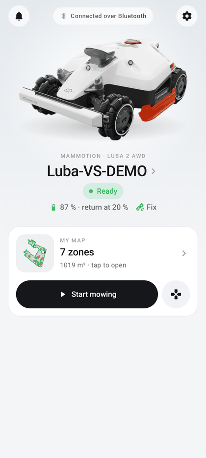
  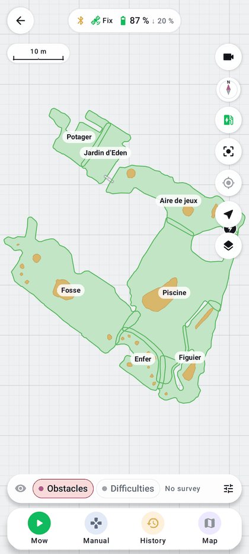
  
  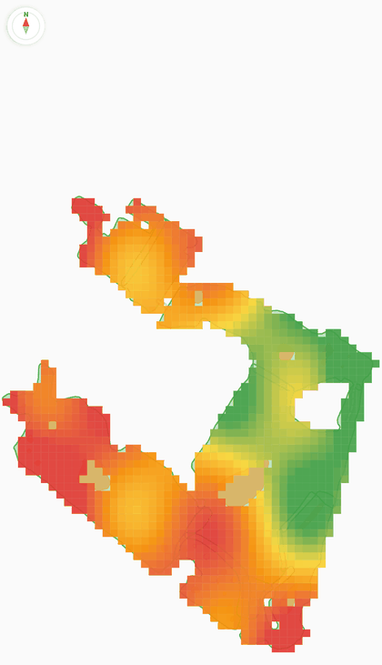
</p>

</div>

DumbyLuba is a free and open-source Android app (Kotlin, Jetpack Compose) that talks directly to **Mammotion robot
mowers** over Bluetooth Low Energy. The **LUBA 2 AWD** is the only model validated so far; the other Mammotion mowers
(LUBA 1, LUBA 3, LUBA mini, Yuka…) are recognized and connect in **read-only mode** (telemetry, map, diagnostics, no
motion and no blades) until each one is adapted and tested with its owners: see the
[supported models](docs/features/supported-models.md). It reads the robot's map, **computes the mowing route on the phone**, checks it against the
robot's footprint, simulates it, then has the robot follow it command by command, with return to base, recharging and
resume. Above all, it adds what the official app does not offer:
[remote control with the camera view](#remote-control-with-the-camera-view), fast and animated route generation,
full simulation, Wi-Fi / mobile / RTK coverage maps, a mowing area painted with your finger, a last position that is
truly remembered, a photo of the obstacle after a contact, and plenty of debug tools.

The repository also contains the gateway that sits on the robot (Android phone or ESP32), a printable enclosure
charged by induction, and a small home server.

The app UI is available in English and French: it follows the phone language, or the language chosen in Me → Language.

> [!IMPORTANT]
> **Before you start**
>
> - **A device placed on the LUBA is required to control it over Bluetooth.** The robot's Bluetooth only reaches a
>   few meters: an old Android phone or an ESP32 board placed on the robot holds the Bluetooth link, and your phone
>   drives it over Wi-Fi anywhere in the garden ([gateway](docs/features/gateway.md)). Direct Bluetooth from your
>   phone is only useful right next to the robot, for tests and setup.
> - **The ultrasonic sensors are not available**: the known protocol does not publish any ultrasonic distance.
>   Only the **bumper** detects obstacles; the app reacts on contact (stop, back-off, bypass), not on approach.

> *DumbyLuba is an experimental, open-source Android app that drives Mammotion robot mowers (validated on the
> LUBA 2 AWD, other models in read-only mode) over Bluetooth LE with on-phone coverage path planning, simulation, obstacle bypass, interrupted-mow resume, signal
> heatmaps and an on-robot Wi-Fi gateway (Android phone or ESP32). Unofficial, not affiliated with Mammotion,
> provided without any warranty.*

> [!WARNING]
> **Unofficial, experimental project, with no warranty whatsoever.** This software is not affiliated with,
> endorsed by or supported by Mammotion. It sends motion and blade commands to a dangerous machine, using a
> reverse-engineered protocol that may change with any firmware update.
>
> - Start with the blades stopped, the robot in sight, no children, animals or people in the area, and STOP within
>   reach.
> - That the robot's firmware stops it when the app goes silent **has not been demonstrated**: check it on your own
>   robot (Service → Command cutoff) before any mowing.
> - Using it may breach Mammotion's terms of use and affect the robot's warranty.
> - Only the LUBA 2 AWD (`Luba-VS…`) receives motion and blade commands. Any other model stays in read-only mode: do
>   not try to bypass it, report your model instead ([supported models](docs/features/supported-models.md)).
> - "Mammotion", "LUBA" and "Yuka" are trademarks of Mammotion, named only to indicate compatibility; the name
>   DumbyLuba does not imply any endorsement.
>
> You use it entirely at your own risk (see sections 15 and 16 of the [license](LICENSE)).

## Contents

- [What the official app does not do](#what-the-official-app-does-not-do)
- [Coming next](#coming-next)
- [Screenshots](#screenshots)
- [All features](#features)
- [How it works](#how-it-works)
- [Supported hardware](#supported-hardware)
- [Installation](#installation)
- [Quick start](#quick-start)
- [Development and tests](#development-and-tests)
- [Repository layout](#repository-layout)
- [Documentation](#documentation)
- [Project status](#project-status)
- [Data and privacy](#data-and-privacy)
- [FAQ](#faq)
- [Contributing](#contributing)
- [License and acknowledgements](#license-and-acknowledgements)

## What the official app does not do

| | Highlight | In one sentence |
|---|---|---|
| 🎮 | [Remote control + camera view](#remote-control-with-the-camera-view) | drive the robot with joysticks from indoors while watching its camera |
| ⚡ | [Fast, animated route generation](#fast-animated-route-generation) | your route, computed on the phone and drawn before your eyes in the actual mowing order |
| 🎬 | [Simulation](#full-simulation) | the whole mowing session replayed at high speed, recharges included, before the robot sets off |
| 📶 | [Signal coverage map](#coverage-map-wi-fi-mobile-rtk-bluetooth-gnss) | Wi-Fi, mobile, RTK, Bluetooth and GNSS heatmaps of the garden, plus terrain |
| 🧪 | [Plenty of debug tools](#plenty-of-debug-tools) | blades, camera, navigation, border, zones, Bluetooth, telemetry… |
| ✏️ | [Map corrected on the phone](docs/features/map.md#correcting-the-map-local-corrections) | adjust zones and no-go zones, add no-go zones and obstacles, without touching the Mammotion map; each correction can be undone on its own |
| 🖌️ | [Mowing area painted with your finger](#paint-an-area-to-mow) | paint the area to mow right now, overlaid on the map |
| 📍 | [Last position remembered](#a-last-position-that-is-truly-remembered) | find the robot even when it is offline, with its track and timestamp |
| 🚨 | [Obstacle or stuck alert with photo](#obstacle-or-stuck-alert-with-the-camera-image) | notification and a photo of the obstacle taken by the camera after the back-off |

### Remote control with the camera view

- **Two on-screen joysticks** (forward/backward and turn, usable together), adjustable top speed from 10 to 100%,
  blades always stopped.
- **From indoors**: with the [gateway](docs/features/gateway.md) placed on the robot, commands go over Wi-Fi; no more
  Bluetooth range limit, as long as Wi-Fi covers the garden.
- **Camera view**: the robot's video (front/left or right camera) is shown as a thumbnail over the app while you
  drive; you can move and resize it with your finger ([camera](docs/features/camera.md); a Mammotion account is
  required for video).
- **Safe by design**: releasing the joysticks sends STOP; if your phone goes silent for more than 2 s, the gateway
  stops the robot itself.

<p align="center">
  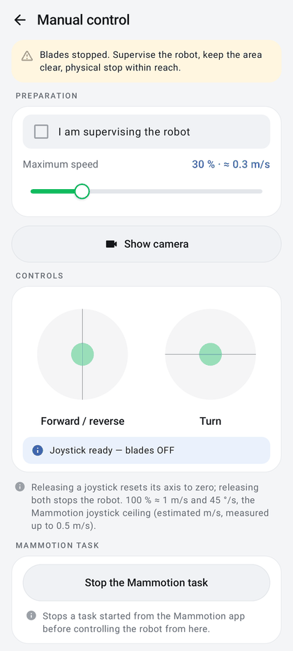
  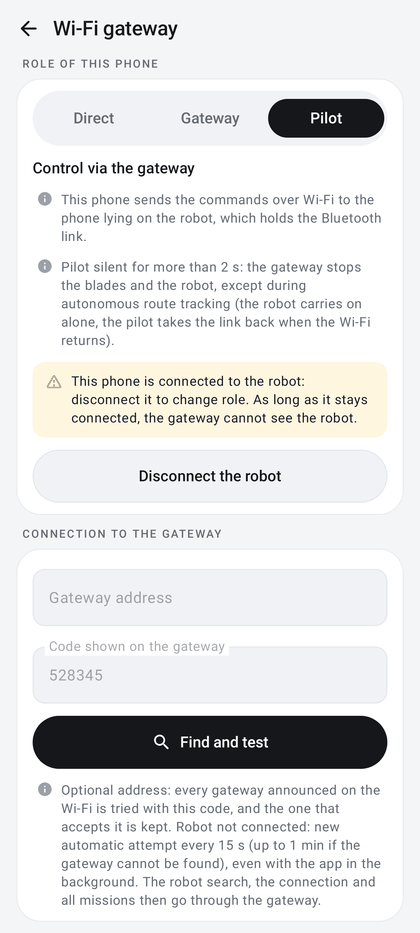
</p>

[Manual control](docs/features/manual-control.md) · [Camera](docs/features/camera.md)

### Fast, animated route generation

- **Your route, not a black box**: zone order, mode (Zigzag, Optimized, Checkerboard), pass spacing, number of border
  laps, inset, height, decreasing-height passes for tall grass (up to 3 passes, for example 70 → 55 → 40 mm), speed,
  recharge thresholds, working hours.
- **Computed on the phone**, no cloud: orientations evaluated in parallel, continuous mowing (a started cell is
  finished before the next one), start from the point nearest the robot or from a point picked on the preview
  (can be saved per zone), safe links, chassis checked on every translation and every pivot.
- **Animated**: the preview draws itself progressively, pass after pass, **in the actual mowing order**, with the start
  point, border laps, coverage, unmowed area, distance, duration and number of recharges.

<p align="center">
  
  
  
  
</p>

[Preparing a mowing session](docs/features/mowing-preparation.md)

### Full simulation

- The prepared route is replayed on the map, **from ×1 to ×300**: slow, straight exit from the base like the robot,
  start, mowing, returns to base, recharges, resumes at the exact interruption point, final return.
- Adjustable scenario: mowing already done, starting battery, battery life, recharge duration.
- Exactly the same route the robot will follow: you can then **run it with the blades stopped** to check it on the
  ground, then mow.
- Obstacle simulation: place an object on the map and watch the robot hit it, back off and bypass it.

<p align="center">
  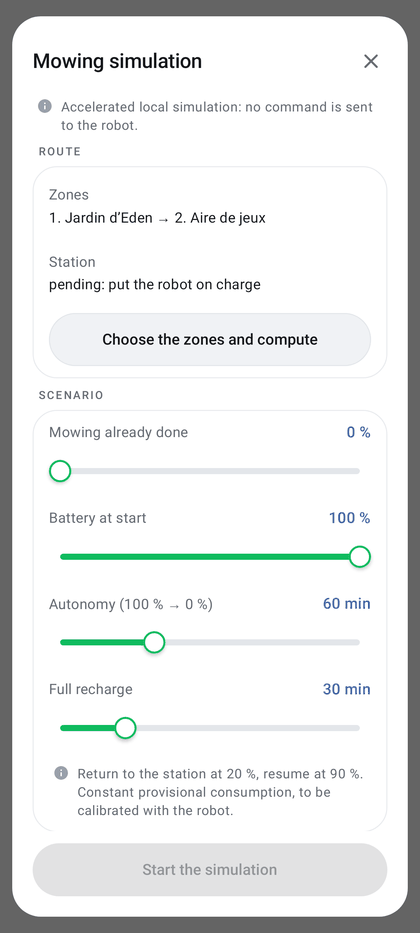
  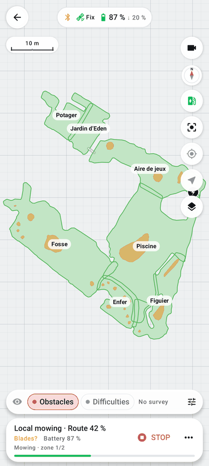
  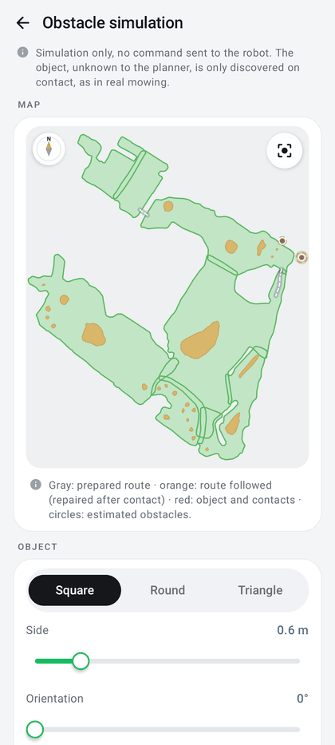
</p>

[Simulation](docs/features/simulation.md) · [Obstacle simulation](docs/features/obstacles.md#obstacle-simulation)

### Coverage map (Wi-Fi, mobile, RTK, Bluetooth, GNSS)

- **Automatic** survey during every robot move: the app measures, meter by meter, **Wi-Fi**, **mobile network**,
  **RTK FIX**, **Bluetooth** and **GNSS satellites** (Service → Signal surveys).
- Layers drawn **on top of the map**; optional dedicated run (**Full loop** or **Grid** with a 1 to 10 m spacing,
  blades stopped) to measure everything in one go.
- With a gateway phone on the robot: terrain **slope and relief**, as shading or in a **3D view**.
- **History** of all surveys, viewable on their original map; simulated heatmap to try it out.
- Ideal for placing a Wi-Fi access point, a repeater or the RTK antenna.

<p align="center">
  
  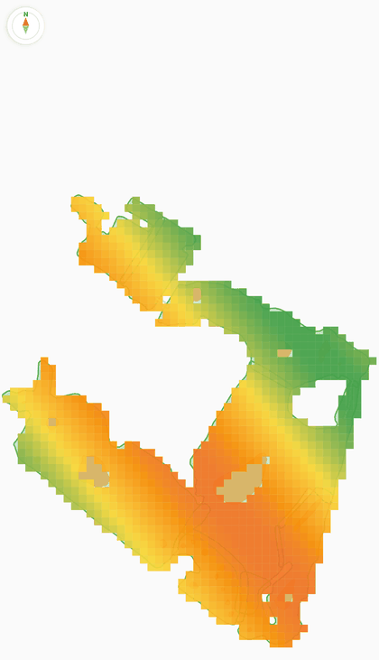
  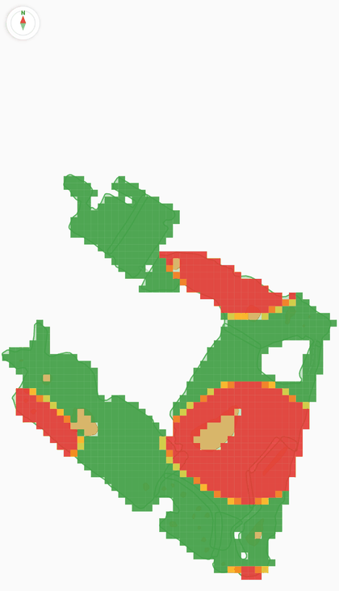
  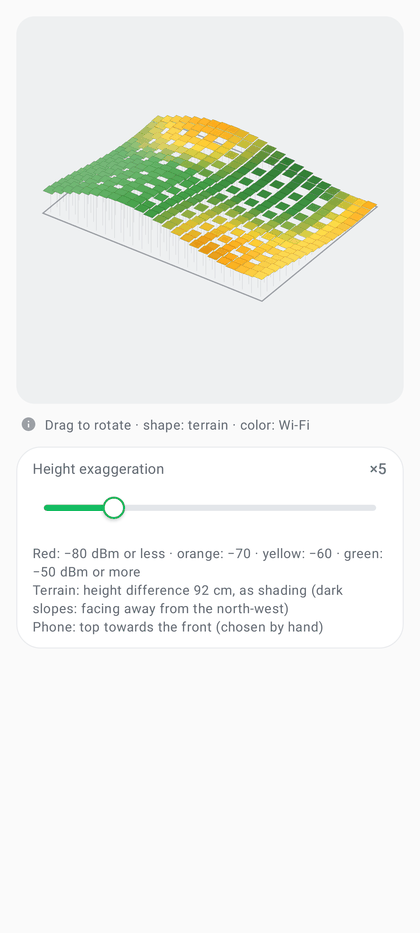
</p>

[Signal surveys and terrain](docs/features/signal-surveys-and-terrain.md)

### Plenty of debug tools

| Tool | What it does |
|---|---|
| **Cutting height** and **Blade test** | apply a height, spin the discs while a button is held, cutting test while moving |
| **Camera** | front/left and right streams, token refresh, forced video activation, detailed player status |
| **Navigation** | short route computed around the robot, measurement of deviation and stopping delay, calibration |
| **Border** | follow a single border at a chosen inset (0 to 100 cm), validate it with its deviation (validated borders in green, borders still to validate in red on the map), then reuse that inset for mowing |
| **Trial mowing (painted zone)** | mow a zone painted with your finger ([below](#paint-an-area-to-mow)) |
| **Command cutoff** | measure whether *your* robot stops on its own when the app goes silent |
| **Bluetooth and telemetry** | diagnostics campaign, detailed status, latest error among 664 decoded error codes |
| **Sensors and perception** | what the robot publishes about its ultrasonic sensors and camera perception (exploration) |
| **Obstacle tests** | bumper contact, learning an obstacle on contact, bypass, frontal border test (how close a pass end gets to the limit) |
| **Obstacle simulation** | place an object on the map and watch the back-off and bypass, no command sent |

<p align="center">
  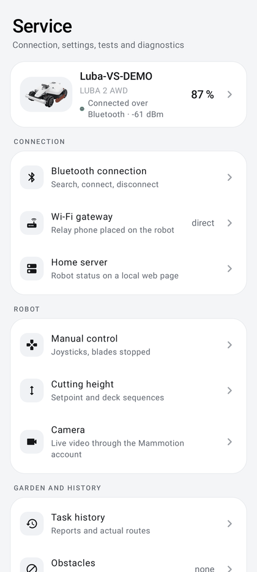
  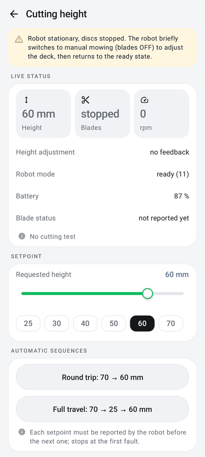
  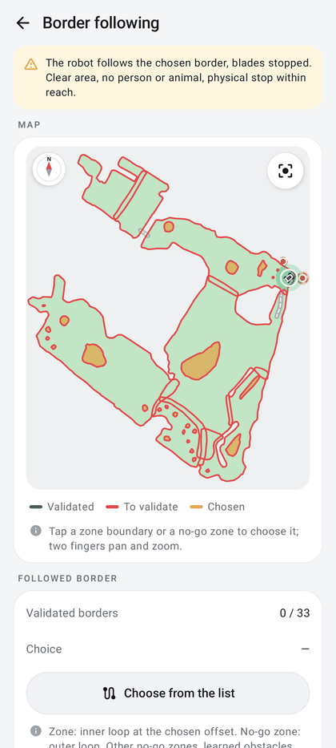
  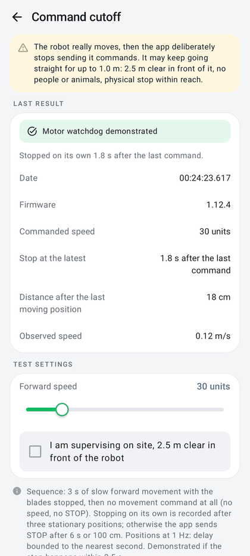
</p>

All tests are supervised, either hold-to-run or with a permanent STOP button.
[Tests and diagnostics](docs/features/tests-and-diagnostics.md)

### Paint an area to mow

- Service → **Trial mowing (painted zone)**: **paint with your finger**, overlaid on the map, the area to mow right
  now (the damaged corner, the strip in front of the terrace…), with a 0.6 to 4 m brush, an eraser and undo.
- Only paint inside existing zones is kept, no-go zones excluded.
- The route is computed by the same engine as a full mowing session, then **Mow · X mm** (blades running). To check
  a route with the blades stopped first, use **Border following** or **Follow, blades stopped** from a simulation.
- The robot's map is not modified.

<p align="center">
  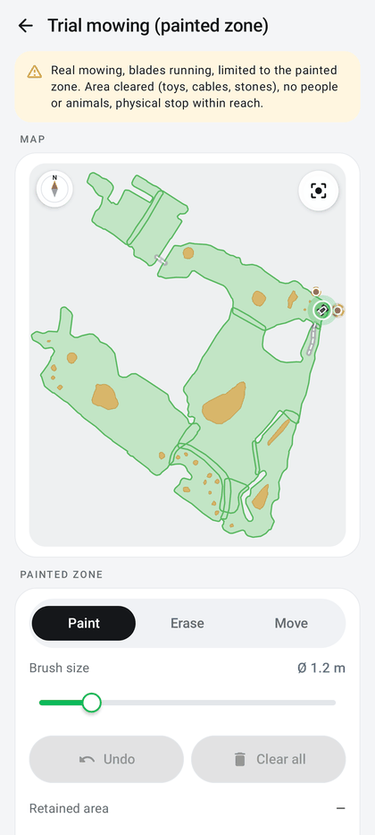
  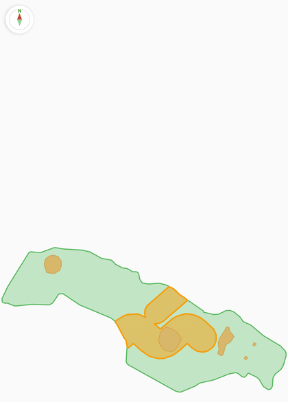
</p>

[Trial mowing (painted zone)](docs/features/tests-and-diagnostics.md#trial-mowing-painted-zone) · [Border following](docs/features/tests-and-diagnostics.md#border-following)

### A last position that is truly remembered

- The app keeps, **per robot and on the phone**, the last **reliable RTK FIX** position, its heading, timestamp,
  battery, state and the track of the previous 5 minutes.
- A degraded or stale position never overwrites it; it survives closing the app and restarting the phone.
- Robot offline, battery empty, stuck at the far end of the garden: the map shows where it really was and since when.

<p align="center">
  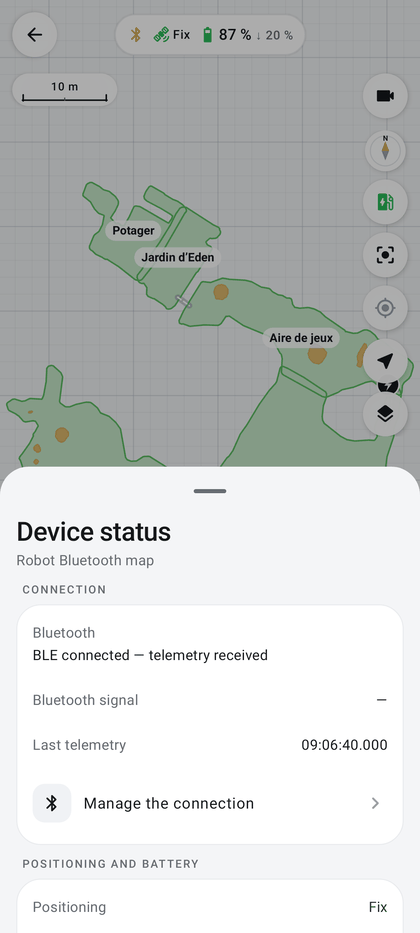
  
</p>

[Map: finding an offline robot](docs/features/map.md#finding-an-offline-robot)

### Obstacle or stuck alert, with the camera image

- **Local alerts** produced by the phone, no cloud: robot stuck, lifted, repeated bumper contacts, lost link or RTK,
  critical battery, return impossible…
- **On bumper contact**: stop, back-off along the track, then an **automatic photo of the obstacle** by the robot's
  camera. The photo is shown as a thumbnail in the app and stored with the obstacles (Service → Obstacles); the robot
  then bypasses the obstacle and carries on mowing.
- The robot bypasses the obstacle **as tightly as possible, on the most favorable side** (the inner side near an
  edge).
- Every contact stays **on the map with its photo** (Obstacles layer); stuck events, wheel slips and lifts form a
  **difficulties heatmap**. An obstacle hit several times is avoided by later mowing sessions, and moves go around
  difficult areas; the obstacle can also be saved.

<p align="center">
  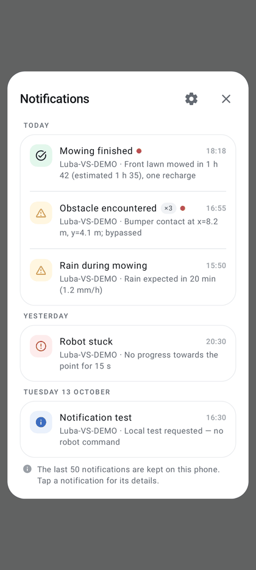
  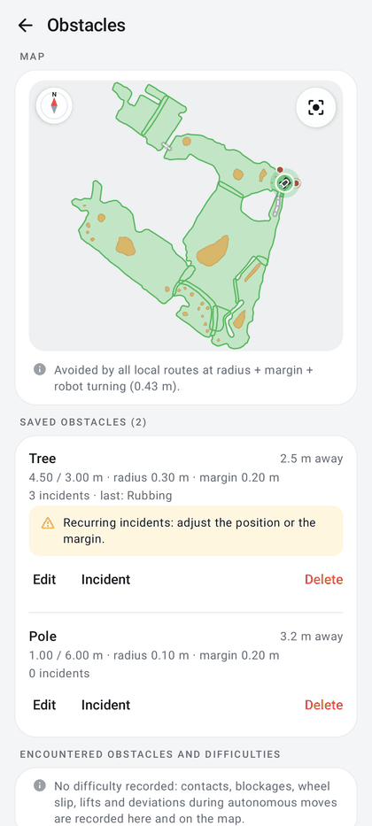
  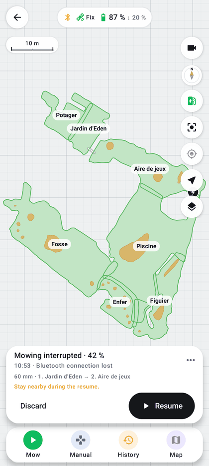
</p>

[Local alerts](docs/features/notifications.md) · [Obstacles](docs/features/obstacles.md) ·
[Photo after contact](docs/features/camera.md#obstacle-photo-after-a-contact)

### And also

- **Fully local**: the Bluetooth link needs neither an account nor Internet; map, obstacles and logs stay on the
  phone.
- **Resume of an interrupted task** (mowing, blades-stopped run, survey, border following, trial mowing, move to a
  point) after a STOP, a link loss or an app restart, with **Unblock** (back-off to a safe position) and **Resume
  further on** (chosen distance, resume point shown on the map).
- **Safety first**: STOP everywhere, continuous guards, lift detection, supervised tests to measure what *your* robot
  actually does.

## Coming next

- **Passages in the local map corrections**: zones, no-go zones and obstacles can already be corrected on the phone
  ([map corrections](docs/features/map.md#correcting-the-map-local-corrections)); the passages recorded by the robot
  cannot be edited yet (only base accesses can be drawn on the phone,
  [details](docs/features/map.md#base-and-manual-accesses)).
- **Varied travel routes**: not always take the same path to reach a zone or the base, to avoid wearing tracks into
  the lawn.
- Fusion of the robot's rain sensor with the radar and the forecast ([design](docs/RAIN_WEATHER_FUSION.md)).
- Autonomous tracking on the ESP32 gateway and port to ESP32-S3.

## Screenshots

Screenshots generated by the app's Robolectric tests, on the test reference map with fictitious data (robot
`Luba-VS-DEMO`, simulated signals); the camera, displayed in a WebView, does not appear.

| Home | Map | Preparation | Preview |
|:---:|:---:|:---:|:---:|
|  |  |  |  |
| **Mowing in progress** | **Resume** | **Charging station** | **Move to point** |
|  |  | 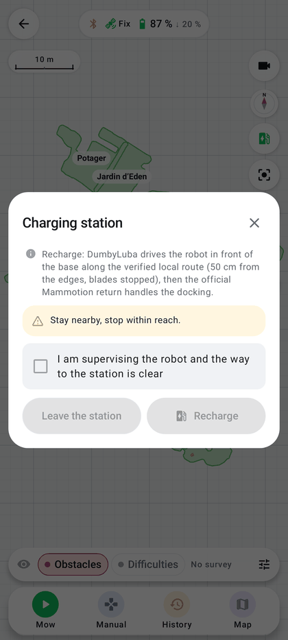 | 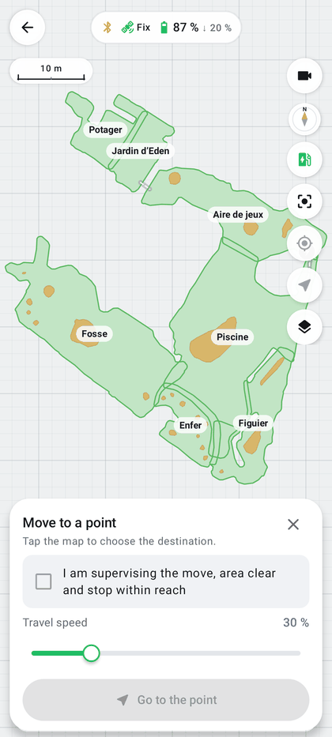 |
| **Signal survey** | **Terrain shading** | **Map sheet** | **Robot locked** |
| 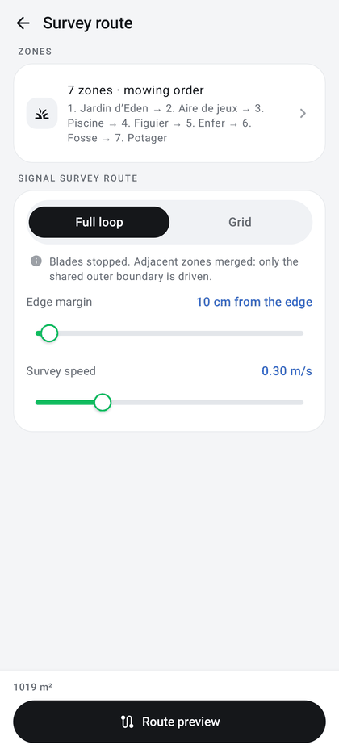 | 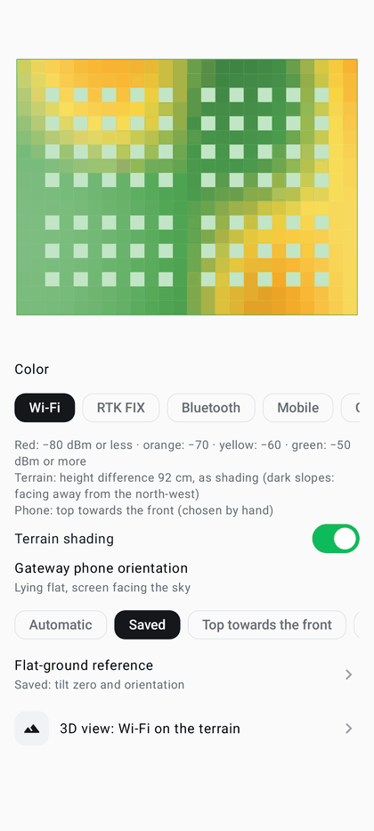 | 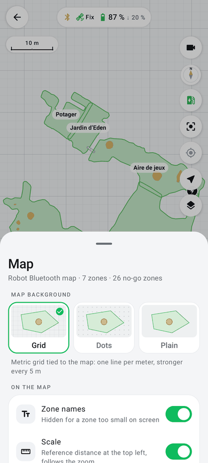 | 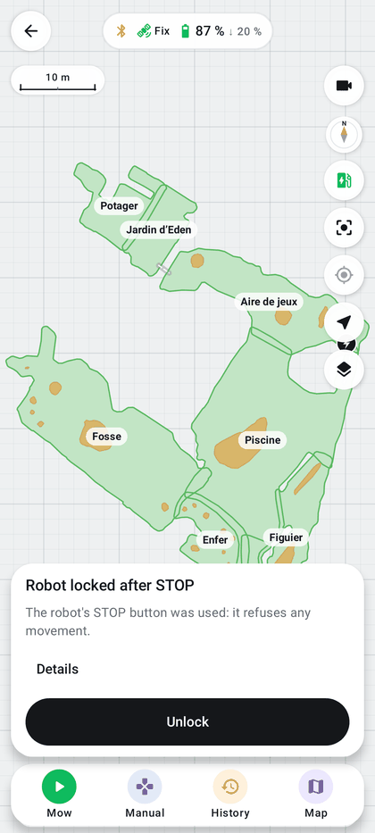 |
| **Gateway on the robot** | **Connection** | **Bluetooth diagnostics** | **Logs** |
| 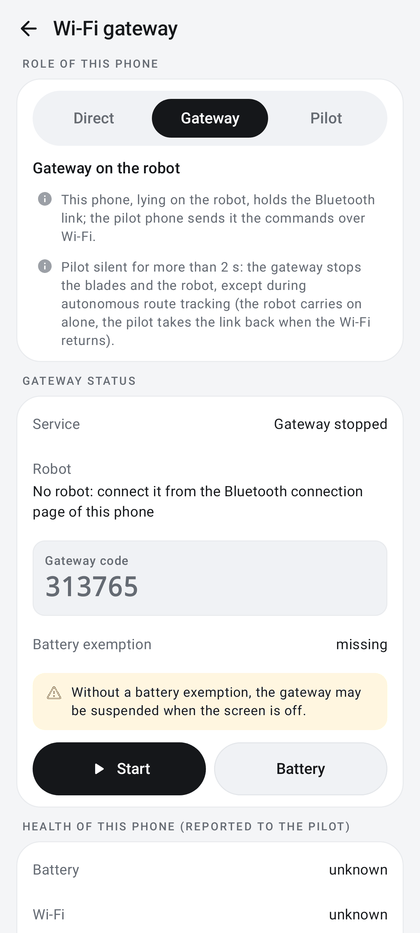 |  | 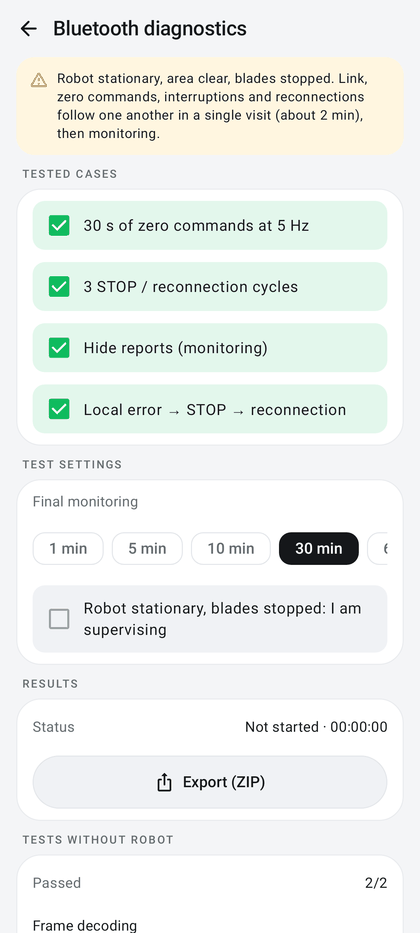 | 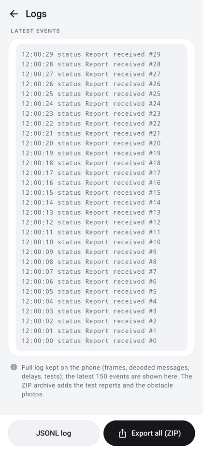 |
| **Rain and weather** | **Mammotion account** | **Me** | **Dark theme** |
| 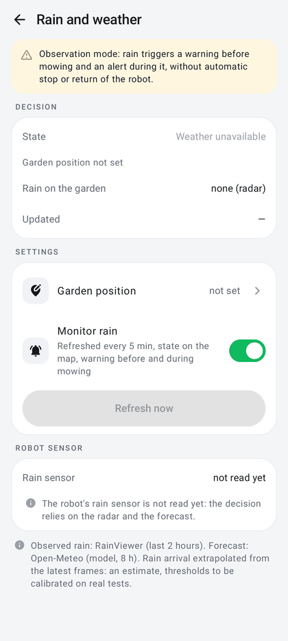 |  | 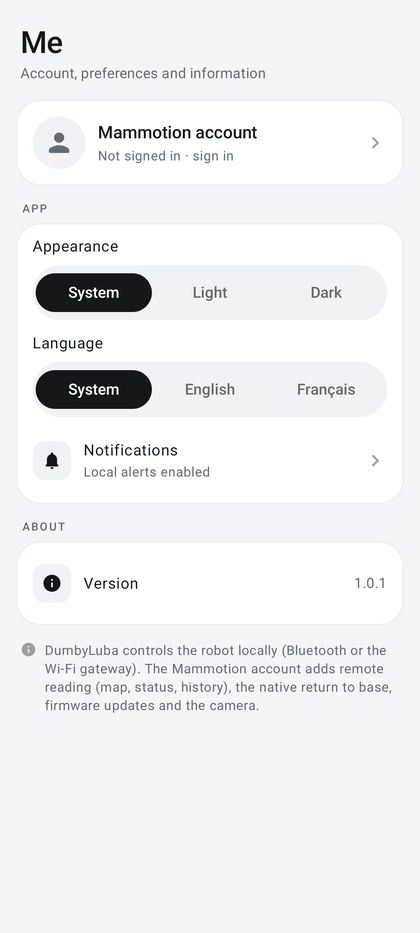 | 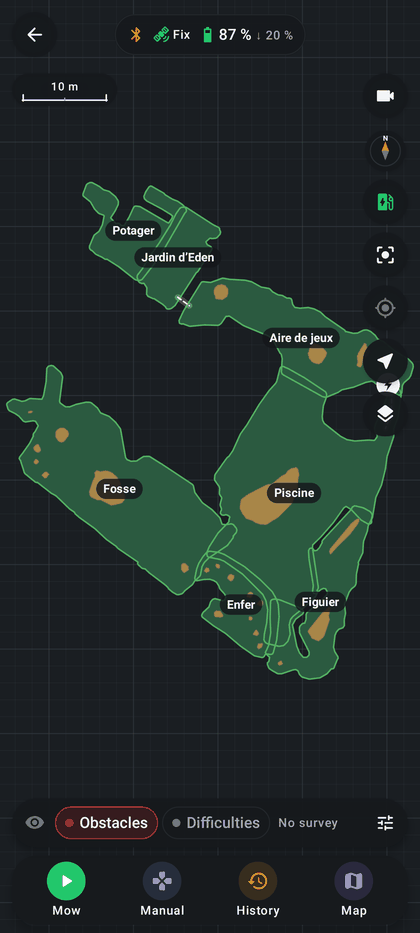 |

## Features

| | Feature | In short |
|---|---|---|
| 📱 | [**Interface**](docs/features/interface.md) | Device / Service / Me tabs, global STOP bar, light and dark theme, English or French |
| 🔗 | [**Bluetooth connection**](docs/features/bluetooth-connection.md) | scanning, connection, link loss, link kept in the background, advanced settings |
| 👤 | [**Mammotion account**](docs/features/mammotion-account.md) | optional: map and status through the cloud, camera, native return to base, firmware update |
| 🗺️ | [**Map**](docs/features/map.md) | read over Bluetooth or through the Mammotion account, local cache, zones, no-go zones, passages, base and manual accesses, last known position, map sheet (background, layers, legend), local corrections |
| 🧭 | [**Local planning**](docs/features/mowing-preparation.md) | Zigzag, Optimized and Checkerboard modes; border laps; decreasing-height passes; continuous mowing; start from the point nearest the robot or a start point saved per zone; chassis checked on every translation and every pivot |
| 🎬 | [**Simulation**](docs/features/simulation.md) | animated route up to ×300 with battery, returns to base, recharges and resumes |
| 🤖 | [**App-driven mowing**](docs/features/real-mowing.md) | route tracking over BLE, cutting height, recharge during mowing, working hours, docking through the official return |
| ⏯️ | [**Resume of an interrupted task**](docs/features/mowing-resume.md) | mowing, blades-stopped run, survey, border, test or move to a point, after a STOP, a link loss or an app restart; Unblock, Resume further on |
| 📋 | [**Task history**](docs/features/mowing-history.md) | latest mowing sessions, surveys and runs (History button on the map); replay of the actual route on the map; end-of-mowing report, duration and recharges compared with the estimate, estimates adjusted from actual sessions |
| 🪨 | [**Obstacles**](docs/features/obstacles.md) | back-off and bypass after a bumper contact, encountered and presumed obstacles, difficulties heatmap, saved obstacles, obstacle tests, obstacle simulation |
| 🔌 | [**Station and moves**](docs/features/station-and-moves.md) | leave the base, recharge, send the robot to a point |
| 🕹️ | [**Manual control**](docs/features/manual-control.md) | two joysticks, blades stopped |
| 🛑 | [**Safety**](docs/features/safety.md) | global STOP, continuous guards, lift detection, decoded error codes, command cutoff test |
| 🔔 | [**Local alerts**](docs/features/notifications.md) | robot stuck or lifted, battery, lost link or RTK, rain |
| 🌧️ | [**Rain and weather**](docs/features/rain-and-weather.md) | RainViewer radar and Open-Meteo forecast around the garden |
| 📷 | [**Robot camera**](docs/features/camera.md) | live video, photo of the obstacle after a contact |
| 📶 | [**Signal surveys and terrain**](docs/features/signal-surveys-and-terrain.md) | Wi-Fi, RTK, Bluetooth, mobile and GNSS heatmaps; estimated terrain; 3D view; history |
| 🧪 | [**Tests and diagnostics**](docs/features/tests-and-diagnostics.md) | Bluetooth campaign, telemetry, sensors and perception, blades and height, navigation test, border following with validated borders, mowing a zone painted with your finger |
| 📝 | [**Logs and local data**](docs/features/logs-and-data.md) | JSONL logs, ZIP export, what is stored on the phone |
| 📡 | [**Gateway on the robot**](docs/features/gateway.md) | **required**: Android phone or ESP32 that holds the Bluetooth link, stops the robot if the pilot goes silent and follows the route on its own |
| 🏠 | [**Home server**](docs/features/home-server.md) | local web page with the robot's status, dependency-free Python |
| 🔧 | [**ESP32 hardware**](docs/features/esp32-hardware.md) | PlatformIO firmware, waterproof enclosure charged by induction |

Details, settings and validation status of each feature: **[docs/FEATURES.md](docs/FEATURES.md)**.

## How it works

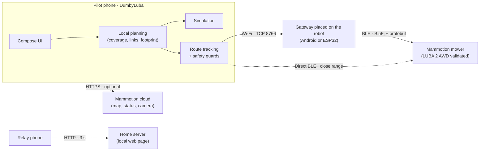

1. **Map**: read from the robot over Bluetooth (or through the Mammotion account), then cached.
2. **Planning**: the phone computes passes, borders and links, and checks every move against the robot's footprint
   (690 × 513 mm) and the obstacles.
3. **Simulation**: the same route is replayed with a battery and recharge model.
4. **Execution**: the phone sends speed and rotation at 5 Hz (through the gateway placed on the robot), controls
   blades and height, and continuously monitors state, position, deviation, progress, bumper and lift. Mammotion's
   native planner is never used for mowing; only the final docking goes through the official return.

The protocol (BluFi + protobuf) comes from the work of [PyMammotion](https://github.com/mikey0000/PyMammotion), whose
schemas are included: see [docs/MAMMOTION_PROTOCOL.md](docs/MAMMOTION_PROTOCOL.md).

## Supported hardware

| Item | Required | Tested |
|---|---|---|
| Robot | **Mammotion mower**: full control on the LUBA 2 AWD (`Luba-VS…`), read-only on the other models | a single LUBA 2 AWD |
| Pilot phone | Android **8.0+** (API 26) with Bluetooth LE | Samsung Galaxy Z Fold |
| **Gateway placed on the robot** (required) | Android 8.0+ phone or LILYGO TTGO T-Call V1.3 board (ESP32), on the same Wi-Fi as the pilot phone | Redmi A1, T-Call V1.3 |
| Mammotion account (optional) | for camera video, remote map, native return and firmware | |
| Home server (optional) | any machine with Python 3.10+ on the local network | macOS |

### Supported robot models

| Model | Bluetooth name | Status | What works |
|---|---|---|---|
| **LUBA 2 AWD** | `Luba-VS…` | ✅ validated (a single robot) | everything: control, mowing, gateway, surveys |
| LUBA 2 AWD X series | `Luba-VP…` | 🔒 read-only, tester wanted | connection, telemetry, map, camera, diagnostics |
| LUBA AWD (LUBA 1) | `Luba…` | 🔒 read-only, tester wanted | same |
| LUBA 3 AWD | `Luba-VA…` | 🔒 read-only, tester wanted | same |
| LUBA mini AWD | `Luba-MN…`, `Luba-LD…` | 🔒 read-only, tester wanted | same |
| LUBA mini 2 AWD | `Luba-LA…`, `Luba-MD…`, `Luba-MB…`, `Luba-LS…`, `Luba-MS…` | 🔒 read-only, tester wanted | same |
| Yuka family | `Yuka…`, `Ezy-…` | 🔒 read-only, tester wanted | same, protocol differences expected |
| Other recent Luba | `Luba-HM…`, `Luba-ME…`, `Luba-TR…`, `Luba-SP…` | 🔒 read-only, tester wanted | same |

**Read-only** means the app refuses every motion, blade, blade-height and navigation command for that model, at the
last step before Bluetooth, whatever the screen. Each model is unlocked only after an owner has run the documented
tests on their robot, blades stopped first. Own one of them? Read
[supported models](docs/features/supported-models.md) and open a *Model compatibility report* issue.

Nothing guarantees it works with another firmware or another phone. Speeds remain in raw, uncalibrated units. The
robot's ultrasonic sensors are not used: only the bumper detects obstacles.

## Installation

### Prebuilt APK (simplest)

Each [GitHub release](https://github.com/cleborgne-pro/DumbyLuba/releases) provides the signed APK
(`dumbyluba-X.Y.Z.apk`), the ESP32 gateway firmware and a `SHA256SUMS` file. Download the APK on the phone and allow
installation from that source, or follow new versions with [Obtainium](https://github.com/ImranR98/Obtainium)
(source: `https://github.com/cleborgne-pro/DumbyLuba`). Install the same version on the pilot phone and on the Android
gateway phone.

The published app has the identifier `io.github.cleborgne_pro.dumbyluba`, signed with the certificate whose SHA-256 is
`1E:B9:BE:0C:37:2D:87:14:94:FB:6B:E8:CE:50:E3:F9:0A:0F:AC:5D:12:B0:44:77:9E:8B:D0:77:09:F2:65:9B`. Builds made from
source with the options below (debug, `fold`) keep the `fr.luba.poc` identifier and the debug key: they install next to
the published app, with their own data.

### Build from source

#### Prerequisites

- **JDK 17**;
- **Android SDK 36** (Android Studio or command-line tools), set in `local.properties`
  (`sdk.dir=/path/to/sdk`) or through the `ANDROID_HOME` variable;
- `adb` to install on the phone (developer options and USB debugging enabled).

```sh
git clone https://github.com/cleborgne-pro/DumbyLuba.git dumbyluba
cd dumbyluba
echo "sdk.dir=$HOME/Library/Android/sdk" > local.properties   # adjust the path
```

#### Option 1: debug APK

```sh
./gradlew :app:assembleDebug
adb install -r app/build/outputs/apk/debug/app-debug.apk
```

#### Option 2: build, test and deploy in one command

```sh
tools/deploy.sh             # build + tests + lint, install on every ADB device, launch
tools/deploy.sh --no-tests  # build only
DEPLOY_SERIALS=SERIAL tools/deploy.sh   # restrict to one device
```

`deploy.sh` builds the `fold` variant (not debuggable, hence faster at computing routes, signed with the debug key so
it can update an existing install) and checks that the app starts without crashing.

#### Option 3: signed release

```sh
cp keystore.properties.example keystore.properties   # then fill in the keystore (not versioned)
./gradlew :app:assembleRelease
```

Without `keystore.properties`, the release APK is built unsigned. The release variant uses the published identifier
`io.github.cleborgne_pro.dumbyluba`: signed with another key, it cannot update the app installed from GitHub.

### Gateway and optional components

| Component | Installation |
|---|---|
| **Android gateway** (required, or ESP32) | install the same APK on a second phone, then Service → Wi-Fi gateway → *Gateway on the robot* ([guide](docs/features/gateway.md#setup-with-two-android-phones)) |
| **ESP32 gateway** (alternative to the phone) | `cd firmware/esp32-gateway && pio run -e tcall -t upload`, or without PlatformIO the release `esp32-gateway-X.Y.Z-full.bin`: `esptool.py --chip esp32 write_flash 0x0 esp32-gateway-X.Y.Z-full.bin` ([guide](firmware/esp32-gateway/README.md)) |
| **ESP32 diagnostics** | `cd firmware/esp32-diag && pio run -t upload` ([guide](firmware/esp32-diag/README.md)) |
| **Home server** | `python3 home-server/server.py --data home-server/data/relay.sqlite3` ([guide](home-server/README.md)) |
| **ESP32 enclosure charged by induction** | STL parts and shopping list in [hardware/luba-esp32-qi](hardware/luba-esp32-qi/README.md) |

PlatformIO installs without administrator rights: `python3 -m venv /tmp/espvenv && /tmp/espvenv/bin/pip install platformio`.

## Quick start

1. **Close the Mammotion app**: the robot accepts only one Bluetooth link at a time.
2. **Place the gateway on the robot**: on the gateway phone, Service → **Wi-Fi gateway** → role **Gateway**
   (*Gateway on the robot*), note the **Gateway code**, then connect the robot from Service → **Bluetooth
   connection** ([guide](docs/features/gateway.md#setup-with-two-android-phones); ESP32:
   [firmware](firmware/esp32-gateway/README.md)).
3. On your phone: grant the permissions (notifications on Android 13+), then Service → **Wi-Fi gateway** → role
   **Pilot** (*Control via the gateway*), enter the code, **Find and test**. Scanning for and connecting to the robot
   then go through the gateway. (Next to the robot, the **Direct** role is enough for a first test.)
4. Device tab → tap the map thumbnail (**MY MAP** card) to open the map, then **Map** button → **Read the robot
   map**. No robot at hand: **Try the demo**.
5. **Mow** → tap the zones in order → **Next** → adjust the **Task settings** → **Route preview** → **Simulate** to
   see the full route, recharges included.
6. Before any mowing, on your robot: Service → **Command cutoff** (does the robot stop on its own if the app
   freezes?), then **Manual control** and **Navigation test**, blades stopped.
7. From the simulation bar, **⋯** → **Run this route** → **Follow, blades stopped**: the robot drives the route
   without cutting. Keep your finger near **STOP**.
8. Once everything is under control: **Start** from the preview for real mowing.

Detailed procedure for the first test: [docs/MILESTONE_1_TEST.md](docs/MILESTONE_1_TEST.md).

## Development and tests

```sh
./gradlew :app:assembleDebug :app:testDebugUnitTest :app:lintDebug   # build, JVM/Robolectric tests, lint
tools/check.sh quick     # reduced suite (without the long reference-map tests)
tools/check.sh planner   # planner on the reference map (all zones)
tools/check.sh full      # build + tests + lint
```

- Every planner change is validated on the reference map
  `app/src/test/resources/planner-reference-map.json` (`ReferenceMapPlannerTest`), in addition to the synthetic tests.
- Firmware: `pio test -e native` in `firmware/esp32-gateway` (core tests on the computer).
- Home server: `python3 -m unittest discover -s home-server/tests -v` and
  `node --test tools/relay-map-test.cjs tools/relay-web-test.cjs`.
- Screenshots (Robolectric, no device):
  `./gradlew :app:testDebugUnitTest --tests '*UiShots*' --tests '*UiScreenshotTest*' -PuiShots=/tmp/captures`,
  then `tools/export-screenshots.py` to update `docs/images/` (instructions at the top of the script).
- Planner benchmarks and analyses: `tools/benchmark-*.sh|py` and `tools/analyze-*.py` scripts.

## Repository layout

```
.
├── app/                     Android app (fr.luba.poc)
│   └── src/main/java/fr/luba/poc/
│       ├── ble/             GATT link, send queue, route tracking, guards
│       ├── protocol/        BluFi, protobuf commands, telemetry, error codes, command policies
│       ├── map/             Map, preview, coverage, signal surveys, terrain
│       ├── planning/        Single planning engine (orientation, order, links, evaluation)
│       ├── simulation/      Simulator, route tracking, recharge, docking, resume, bypass
│       ├── obstacles/       Learned obstacles and learning on contact
│       ├── difficulty/      Encountered obstacles, difficulties heatmap, presumed obstacles
│       ├── history/         Task history, actual track, estimate calibration
│       ├── mowing/          Working hours, Mammotion task state, firmware route reading
│       ├── diagnostics/     Supervised tests, command cutoff, lift detection
│       ├── gateway/         Wi-Fi ↔ BLE gateway (roles, protocol, safety)
│       ├── autonomy/        Autonomous route tracking by the gateway
│       ├── relay/           Relay to the home server, foreground service keeping the link in the background
│       ├── auth/            Mammotion account (OAuth, MQTT, filtered read-only)
│       ├── camera/          Robot camera (Agora Web SDK in a WebView)
│       ├── weather/         Rain radar and forecast
│       ├── alerts/          Local notifications
│       ├── manual/          Joysticks
│       ├── i18n/            Bilingual text helper (English / French)
│       └── ui/              Screens, theme and shared components
├── firmware/                ESP32 gateway and diagnostics (PlatformIO)
├── hardware/                ESP32 enclosure charged by induction (STL, CAD, 3D viewer)
├── home-server/             Python home server (dependency-free)
├── docs/                    Features, protocol, design, test procedures
└── tools/                   Build, ADB deployment, benchmarks, error-code table generation
```

## Documentation

- **[Features](docs/FEATURES.md)**: one page per feature, with access, settings, safeguards and validation status.
- **[Technical documentation index](docs/README.md)**: protocol, planning, execution, gateway, test procedures.
- Entry points: [Mammotion protocol](docs/MAMMOTION_PROTOCOL.md) ·
  [Mammotion account](docs/MAMMOTION_ACCOUNT.md) · [planner architecture](docs/path-planning/ARCHITECTURE.md) ·
  [gateway](docs/ANDROID_GATEWAY.md) · [first test](docs/MILESTONE_1_TEST.md).
- [CHANGELOG](CHANGELOG.md) · [Third-party references and licenses](THIRD_PARTY.md).

## Project status

Proof of concept developed and tested on **a single** LUBA 2 AWD (the other models are read-only, see
[supported robot models](#supported-robot-models)), with a Samsung Galaxy Z Fold as the pilot and a
Redmi A1 or a LILYGO T-Call (ESP32) as the gateway. Many features are validated in simulation and JVM tests (about
230 test files), but only partly in the field. Each [feature](docs/FEATURES.md) page states what has actually been
verified; the [milestones](docs/FEATURES.md#milestones) table summarizes progress.

## Data and privacy

- The Bluetooth link needs neither an account nor a secret; map, obstacles, surveys and logs stay in the app's private
  storage ([details](docs/features/logs-and-data.md)).
- The Mammotion account is optional. Credentials and session are encrypted on the phone (Android Keystore) and sent
  only to Mammotion's servers.
- Weather sends the garden's position (to within about ten meters) to Open-Meteo and downloads the surrounding
  RainViewer radar tiles; the camera loads Agora's web SDK. The home server and the gateway are meant for the local
  network only.
- No telemetry is sent to the project's authors.

## FAQ

<details>
<summary><b>Why not just use the Mammotion app?</b></summary>

The official app remains the reference for everyday use. DumbyLuba adds what it does not do: remote control with the
camera, a route chosen and simulated before setting off, signal coverage maps, a zone painted with your finger, a
remembered last position, a photo of the obstacle after a contact, debug tools
([details](#what-the-official-app-does-not-do)).
</details>

<details>
<summary><b>Why is a device needed on the robot?</b></summary>

The LUBA's Bluetooth only reaches a few meters and the robot accepts only one link at a time. An Android phone (an old
model is enough) or an ESP32 board placed on the robot holds that link at close range; your phone talks to it over
Wi-Fi. With a phone, the gateway can even follow the route on its own if Wi-Fi drops, and it provides the
accelerometer used for terrain. See [gateway](docs/features/gateway.md) and the
[ESP32 enclosure charged at the base](hardware/luba-esp32-qi/README.md).
</details>

<details>
<summary><b>Does the robot avoid obstacles before hitting them?</b></summary>

No. The ultrasonic sensors are not available: the known protocol only publishes their health status, no distance.
Only the bumper is used: on contact, the robot stops, backs off, takes a photo of the obstacle and bypasses it. Fixed
obstacles can be saved so that later mowing sessions avoid them in advance ([obstacles](docs/features/obstacles.md)).
</details>

<details>
<summary><b>Do I need a Mammotion account?</b></summary>

No. Mowing, planning and control work over Bluetooth without an account. The account adds remote map reading, the
camera, native return to base without Bluetooth, and firmware updates.
</details>

<details>
<summary><b>Does the robot stop if the phone crashes?</b></summary>

This has **not been demonstrated** in general: that is precisely the purpose of the Service → **Command cutoff** test,
to run on your own robot and firmware. With a gateway, the gateway stops the robot if the pilot goes silent for more
than 2 s (except during autonomous tracking).
</details>

<details>
<summary><b>Does it work with other Mammotion robots?</b></summary>

Not fully yet. Every Mammotion mower (LUBA 1, LUBA 2 X, LUBA 3, LUBA mini, Yuka…) is recognized and connects in
read-only mode: telemetry, map, camera and diagnostics export, without motion or blades. Only the LUBA 2 AWD
(`Luba-VS…`) is validated for control. Each other model will be adapted with the help of its owners: see
[supported models](docs/features/supported-models.md) to send a compatibility report.
</details>

<details>
<summary><b>Which languages does the app support?</b></summary>

English and French: the interface follows the phone language (English by default, French on a French device), or
the language chosen in the app (Me → Language: System / English / Français).
Translations into other languages are a welcome contribution.
</details>

## Contributing

Contributions are welcome: test reports on other robots or firmware versions, fixes, porting the firmware to
ESP32-S3, translations… Read [CONTRIBUTING.md](CONTRIBUTING.md) before proposing a change: the project drives a machine
with blades, so safety comes before features. Report security vulnerabilities privately ([SECURITY.md](SECURITY.md)),
not in a public issue.

## License and acknowledgements

Copyright © 2026 Cyril Le borgne and the DumbyLuba contributors.

Distributed under the **GNU GPL v3.0** (`GPL-3.0-only`, see [LICENSE](LICENSE)), because the app includes the protobuf
schemas from [PyMammotion](https://github.com/mikey0000/PyMammotion), under the same license. Sources, third-party
licenses and services used: [THIRD_PARTY.md](THIRD_PARTY.md).

Thanks to the authors of PyMammotion and Mammotion-HA, without whom the protocol could not have been understood.
"Mammotion", "LUBA" and "Yuka" are trademarks of Mammotion, mentioned only to indicate compatibility. DumbyLuba is
an independent project, not affiliated with, endorsed by or supported by Mammotion.
