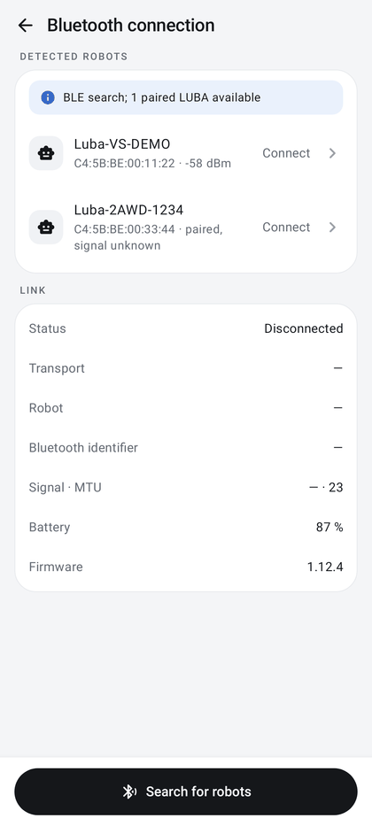

# Bluetooth connection

The app talks directly to the robot over Bluetooth Low Energy (BLE), using Mammotion's BluFi + protobuf protocol. No
account, secret or prior pairing is needed.

| | |
|---|---|
| **Access** | Service → **Bluetooth connection** |
| **Status** | Implemented; real BLE campaign on a LUBA 2 AWD |
| **Code** | `ble/RobotBle.kt`, `ble/RobotLink.kt` (`GattLink`), `protocol/Blufi.kt`, `protocol/Commands.kt`, `protocol/Telemetry.kt`, `protocol/TelemetryWatchdog.kt`, `relay/RobotLinkService.kt`, page `ConnectionPage` in `ui/RobotPanel.kt` |
| **Reference** | [Mammotion protocol](../MAMMOTION_PROTOCOL.md) |

  

## Usage

1. Close the Mammotion app: the robot accepts only **one** Bluetooth link and stops advertising while it is open.
2. Service → Bluetooth connection (or tap the robot card at the top of the Service tab). When no robot is connected,
   the page starts a search on its own; **Search for robots** (bottom button, "Searching…" while it runs) starts a
   new one. A search lasts 15 s. The **Detected robots** list shows the name, the Bluetooth address and the signal
   (dBm) of devices whose name starts with `Luba`; LUBA robots already paired in Android are listed too, with "paired,
   signal unknown".
3. Tap the robot (**Connect**). Automatic connection: after 4 s of listening (then at the end of the search), if a
   single robot was actually received, the app connects to it; with several, it shows "Several robots detected:
   choose the one to connect". Robots that are only paired do not count.
4. **Disconnect (stop the robot)** sends STOP before closing the link.

A search with automatic connection also runs every time the app comes back to the foreground, whatever the screen
(when no robot is connected); if several robots answer, a message opens this page. In **Direct Bluetooth** role, if a
[gateway](gateway.md) is advertised on the Wi-Fi, no automatic direct connection is made, so that the robot stays
free for it ("Gateway detected on the Wi-Fi: no direct automatic connection…"); tapping the robot still connects
directly.

End-of-search messages: "No LUBA found. Close Mammotion and restart the detection; check the Android paired
devices.", "Detection finished: N LUBA available", or "Turn on Android Bluetooth" when Bluetooth is off.

Permissions requested: Bluetooth (scan and connect) on Android 12+, precise location for scanning on Android 8
to 11. If refused: "Allow Bluetooth in the Android settings (Android 8 to 11: location turned on)."

### Link group

Below the list, the **Link** group shows **Status**, **Transport** ("Direct Bluetooth" or "Wi-Fi gateway →
Bluetooth"), **Robot**, **Bluetooth identifier**, **Signal · MTU**, **Battery** and **Firmware**.

### Depending on the phone's role

- **Control via the gateway**: search and connection go through the gateway ("Search and connection through the
  gateway (Service → Wi-Fi gateway)").
- **Gateway on the robot**: tapping the robot hands it to the gateway service, which holds the link and reconnects it
  on its own. A **Gateway link** group shows the robot held and a **Release the robot** button, which hands the robot
  back to the Mammotion app or to direct Bluetooth (no more automatic reconnection). See the
  [gateway](gateway.md#setup-with-two-android-phones).

## What happens after connecting

- Discovery of the UART service `0000ffff-…` (write characteristic `FF01` with response, notifications on `FF02`),
  MTU 512 requested (the negotiated value is displayed; MTU 23 is still supported with fragmentation), subscription
  to notifications. The connection must be ready within 15 s, otherwise "Connection / GATT discovery timeout" (through
  a reachable gateway: "Robot not answering over Bluetooth (off or out of range of the gateway); gateway
  reachable").
- On ready: synchronization, report subscription (1 s requested, 200 ms during a route, a navigation test, a bumper contact test or the command cutoff test; actual rate measured) and reading of the error
  codes. Then synchronization every 5 s (1.5 s while reading a map), renewal of the report subscription every 8 s,
  signal reading every 5 s (30 s through a gateway, skipped while the robot moves through it).
- Only one GATT operation at a time, each confirmed within 1.5 s (through a gateway: 5 s for maintenance writes,
  see [gateway](gateway.md#autonomous-tracking-android-gateway)). Length, CRC, duplicates and continuity of the
  received sequences are checked; an encrypted frame ("Encrypted BLE not supported") or a sequence break ("BluFi
  sequence lost") stops acquisition instead of silently resuming.
- The foreground service `RobotLinkService` starts as soon as the link is ready
  ([background link](../BACKGROUND_LINK.md)).

## Link loss

- The **telemetry watchdog** declares the link lost if no valid status arrives within the configured delay (10 s by
  default): the current activity fails and STOP is sent ("FAILED — valid telemetry timeout"). It is suspended while
  a gateway Wi-Fi outage is being held (autonomous tracking, recharging at the base).
- An unexpected loss during a route, a navigation test or manual control raises the critical alert "BLE lost:
  physical STOP not guaranteed" ("Gateway lost: …" when it is the gateway's Wi-Fi that dropped). The app attempts at
  most 5 reconnections (waiting 2 s × attempt number; the counter restarts if the previous link stayed ready for more
  than one minute) but **does not resume any mission**: resuming mowing remains a user action
  ([resume](mowing-resume.md)), apart from the documented automatic resumes through the gateway.
- No reconnection after a manual STOP, a requested disconnection or during a Bluetooth diagnostics campaign.
- In the background, hold-to-run activities (joystick, tests, campaign) stop. Automatic missions (mowing, moves)
  continue as long as the foreground service keeps the link
  ([details](../BACKGROUND_LINK.md)).

## Advanced settings

Service → **Advanced settings** (safety notice: "An app crash does not guarantee that STOP is sent: keep the
physical stop within reach."), group **Bluetooth link**:

| Setting | Value |
|---|---|
| Telemetry validity delay | slider 5 to 30 s, step 1 s, 10 s by default; can only be changed with the robot disconnected ("Can be changed with the robot disconnected."); not saved: back to 10 s at the next launch |
| GATT delay | 1.5 s (fixed) |
| Connection | 15 s (fixed) |
| BLE sync | 5 s (fixed) |
| Report renewal | 8 s (fixed) |
| Requested reports | "1 s, 200 ms during routes and tests (actual rate measured)"; see above for the 200 ms cases |

Group **Test limits**: **Minimum battery** 30 % (fixed). The page also holds the wireless debugging group of the
[Android gateway](gateway.md#android-gateway-settings).

## Limitations

- The protocol comes from reverse engineering (PyMammotion) and may change with a firmware update.
- Only `Luba-VS…` names (LUBA 2) are accepted for movement commands; a name proves neither the exact model nor the
  owner.
- The robot's Bluetooth range is a few meters: direct Bluetooth from the phone is only usable nearby (tests,
  configuration). To control the robot across the whole garden, **a device placed on the LUBA is required**: the
  [gateway](gateway.md) (Android phone or ESP32), to which the pilot phone connects over Wi-Fi. Commands, telemetry
  and robot discovery then go through it.
