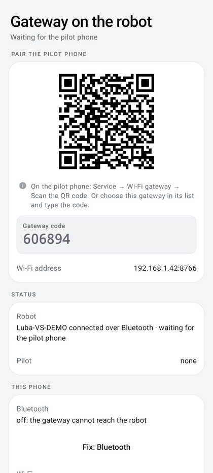

# Gateway on the robot

**A device mounted on the LUBA is required to control it over Bluetooth across the whole garden.** A second device
placed on the robot, an old Android phone or an ESP32 board, holds the Bluetooth link right next to the LUBA, whose
Bluetooth only reaches a few meters. The pilot phone talks to it over Wi-Fi, with no Bluetooth range limit. The gateway
stops the robot if the pilot goes silent and, with a phone, can even follow the prepared route on its own.

```
Pilot phone (map, planning, guards) ── Wi-Fi, TCP 8766 ── Gateway (on the robot) ── BLE ── LUBA 2
```

| | |
|---|---|
| **Access** | Service → **Wi-Fi gateway** |
| **Status** | Android gateway in use on the robot (Redmi A1); autonomous tracking simulated and tested, then used on the robot during the tests of Oct 14 to 16 (incidents fixed up to 0.62.0; full checklist [not verified](../AUTONOMOUS_GATEWAY.md#to-validate-on-the-robot)); ESP32 gateway without autonomous tracking |
| **Code** | `gateway/` (page `GatewayPanel.kt`, home screen `GatewayHomeScreen.kt`, pairing `GatewayPairing.kt`, `QrCode.kt`, `QrScanner.kt`, service `GatewayService.kt`), `autonomy/`, `firmware/esp32-gateway/` |
| **References** | [Android gateway: how it works and setup](../ANDROID_GATEWAY.md) · [Autonomous tracking](../AUTONOMOUS_GATEWAY.md) · [ESP32 gateway](../../firmware/esp32-gateway/README.md) |

<p align="center">
  
  
  
</p>

## Roles

Each phone picks what it is for in Service → Wi-Fi gateway, group **Role of this phone**: a segmented control
**Pilot** / **Gateway** (1.10.0; there used to be three segments, Direct, Gateway and Pilot), with the full role name
below it. The Service hub entry shows "pilot · direct", "pilot · gateway", "gateway" or "stopped".

| Choice | Full name shown | Use |
|---|---|---|
| **Pilot**, no gateway paired or **Go through the gateway** off | **Direct Bluetooth** | the phone talks to the robot on its own (default) |
| **Pilot**, gateway paired and **Go through the gateway** on | **Control via the gateway** | the user's phone controls the robot through the gateway; direct Bluetooth while the gateway does not answer |
| **Gateway** | **Gateway on the robot** | the phone placed on the robot holds the Bluetooth link |

In the Pilot choice, group **Gateway on the robot**: without a paired gateway, "No gateway paired: direct Bluetooth, a
few meters from the robot. Pair the gateway below…"; once a gateway is paired (QR code, or **Find and test**
succeeding with its code, which also turns it on), the switch **Go through the gateway** (subtitle: the gateway's
address and the direct Bluetooth fallback, or "Off: direct Bluetooth only") and **Forget this gateway** (address and
code erased, direct Bluetooth). Turning the switch off keeps the pairing. Leaving **Gateway** for **Pilot** goes
through the paired gateway if there is one, otherwise direct Bluetooth.

The role can only be changed with the robot disconnected: while this phone holds the robot, the page shows "This phone
is connected to the robot: disconnect it to change role…" and a **Disconnect the robot** button. Choosing **Gateway**
asks for the Bluetooth permissions (and notifications on Android 13+) and starts the gateway service; leaving it stops
the service. With a gateway in use, a note recalls the 2 s silence rule.

## Setup with two Android phones

> The robot accepts only **one** Bluetooth connection. First switch the pilot to "Control via the gateway" and close
> the Mammotion app, otherwise the gateway cannot see the robot.

1. Install DumbyLuba on both phones, ideally **the same version** (the two phones must speak the same gateway
   protocol; with different app versions they still work together, see [Versions](#versions)).
2. **Gateway phone**: role **Gateway on the robot**, allow Bluetooth, exempt the app from battery optimization
   (**Battery** button: Android asks directly "Let the app always run in the background?"). Its home screen then
   becomes the [gateway home screen](#gateway-phone-home-screen), with the **pairing QR code** and the six-digit
   code. Nothing else to do on this phone: the robot is chosen from the pilot.
3. **Pilot phone**: role **Pilot**, then **Scan the gateway QR code** (group *Pairing*; camera
   permission asked the first time) and aim at the gateway's home screen: address, port and code are filled in and
   the connection is tested at once. Without a camera: group *Gateways on this Wi-Fi* lists the gateways announced
   on the Wi-Fi by phone model ("Redmi A1", "ESP32"…); tap one to choose it (**Search again** to refresh), then
   group *Connection to the gateway*: **Gateway address** (filled by the choice, optional: "found automatically on
   the Wi-Fi") and **Code shown on the gateway** (six digits, saved automatically), then **Find and test**. Scanning
   for and connecting to the robot then go through the gateway: tap the robot in Service → Bluetooth connection (or
   wait for the automatic connection, within 15 s), the gateway keeps it, reconnects to it on its own and restarts
   with the phone.
4. Turn **Go through the gateway** off to control the robot over direct Bluetooth without forgetting the gateway.

The gateway address is optional: every gateway advertised on the Wi-Fi (mDNS `_dumbyluba._tcp`, instance
"DumbyLuba passerelle · *phone model*" since 1.6.0) is tried with the code, and the one that accepts it is
remembered. The code typed on the pilot is its own setting (1.6.0): it no longer replaces the code this phone shows if
it later becomes a gateway itself (older versions kept a single code for both; a pilot's code is carried over once). If the gateway is unreachable, the pilot falls back to direct
Bluetooth; a new attempt is made every 15 s (backing off to 1 min).
Gateway reached but Bluetooth scan impossible (Bluetooth turned off on the gateway phone): the pilot shows "Gateway
reached, but Bluetooth scan impossible: Bluetooth disabled on the gateway", without falling back to direct Bluetooth
(previously: an empty list, with no reason given).

Failure message (0.50.1): the failure of the saved gateway is shown first ("192.168.0.189 unreachable (timed out);
other gateway 192.168.0.187: Incorrect gateway code"). Previously, only the rejection from another gateway on the same
Wi-Fi (the ESP32, with its own code) was shown: "Incorrect gateway code" even though the code was right. A rejection
from the saved gateway itself is still shown as is. If the last Wi-Fi level received from the gateway (less than
15 min old) is below −70 dBm, the disconnection and reconnection messages mention it ("Gateway Wi-Fi −89 dBm: too
weak, move the robot closer to the access point or add a repeater").

### Pairing QR code

The QR code holds the link `dumbyluba://pair?v=2&host=IP&port=8766&code=NNNNNN&name=MODEL`. It is read by the pilot's
**Scan the gateway QR code** (CameraX preview, ZXing decoding, nothing leaves the phone); another QR code is ignored
("This QR code is not a DumbyLuba gateway pairing."), and **Enter the code by hand** closes the reader. The same link
opened from outside the app (camera app, shared link) shows **Use this gateway?** with the gateway's name and address:
nothing changes before **Use this gateway**, which requires the robot to be disconnected (and stops the gateway if this
phone was one). The QR code carries the gateway code like its screen does: it is only shown on the gateway phone. A
stale address (DHCP) is harmless: the pilot finds the gateway again on the Wi-Fi with the same code.

### From direct Bluetooth

In the **Direct Bluetooth** role, when a search finds a gateway announced on the Wi-Fi, Service → Bluetooth connection
shows "A DumbyLuba gateway is announced on this Wi-Fi (*address*)." and a **Use this gateway** button: it switches
this phone to control via that gateway (address kept) and opens the gateway page, where only the code remains to
enter (or the QR code to scan).

### Versions

The pilot shows, in **Gateway health**, the **Version** row "gateway 1.6.0 · this phone 1.6.0" (Android gateway
1.6.0 onwards; nothing for an older gateway or the ESP32). Different app versions stay compatible as long as the
protocol is the same; a note advises installing the same version on both phones to get the same fixes. A protocol
mismatch is refused with both versions named: "Different gateway protocol (gateway v3, this phone v2): install the
same DumbyLuba version on both phones (this phone: 1.6.0)". When the pilot has read a newer GitHub release than the
gateway's version ([new versions](interface.md#new-versions)), a second note asks to update the gateway phone too.

### Gateway phone home screen

In the **Gateway on the robot** role, the Device tab no longer shows the map and mowing screens (they belong to the
pilot phone) but **Gateway on the robot**, with the service state below the title:

- **Pair the pilot phone**: the pairing QR code (once the service runs and the Wi-Fi address is known; "Waiting for
  the Wi-Fi address of this phone…" otherwise), the **Gateway code** and the **Wi-Fi address**. Once a pilot is
  connected, "Pilot connected: …" replaces the QR code (**Show the QR code** to show it again).
- **Status**: **Robot** ("No robot yet: choose it from the pilot phone (Service → Bluetooth connection)", then the
  robot held) and **Pilot**.
- **This phone**: **Bluetooth**, **Wi-Fi**, **Battery exemption** and, when the phone is kept silent, **"Do not
  disturb"**, each with a **Fix: …** action opening the matching Android screen when it is missing; "This phone is
  ready to stay on the robot." when all is fine.
- **Health of this phone (reported to the pilot)**, a placement tip (flat on the robot, screen up, held firmly: the
  Bluetooth signal also detects a fall) and **Gateway settings** (Service → Wi-Fi gateway). A stopped gateway shows
  **Start the gateway**.

### Gateway phone page

In the **Gateway on the robot** role, Service → Wi-Fi gateway shows:

- **Gateway status**: **Service** ("Waiting for the pilot phone", "Pilot connected: …", "Gateway stopped"…),
  **Robot**, **Gateway code**, **Wi-Fi address** (`IP:8766`), **Show the pairing QR code**, **Battery exemption** ("active" or "missing", with the
  warning "Without a battery exemption, the gateway may be suspended when the screen is off."), buttons **Start** /
  **Stop** and **Battery** (direct system request for this app, otherwise the list of optimized apps);
- **Health of this phone (reported to the pilot)** (see [Gateway health](#gateway-health));
- **Gateway settings** (see [Android gateway settings](#android-gateway-settings));
- **Gateway log**: the last 12 events of the service (pilot connections and refusals, robot link, safety stops).

The robot held by the gateway is also shown in Service → [Bluetooth connection](bluetooth-connection.md#depending-on-the-phones-role),
with **Release the robot**.

### Pilot phone page

In the **Pilot** choice: *Gateway on the robot* (switch and forget, above), *Pairing* (**Scan the gateway QR code**),
*Gateways on this Wi-Fi* and *Connection to the gateway* (above); with the gateway in use, also **Gateway health** (state received from
the gateway, or "No information received: gateway not contacted yet." / "Gateway reachable; health state not received
yet." / "Gateway unreachable: …"), **Routes** (switch **Hand routes over to the gateway**, see
[Autonomous tracking](#autonomous-tracking-android-gateway)) and **ESP32 gateway updates** (switch **Updates during
mowing**, see [ESP32 gateway](#esp32-gateway)).

## Security

- **Authentication**: random challenge, HMAC-SHA256 response from the code (never sent in clear), at most 5 wrong
  attempts per minute. Only one pilot session at a time: another phone gets "Gateway busy with another pilot"; the
  same phone coming back while its old session ends is made to wait (8 s at most) instead of being refused.
- **Safety stop**: the pilot sends a PING every 250 ms. If it is silent for more than **2 s**, or the Wi-Fi drops
  without a deliberate close, the gateway itself writes blades stopped then zero speed, each frame confirmed. If a
  fragmented message is in progress (map read), the connection is closed and the stop is reported as "not
  guaranteed".
- **Report**: a pilot that comes back (within 30 min) receives the result of the stop written in its absence.
- The gateway **decides no command** other than the safety stop and autonomous tracking: planning and guards stay on
  the pilot.
- Traffic is not encrypted: keep it to the home Wi-Fi ([SECURITY](../../SECURITY.md)).

## Autonomous tracking (Android gateway)

Switch **Hand routes over to the gateway** (pilot page, group *Routes*, on by default, can only be changed with the
robot disconnected; subtitle "Autonomous tracking by the phone lying on the robot"). When it is off, or with a gateway
that does not announce tracking (ESP32), routes are driven frame by frame from the pilot and a Wi-Fi outage of more
than 2 s stops the robot. For every route (mowing, signal survey, transits, return
to base, resume after recharging), the pilot prepares the route and sends it once; the gateway follows it on its own
with the same tracking loop and its own guards (telemetry, errors, lift).

- **Good Wi-Fi**: progress, telemetry and surveys come back live; STOP interrupts tracking.
- **Wi-Fi lost**: the robot **carries on alone**; the pilot shows "Gateway Wi-Fi lost for N s · the robot carries on
  alone" and retries every second. On reconnection, the gateway sends back the state and the missed surveys.
- Automatic stop after **20 min** without a pilot, or if the gateway phone overheats critically.
- Gateway phone battery **below 5 %** while not charging: blades are forbidden (a cutting segment stops or is not
  started), but moves with blades stopped, including the return to base, remain allowed. If the gateway shuts down,
  the Bluetooth link drops and the robot stops.
- Obstacle bypasses and recharging stay on the pilot: the robot stops and waits for it at those moments. Leaving
  the base is run by the gateway itself when it announces it (`dock-exit`); docking is left to the official Mammotion
  return, which the gateway requests itself if the pilot is unreachable at the end of a return to base (0.38.0).
- **Tracking lost**: if, on reconnection, the gateway has no record of any tracking (start order lost during the
  outage, gateway restarted), the pilot resumes the route from the robot's actual position (at most 4 times per
  mowing) instead of stopping the mowing.
- **Docking and recharging at the base**: the connection is held as during tracking, including during docking via the
  official Mammotion return (0.62.0; on Oct 16, 2 s of Wi-Fi silence at −73 dBm in front of the base closed the
  connection and abandoned the mowing); a Wi-Fi outage is recovered, with no maintenance write during the outage, and
  recharging tolerates 2 min of incident. A maintenance write (synchronization, reports, RSSI) has 5 s to be confirmed
  by the gateway: slow Wi-Fi no longer stops the mission (0.60.1); setpoints, STOP and blades keep 1.5 s. If the
  connection drops anyway during this cycle, mowing resumes on its own once the robot is charging and the gateway is
  back ([resume](mowing-resume.md#automatic-resume-after-losing-the-gateway-during-recharging)).
- **Failing Bluetooth link** during tracking: the gateway stops the robot and names the cause, "BLE interrupted:"
  connection closed, write rejected (code), write unconfirmed for N s, or queue full.
- **Gateway fallen off the robot** (1.3.0): during tracking, the gateway reads its Bluetooth signal to the robot every
  second. Lying on the robot it is strong and steady; fallen on the lawn, it fades as the robot drives away. When the
  signal drops 15 dB below its usual level for 3 readings in a row while the robot is at least 1.5 m from where the
  signal was last normal, the gateway stops the robot (blades OFF, zero speed: it would otherwise come back over the
  phone with its blades) and the pilot raises a critical **Gateway fell off the robot** alert with the position where
  the phone most likely lies (robot position at the last normal reading). A **Gateway** marker shows it on the map
  until the next tracking handed to the gateway. If the Bluetooth link drops first while the signal was already
  falling, the alert says "probably". The usual level is only learned while the robot drives 3 m with a steady signal
  of −50 dBm or better: a phone left on the ground on purpose is never taken for a fall. See
  [technical detail](../AUTONOMOUS_GATEWAY.md#gateway-fallen-off-the-robot-130).

## Gateway health

Every 5 s, the gateway sends battery, charging, temperature, Wi-Fi signal and throughput, thermal state, battery
saver, battery exemption and screen. The pilot shows:

- on the Service tab's robot card, under a hairline, **GATEWAY ON THE ROBOT**: battery (icon by level, green, orange
  below 25 %, red below 15 %), Wi-Fi with four signal bars and its quality ("Wi-Fi · weak"), rate and temperature side
  by side, then the first warning in an orange band ("Gateway Wi-Fi weak (-72 dBm) (+1 more)");
- the warnings on the Home screen;
- the detail in Service → Wi-Fi gateway, also on the gateway phone itself: four tiles (**Battery** with a gauge,
  **Wi-Fi** with its bars, quality, rate and a gauge, **Battery temperature**, **Heating**), the states as pills
  (**Screen on/off**, **Battery saver on/off**, **Battery exemption** / **No battery exemption**, orange when they need
  attention) and every warning below.

Wi-Fi quality: excellent from −55 dBm, good from −63 dBm, fair above −70 dBm, weak from −70 dBm (the limit of the
warning). Warnings: battery below 25 % while not charging ("very low" below 15 %), overheating
(thermal level ≥ moderate, otherwise battery ≥ 45 °C), Wi-Fi ≤ −70 dBm, battery saver on, no battery exemption. An
unknown Wi-Fi signal or battery level is shown as "unknown" (0.65.1). The gateway phone's tilt is sent
every 500 ms for the [terrain](signal-surveys-and-terrain.md#terrain).

## Android gateway settings

Gateway phone, group **Gateway settings**:

| Setting | Default | Purpose |
|---|---|---|
| Keep the screen on while piloting | off | screen kept on during a pilot session, so that Wi-Fi does not go into power saving. Off since 0.27.9: the screen drained ~8 %/h; screen off, the Wi-Fi may lag by a few hundred ms, with no effect on autonomous tracking (only on the sequences still driven from the pilot) |
| Keep this phone silent | on | ringer, notifications, alarms and media at minimum and "Do not disturb", restored at once if they change; without "Do not disturb" access, volumes only (grant it with **Allow "Do not disturb"**; from a computer: `adb shell cmd notification allow_dnd fr.luba.poc`) |

**Keep wireless debugging on** (on by default, for development; needs `adb shell pm grant fr.luba.poc
android.permission.WRITE_SECURE_SETTINGS`) is in Service → **Advanced settings** since 0.54.0 and works in every role.
Since 1.6.0 the group only appears once that permission has been granted: without it the option can do nothing.
Details: [ANDROID_GATEWAY.md](../ANDROID_GATEWAY.md#silent-gateway-phone).

The gateway runs in a foreground service ("DumbyLuba — robot gateway", "Wi-Fi ↔ Bluetooth: waiting for the pilot
phone", action **Stop the gateway**), with CPU and Wi-Fi locks. It restarts on its own after a phone restart or an app
update. Stopping it while a pilot drives first writes the safety stop. A rejected connection (wrong code, different version, too many attempts) is recorded in its recent events
and the gateway stays "Waiting for the pilot phone" (previously it wrongly showed "Pilot connected" with no pilot).

## ESP32 gateway

A **LILYGO TTGO T-Call V1.3** board replaces the phone with the **same protocol**: the pilot stays in "Control via the
gateway". Differences: no autonomous tracking (frame-by-frame control), no accelerometer and therefore no terrain,
reduced health (battery level and power supply).

**Over-the-air update** (firmware 0.2.0): `pio run -e ota -t upload` from the computer. Pilot-side setting, Service →
Wi-Fi gateway → *ESP32 gateway updates* → **Updates during mowing** (off by default), sent to the gateway on every
connection (ESP32 gateway only); with the robot stopped, an update is always accepted:

- off: an update is refused while the pilot holds the robot;
- on: the gateway announces its restart, stops the robot (blades then speed), updates itself and reconnects to the
  robot. The pilot does not raise a failure alert and **resumes the mowing by itself** from its saved progress, within
  6 min (3 attempts; otherwise the "Automatic resume failed" alert and a Resume button).

A version that does not boot, or stays without Wi-Fi, is discarded: the board rolls back to the previous one on its
own. Installation: see the [firmware README](../../firmware/esp32-gateway/README.md) and the
[hardware](esp32-hardware.md) page.

## Limitations

- Read-only mode: the gateway lists every Mammotion mower (Android gateway; the ESP32 still lists only `Luba…`
  names), but autonomous tracking is only offered for the validated LUBA 2 AWD and the Android gateway refuses a leg for
  a known robot name that is not validated ([supported models](supported-models.md)).
- Latency mostly comes from the **gateway phone's Wi-Fi** (screen off, Wi-Fi/Bluetooth coexistence, weak signal in the
  garden): moving the access point closer or adding a repeater remains the best remedy.
- Both phones must speak the same gateway protocol (v2); the same app version is advised.
