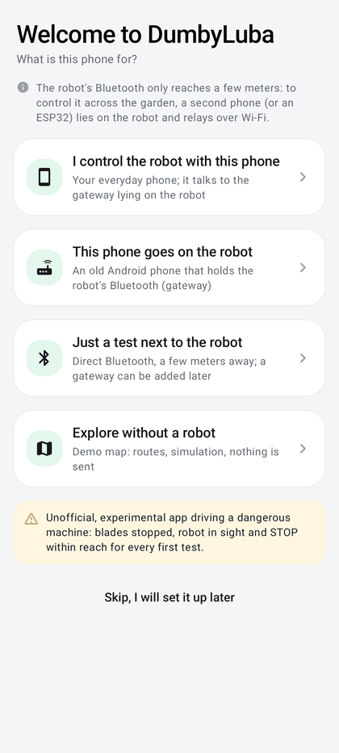
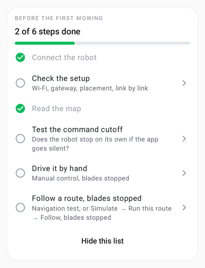

# Getting started and setup check

Everything needed to go from a fresh install to a robot controlled across the garden, then to check that every link
of the chain holds.

| | |
|---|---|
| **Access** | First-launch assistant · Home → **Before the first mowing** · Service → **Wi-Fi gateway** (roles, pairing) · Service → **Check the setup** |
| **Status** | Implemented; JVM tests (verdicts, gateway probe on a simulated gateway); setup on two phones to validate on the robot |
| **Code** | `onboarding/` (`SetupWizard.kt`, `SetupProgress.kt`, `FirstMowingCard.kt`), `gateway/GatewayPairing.kt`, `gateway/GatewayHomeScreen.kt`, `gateway/GatewayPanel.kt`, `diagnostics/SetupCheck.kt`, `ui/SetupCheckPage.kt`, `gateway/GatewayClient.kt` (`probe`) |

  
  

## First-launch assistant

On a fresh installation, after the intro, **Welcome to DumbyLuba** asks what the phone is for. Each path has one
main action per page; every page can be left (**← Back**, **Skip, I will set it up later**) and the same settings stay
in Service → Wi-Fi gateway. Nothing is sent to the robot.

| Choice | Pages |
|---|---|
| **I control the robot with this phone** | Bluetooth and notifications asked together → **Scan the gateway QR code** (the connection is tested at once; if the gateway does not answer yet, the pairing is kept and the app keeps trying) or **No gateway yet: direct Bluetooth for now** → **Paired**: **Check the setup** or **Go to the home screen** |
| **This phone goes on the robot** | permissions → role **Gateway** started → **Prepare this phone** (battery exemption, optional "Do not disturb", read again every 2 s) → **Show the QR code** (gateway home screen) |
| **Just a test next to the robot** | permissions (reminder to close the Mammotion app) → home screen, automatic connection to the only robot in range |
| **Explore without a robot** | the map opens on the demo map |

An installation updated from an older version (a role already chosen or a robot already known) never sees the
assistant nor the list below.

## Before the first mowing

Card of the home screen (pilot and direct roles), below the map: "N of 6 steps done", a progress bar and the steps of
the quick start, each opening its page while not done: **Connect the robot**, **Check the setup** (done once the check
finds nothing to fix), **Read the map**, **Test the command cutoff**, **Drive it by hand**, **Follow a route, blades
stopped** (navigation test, or a route followed without cutting). The robot connection, manual control and the
blades-stopped route are remembered once seen; the map and the cutoff test are read for the current robot. The card
disappears once everything is done, or with **Hide this list**.

## Three ways to use DumbyLuba

| Setup | What you need | When |
|---|---|---|
| **Two Android phones** | your phone (pilot) + an old Android phone lying on the robot (gateway) | everyday use, the whole garden |
| **Phone + ESP32** | your phone (pilot) + an ESP32 board on the robot | same, without autonomous tracking ([firmware](../../firmware/esp32-gateway/README.md)) |
| **Direct Bluetooth** | your phone only | first test or setup, a few meters from the robot |

The robot accepts **one** Bluetooth link at a time: close the Mammotion app first.

### Two Android phones

1. Install DumbyLuba on both phones (same version advised).
2. **Phone for the robot**: Service → Wi-Fi gateway → role **Gateway**, allow Bluetooth, tap **Battery**. Its home
   screen becomes [Gateway on the robot](gateway.md#gateway-phone-home-screen): pairing QR code, code, and the list of
   what the phone still needs, each with **Fix**.
3. **Your phone**: Service → Wi-Fi gateway → **Pilot** (the default) → **Scan the gateway QR code**. The robot then connects
   through the gateway on its own (or tap it in Service → Bluetooth connection).
4. Lay the gateway phone flat on the robot, then run **Check the setup** (below).

### Direct Bluetooth

Next to the robot, **Pilot** without a paired gateway (the default) connects on its own to the only robot in range. If a gateway is found
on the Wi-Fi, **Use this gateway** switches to it ([details](gateway.md#from-direct-bluetooth)).

## Check the setup

Service → **Check the setup** (Connection group) runs, as soon as it opens and again with **Check again**, the checks of
this phone's role. Each line is green (fine), orange (to watch), red (to fix) or grey (not measurable now), with its
detail and, when useful, the action that fixes it. A summary sits on top: "Everything is in place", "Working, N
point(s) to watch" or "N point(s) to fix, M to watch". Nothing is sent to the robot.

| Role | Checks |
|---|---|
| **Pilot** (via a gateway) | **Wi-Fi of this phone**; **Gateway on the Wi-Fi** (announced gateways); **Gateway connection** (address, code accepted, answer time; orange above 800 ms); **Versions** of both phones; **Gateway phone** (its health warnings); **Robot seen by the gateway** (the gateway searches over Bluetooth); **Robot link**; **Gateway on the robot** (placement, from the gateway ↔ robot signal); **Wi-Fi at the base** (while the robot charges); **Command cutoff** |
| **Direct** | **Bluetooth** (permission and state); **Robot link** (a fresh search, without automatic connection); **Range** (advice to use a gateway, or the gateway found on the Wi-Fi); **Command cutoff** |
| **Gateway** | **Gateway service**; **Bluetooth**, **Wi-Fi**, **Battery exemption**, **"Do not disturb"**; **Robot** held; **Pilot** |

- **Through a gateway**, when the robot is not linked, the check connects like a pilot and asks the gateway for a
  Bluetooth search, without opening the robot link (`GatewayClient.probe`). A robot already linked through the gateway
  is checked from the live link instead: a second session would be refused by the gateway.
- **Placement**: −50 dBm or better between the gateway and the robot is "well placed" (the level the
  [fall detection](gateway.md#autonomous-tracking-android-gateway) learns from); down to −70 dBm "lay the phone flat
  on top of the robot"; below, the phone is not on the robot or too far.
- **Wi-Fi at the base**: judged only while the robot charges; −70 dBm or less is orange, as the link may drop during
  docking (incident of 16/10/2026 at −73 dBm): move the access point closer or add a repeater.
- **Robot not found**: the robot stops advertising while another device holds its only Bluetooth link. The message
  names the remembered robot: "Luba-VS… does not advertise: off, out of range, or connected to the Mammotion app,
  another phone or a gateway. Close the Mammotion app, then search again." (same text at the end of a search in
  Service → Bluetooth connection).
- **Fixes**: open the gateway page, the Bluetooth connection, the command cutoff test, the Android Bluetooth, Wi-Fi,
  battery or "Do not disturb" screens, or **Use this gateway** (direct role, robot disconnected).
