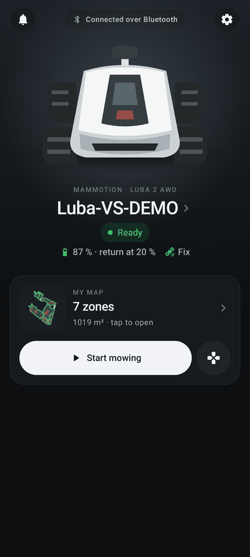

# Interface and navigation

The app fits into three tabs. The **STOP** button stays within reach as soon as a robot is linked or an activity is
in progress. The interface is in English by default, and in French when the phone's language is French, unless
another language is chosen in Me → Language ([language](#language)).

| | |
|---|---|
| **Access** | Bottom bar: **Device** · **Service** · **Me** |
| **Status** | Implemented, used daily on the test phone |
| **Code** | `MainActivity.kt`, `ui/HomeScreen.kt`, `ui/LinkStatus.kt`, `ui/RobotModel.kt`, `ui/RobotPanel.kt` (`ServicePage`), `ui/MeScreen.kt`, `ui/theme/`, `ui/components/`, `ui/brand/DumbyBrand.kt`, `i18n/I18n.kt`, `ui/Format.kt` |
| **Tests** | `I18nTest`, `FormatPluralTest`, `LinkStatusTest`, `RobotModelTest`, `RobotModelImageTest`, `ChargeStatusTest`; screenshots `UiShotsAccueilTest`, `UiShotsServiceTest` (`-PuiShots`) |

  
  
  
  

## The three tabs

### Device (home)

On a fresh installation the [first-launch assistant](getting-started.md#first-launch-assistant) comes first; below the
map, the [Before the first mowing](getting-started.md#before-the-first-mowing) card lists the steps still to do.

On the phone mounted on the robot (**Gateway on the robot** role), this tab shows the
[gateway home screen](gateway.md#gateway-phone-home-screen) instead: pairing QR code and code, state, phone checks.

- **Header**: **Notifications** bell, which opens the [notifications panel](notifications.md#notifications-panel)
  (red badge for notifications not seen yet, or when notifications are blocked); link status pill in the center
  ("Connected over Bluetooth", "Connected via the gateway", "Connecting…", "Gateway OK · robot unreachable",
  "Gateway unreachable", "Mammotion account", "Offline"; orange badge when the [gateway](gateway.md) reports a
  problem); **Device settings** gear. The pill and the gear open the Service tab.
- **Robot**: photo of the detected model (tapping it opens the map), "MAMMOTION · <model>" overline, robot name
  (tapping it opens the Service tab), status badge (the route or mowing status while one runs, the charging state,
  "Ready", "Connecting…", "Offline", "Controlled from the other phone" or "Waiting for the pilot" on the gateway
  phone, "Robot unreachable" or "Gateway unreachable" when controlling through the gateway),
  battery followed by the return threshold ("45 % · return at 20 %", in red at that threshold) and position
  quality. An animated card appears while charging, with the resume threshold ("resume at 90 %" and a marker on the
  bar) ([thresholds](real-mowing.md#threshold-shown-next-to-the-battery)). A warning line appears only if the
  [gateway](gateway.md) reports a problem (first warning, "(+N)" for the others); it opens the Service tab.
  The model (LUBA AWD, LUBA 2 AWD, LUBA 3 AWD, LUBA mini AWD, LUBA mini 2 AWD) is deduced from the prefix of the
  Bluetooth name (`Luba-VS`/`Luba-VP` → LUBA 2, `Luba-VA` → LUBA 3, `Luba-MN`/`Luba-LD` → mini, `Luba-LA`/`MD`/`MB`/`LS`/`MS`
  → mini 2, any other `Luba…` name → LUBA 1) or, failing that, from the product key of the Mammotion account; the
  same photo appears at the top of the Service tab with the model name. Newer Luba models with no established trade
  name (`Luba-HM`, `MH`, `ME`, `TR`, `SP`) and the absence of a robot keep the generic illustration. Table:
  `ui/RobotModel.kt`, based on PyMammotion's `DeviceType`. Mammotion product photos remain Mammotion's property
  ([THIRD_PARTY.md](../../THIRD_PARTY.md#robot-image)): if they are removed, the illustration replaces the photo and
  the model name is still shown.
- **MY MAP**: map thumbnail, number of zones ("No map" without one), then "<area> m² · tap to open", "<N> % mowed ·
  tap to open" during a local route, or "Read the map from the robot or the account". The card opens the
  [map](map.md). The **Start mowing** button (or **Follow mowing** during a mission) opens the map in zone selection
  mode. The gamepad icon opens [manual control](manual-control.md) when the robot is ready.
- With no account and no map, a **Read the map via the Mammotion account** link opens the
  [Mammotion account](mammotion-account.md) page.

### Service

This is the index of connection, settings, tests and diagnostics, ordered from everyday use to diagnostics. At the
top, a robot card shows the model photo, the name ("No robot connected" without one), the link summary, the gateway
health and the battery; tapping it opens the Bluetooth connection. Each entry has a one-line subtitle. Entries that
require a linked robot stay grayed out without a link; on the right, a short status ("in progress", "to test",
"demonstrated", height in mm, number of obstacles, number of survey samples, rain decision…). A page opens as a pushed
page (back arrow, bottom bar hidden).

| Group | Entries |
|---|---|
| **Connection** | [Bluetooth connection](bluetooth-connection.md) · [Check the setup](getting-started.md#check-the-setup) · [Wi-Fi gateway](gateway.md) · [Home server](home-server.md) |
| **Robot** | [Manual control](manual-control.md) · [Cutting height](tests-and-diagnostics.md#cutting-height-and-blade-test) · [Camera](camera.md) · [Maintenance](maintenance.md) |
| **Garden and history** | [Task history](mowing-history.md) · [Obstacles](obstacles.md) (list, difficulties, photos, [simulation](obstacles.md#obstacle-simulation)) · [Signal surveys](signal-surveys-and-terrain.md) · [Rain and weather](rain-and-weather.md) |
| **Supervised tests** | [Command cutoff](safety.md#command-cutoff-motor-watchdog) · [Navigation test](tests-and-diagnostics.md#navigation-test) · [Border following](tests-and-diagnostics.md#border-following) · [Obstacle tests](obstacles.md) · [Blade test](tests-and-diagnostics.md#cutting-height-and-blade-test) · [Trial mowing (painted zone)](tests-and-diagnostics.md#trial-mowing-painted-zone) |
| **Diagnostics** | [Bluetooth diagnostics](tests-and-diagnostics.md#bluetooth-diagnostics) · [Detailed telemetry](tests-and-diagnostics.md#detailed-telemetry) · [Sensors and perception](tests-and-diagnostics.md#sensors-and-perception) · [Logs](logs-and-data.md) · [Advanced settings](bluetooth-connection.md#advanced-settings) |

Shared guards on the robot test pages: without a link, "Robot not connected: this page unlocks as soon as it is
(gateway or direct Bluetooth)."; during a mowing (except manual control), "Mowing is in progress: finish it from the
map before starting a test.". A refused navigation or test opens an **Action blocked** dialog with the reason and
**Open manual control** (or **Unlock** when the robot is locked after a STOP); a refusal near a limit or an exclusion
adds "Move the robot more than one meter away from the boundaries and exclusions with manual control, then try
again.".

### Me

- **Profile**: email of the [Mammotion account](mammotion-account.md) (or "Mammotion account") with "Signed in ·
  remote map reading" or "Not signed in · sign in"; the card opens the account page.
- **Account map**, shown when the cloud map is complete; it opens the map.
- **App**: **Appearance** (System / Light / Dark, System by default, remembered between launches),
  **Language** (System / English / Français, System by default, remembered between launches, [language](#language)) and
  **Notifications** ([local alerts](notifications.md)), whose subtitle is the latest notification, "Local alerts
  enabled" or "Notifications blocked · allow".
- **About**: **Version** (the `versionName` to include in a ticket) and **Updates** ([new versions](#new-versions)).
  Connection, tests and logs are in the Service tab.
- Note at the bottom: "DumbyLuba controls the robot locally (Bluetooth or the Wi-Fi gateway). The Mammotion account
  adds remote reading (map, status, history), the native return to base, firmware updates and the camera."

#### New versions

The app detects a new version published on GitHub; it downloads and installs nothing by itself.

- **What is read**: the `release.json` file of the latest
  [GitHub release](https://github.com/cleborgne-pro/DumbyLuba/releases) (link
  `releases/latest/download/release.json`, which skips drafts and pre-releases). No GitHub account and no API call:
  only GitHub sees the request (the phone's IP address and the app version in the User-Agent).
- **When**: with **Check automatically** on (default), at most once a day, when the app comes to the foreground; at
  any time by touching **Updates**.
- **Comparison**: the `versionCode` of the release against the installed one, for the published app only
  (`io.github.cleborgne_pro.dumbyluba`). Builds made from source (debug, `fold`, identifier `fr.luba.poc`) never check
  by themselves and never offer the update: a manual check only shows "Development build · latest published X.Y.Z".
- **Display**: the **Updates** row reads "Version X.Y.Z available · open the release", "Up to date · checked 3 h ago",
  "Checking GitHub…" or "Check failed (reason) · try again"; a green dot marks the **Me** tab while a newer version is
  available. Touching the row then opens the release page (notes, signed APK, checksums) in the browser; install the
  APK from there, or let [Obtainium](https://github.com/ImranR98/Obtainium) follow the releases.
- **Gateway phone**: on the pilot, Service → Gateway → **Gateway health** adds "Version X.Y.Z is published on GitHub:
  update the gateway phone too (1.13.0)." when the Android gateway announces an older version than the latest release
  read by this phone ([gateway versions](gateway.md#versions)).
- The last release read and the setting are kept between launches; a failed check keeps the last release read.

## Global STOP bar

- It appears above the navigation as soon as a link or an activity exists, and stays for 15 s after a
  disconnection. Exception: on the map at rest (no movement or test), it is hidden — the link is already shown in
  the status pill at the top; it comes back as soon as an activity starts.
- Its label describes the activity: "Local mowing in progress", "Manual control", the current mowing phase,
  "Navigation in progress", "Blade test", "Obstacle test", "Diagnostics in progress", or the link status ("Gateway"
  instead of "BLE" when controlling through the gateway).
- The button triggers the full stop described in [Safety](safety.md#global-stop).

## Automatic behaviours

- **Robot search** every time the app returns to the foreground, when no link, diagnostics campaign or blade test is
  running (Bluetooth permissions requested once if missing): if a single robot is found, it connects automatically;
  with several robots, the message "Several robots found: choose the one to connect." opens Service → Bluetooth
  connection. If a gateway announces itself on the Wi-Fi, automatic direct connection is suspended to leave the robot
  to it; in the pilot role, the search goes through the [gateway](gateway.md).
- **Screen kept on** during mowing, a move, manual control, a test or a diagnostics campaign.
- **Reading through the account every 30 s** on the home screen and the map, when the account is signed in, the
  robot is not linked over Bluetooth and the app is in the foreground.
- **Animated intro** at launch (about 1.4 s, "Your garden, simply.", a tap skips it, skipped when Android
  animations are off, not replayed when the screen is recreated), Android 12+ splash screen and adaptive icon with a
  monochrome variant ([identity](../BRANDING.md)).
- **Single window**: tapping an Android notification (local alert, gateway, relay or link service) reopens the
  existing window; a local alert opens the [notifications panel](notifications.md#notifications-panel).
- **System back**: closes a pushed page first (map, manual control, account page, Service page), then returns to the
  Device tab.
- **Fold folding or rotation**: the screen is recreated without stopping the mission or dropping the link. Leaving
  the app otherwise is handled as described in [Bluetooth connection](bluetooth-connection.md#link-loss).

## Theme

A single theme inspired by the Mammotion app, light and dark, which follows the system theme by default (Me →
**Appearance**: System / Light / Dark, stored in the app preferences). Primary actions are dark "ink" pills, settings
and selections (sliders, switches, checkboxes) are green, values are blue. Shared components (cards, tiles, status
chips, label/value rows, full-width modals, pushed pages) are in `ui/components/`.

## Language

- **Language choice in the app**: Me → App → **Language**: System / English / Français (stored in the app
  preferences, `LanguageStore`, loaded when the process starts so notifications and background services use it too).
  The screen is rebuilt at once in the new language; a mission in progress and the robot link are kept.
- **System** (default): **English by default**, **French when the phone's language is French** (`I18n`). Changing the
  phone language applies when the screen is recreated.
- Every user-facing text is written in both languages (`tr(english, french)`), including messages built outside
  the screens: planner refusals, tracking stops, gateway errors, [notifications](notifications.md) and the 664
  [robot error codes](safety.md#robot-error-codes) (labels and advice). The Android notification channel names
  ("Robot · INFO", …) are the same in both languages.
- **Numbers follow the language**: decimal point in English (`0.5`), decimal comma in French (`0,5`)
  (`I18n.locale`: British formatting in English, French formatting in French). Times use the 24-hour clock in both
  languages. Day names and months (notification panel: "Today", "Yesterday", then "Monday 13 October") follow the
  language; some full dates are written year first in English (`2026-10-16 14:32`) and day first in French; other
  short dates keep the day/month order in both.
- **Plurals follow the language**: "1 zone", "0 incidents" in English; "0 incident" in French (`Format.plural`).
- Data saved by an earlier French version (refusal prefixes, interruption reasons, saved obstacle kinds) is still
  recognized; stored values keep their original form and are translated when displayed. Texts already recorded (for
  example a stop reason in the [task history](mowing-history.md)) stay in the language they were recorded in.
- Tests: unit tests run in French (`dumbyluba.lang=fr`), documentation screenshots in English; `-PtestLang=en` runs the
  suite in English.
