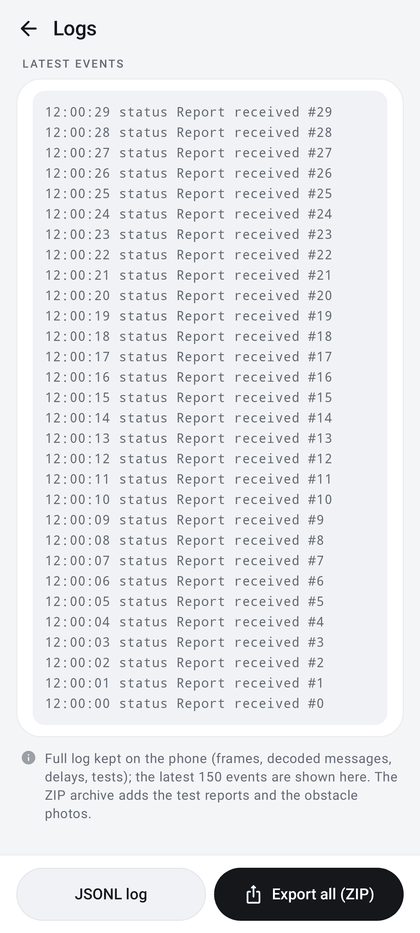

# Logs and local data

Everything the app learns from the robot stays on the phone, in its private storage. Structured logs make it
possible to analyze a test and attach material to a ticket.

| | |
|---|---|
| **Access** | Service → **Logs** |
| **Code** | `EventLog.kt`, Logs page in `ui/RobotPanel.kt` |

  

## Logs

- Structured events in **JSONL** format (one JSON line per event: commands, decoded telemetry, errors, guard
  decisions, alerts…). Each line carries `schemaVersion` (2), `appRunId` (one per launch), `sequence`, `timestamp`,
  `elapsedRealtimeMs`, `event`, `detail` and `fields`. Files: `diagnostics/<appRunId>/0000.jsonl`, `0001.jsonl`… in the
  app's private storage. Failures, stop requests and test results are flushed to disk immediately.
- Service hub, group **This launch**: aggregate of the current launch's log (event count, STOP requests, failures,
  link losses, last link loss time, average successful route preparation), re-read every 30 s without opening the raw
  JSONL. A failure or a link loss leaves a warning note; the detail stays in **Logs**.
- Service → Logs, group **Latest events**: the last 150 events, newest first ("No events." when empty). The notes
  under it recall that the full log stays on the phone, that the ZIP archive adds the test reports, and that exports
  are anonymized.
- Bottom buttons (disabled while a [Bluetooth diagnostics](tests-and-diagnostics.md#bluetooth-diagnostics) campaign runs):
  - **JSONL log**: exports the current launch's log, anonymized, as one `luba-m1-<time>.jsonl` file ("Anonymized
    JSONL log exported");
  - **Export all (ZIP)**: `luba-diagnostics-<time>.zip` with every `.json` and `.jsonl` file of the `diagnostics`
    folder, anonymized: logs of all kept launches and test reports (`campaign-<id>.json`), the task history under
    `tasks/` (`history.json`: every task record; per task that kept its track, `<start>-<kind>.json`: record, map and
    prepared route, typed events, black boxes, and `<start>-<kind>.csv`: one line per recorded position with time, position,
    heading, activity, battery, speed command, measured speed, RTK status, satellites and link state, see
    [task journal](mowing-history.md)), plus `ANONYMIZED.json` (what was removed, number of replacements per category,
    photos left out) ("Anonymized archive exported (reports + kept logs + tasks, without photos)").

  Both go through the Android file picker; a failure shows "Export failed: …". The same anonymized ZIP export is
  offered by the **Export (ZIP)** button of Bluetooth diagnostics, **Export** in Sensors and perception, and **Export
  tests and logs** in the blade and cutting-height pages.
- **Raw archive (not anonymized, with photos)**, action under the notes: `luba-diagnostics-raw-<time>.zip` with every
  `.json`, `.jsonl` and `.jpg` file as stored, for the user's own analysis, with the same `tasks/` folder ("Raw archive
  exported (reports + kept logs + tasks + photos), not anonymized"). Not meant for a public ticket.
- Rotation in 8 MB files, 256 MB at most per launch: beyond, the oldest parts of the launch are deleted (the first one,
  with the connection, is kept; the gap shows in the part numbers and the event sequence). A full log no longer stops
  the robot. The logs of the earlier launches are kept up to 256 MB together, oldest launch first deleted (their
  reports and the photos stay). When less than 32 MB of free space remains, the earlier logs then the old parts of
  this launch are deleted first; writing is suspended only if that is not enough ("Not enough disk space for the
  log"). While the log is not healthy, tests that need it are refused ("BLE / log not ready").
- What is written: every decoded message, except the four the robot sends about once per second (status report,
  `systemUpdateBuf`, `bidire_comm_cmd`, Wi-Fi status), written in full every 10 s (an unchanged one every minute; each
  report still gives a `telemetry` line); raw received frames (`ble_rx`) only when their message fails to decode.
  During a sensor capture every message is written. Replayed on the log of the Fold test of 2026-11-02
  (5.9 h, 37 to 70 MB/h while connected): 14 MB instead of 101 MB, 7 times less.
- A copy (96 MB at most per launch, its latest parts kept, the last 5 launches plus the current one) is reachable over
  ADB in the app's external folder (`Android/data/fr.luba.poc/files/diagnostics/`), for analysis without a manual
  export. The Mammotion account screen logs in its own folders (`cloud-<id>`), kept apart: they no longer push robot
  launches out of the copy.
- Test reports (`campaign-<id>.json`) are written atomically; a report still "RUNNING" when the app process ended is
  marked `INTERRUPTED_PROCESS_END_UNCONFIRMED` at the next launch.

### Anonymized export

The exports (except the raw archive) go through `diagnostics/LogSanitizer.kt` so that they can be attached to a
public ticket without editing ([CONTRIBUTING](../../CONTRIBUTING.md)). One pass per export: the same robot, MAC or
IP address gets the same pseudonym in every file of the archive.

| Data | Treatment |
|---|---|
| Robot and RTK base names (`Luba-VSxxxx`, `Yuka-…`, `RTK-…`) | model prefix kept, rest replaced: `Luba-VS‹1›` |
| Decoded messages (`decoded`, `mapNav`, `lastPerception`) | value of `latitude`, `longitude`, `lat`, `lon`, `rtk_base_num`, RTK credentials, Wi-Fi names and passwords, `wifi_mac`, `ip`, `gateway`, URLs, IMEI/IMSI/ICCID, APN, product and device keys, device names, user/device/account ids, tokens replaced by `"‹removed›"` |
| Mammotion account number | `subtype` of the decoded messages (the robot echoes the account number there), `user_account` / `userAccount`, `preemptAccount`: replaced by `"‹removed›"` in a decoded message, a JSON field (number or string, at any depth) or a free text (`userAccount=…`, `subtype: …`). The app also leaves `subtype` out of the `decoded` form it writes, raw logs included, and only notes `accountEcho` (true when the robot sent a number) |
| MAC addresses | `‹mac-1›`, `‹mac-2›`… |
| IP addresses (private ranges, after `/`, before `:port`) | `‹ip-1›`…; firmware versions are left alone |
| E-mails, tokens (JWT) | `‹email›`, `‹token›` |
| Other Bluetooth devices paired with or seen by the phone | name replaced by `‹other device›` |
| Received BLE frames (`ble_rx`, only frames that failed to decode) | removed (`‹BLE frame removed, n bytes›`): telemetry carries the RTK position, the decoded form stays |
| Raw ZMQ messages, Wi-Fi network of the sensor probe | removed |
| Obstacle photos | left out |

What stays: events, timings, decoded messages, test reports, and the map and positions in the robot's local frame
(metres from its RTK base, whose position is removed). Zone and task names typed by the user are kept. Screenshots
and the raw archive are not filtered.

## Data stored on the phone

| Data | Location | Detail |
|---|---|---|
| Logs and test reports | `diagnostics/` | see [Logs](#logs); obstacle photos in `diagnostics/obstacle-photos/` |
| Robot map | `map-<sha256>.json` | one per geometry, complete maps only |
| Local map corrections | `map-corrections.json` | ([map corrections](map.md#correcting-the-map-local-corrections)) |
| Manual base and access | `map-bases` preferences | per map geometry |
| Last known position | `last-position-<sha256>.json` | per robot, local frame |
| Mowing progress | `mission-checkpoint-<hash>.json` | per robot ([resume](mowing-resume.md)) |
| Move to a point to resume | `point-resume-<sha256>.json` | per robot |
| Track of the mission in progress | `mission-trail-<sha256>.bin` | per robot |
| Mowing history | `mowing-history.json` | last 200 mowing runs, all robots ([history](mowing-history.md)) |
| Actual routes and journals of the history | `task-tracks/` (`.trk` raw run, `.trkz` compressed, `.evt` events, `.box` black boxes, `.json` context) | the 40 most recent tasks, 64 MB at most |
| Learned obstacles | `obstacles.json` | never sent to the robot |
| Difficulties log | `difficulties.json`, `difficulties` preferences | |
| Pivot slide map | `slide-field.json` | |
| Signal surveys | `signal-surveys/`, `signal-tour-*.json` | real and simulated kept apart |
| Terrain | `relief` preferences | phone orientation, flat-ground reference |
| Tracking calibration | `motion_calibration` preferences | gains per robot |
| Command cutoff result | `motor_watchdog` preferences | per robot |
| Mammotion session and credentials | `mammotion_secure_session` preferences, encrypted (Android Keystore) | optional |
| Garden position (weather) | `weather` preferences | optional |
| Working hours | `work_window` preferences | |
| Gateway | `gateway` preferences | role, code, address, robot held, gateway options |
| Autonomous tracking switch | `autonomy` preferences | **Hand routes over to the gateway** |
| Home server relay | `relay-server` preferences, `relay-latest.json` | address, code, relay id, sequence; last unsent snapshot |
| Alerts | `robot_local_alerts_v1` preferences | last 50 events |
| Display and settings | other preferences (`map_layers`, `planner`, `mowing_task`, `trajectory_speed`, `manual_drive`, `camera_window`, `live_camera`, `ui-theme`, `zone-starts`, `border-validations`, `mammotion_map_selection`, `obstacle_photo`, `last_position_robot`) | |

All important writes are atomic. Android backup is disabled: uninstalling the app or clearing its data erases
everything.
