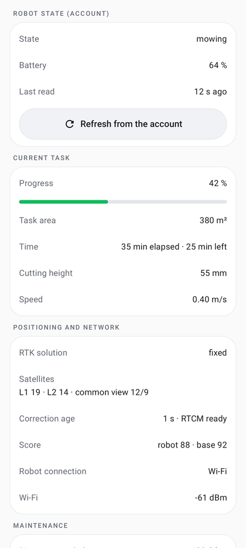

# Mammotion account (optional)

The Mammotion account lets the app read the map and the robot's status **without Bluetooth**, through the Mammotion
cloud. It is also used for the camera stream, the native return to base and firmware updates. Control and mowing
always go through Bluetooth (or the [gateway](gateway.md)).

| | |
|---|---|
| **Access** | Me → profile card (top) → **Mammotion account**; Home → **Read the map via the Mammotion account** (shown when no map and no account) |
| **Status** | Implemented; real cloud map (43 elements) read and displayed on the test phone. Native return and firmware update covered by JVM tests with a simulated cloud; not verified on the robot (see [Limitations](#limitations)) |
| **Code** | `auth/` (`AccountScreen.kt`, `AccountRobotPanel.kt`, `AccountRobot.kt`, `MammotionCloud.kt`, `CloudViewModel.kt`, `CloudRobotFilter.kt`, `CloudReadOnly.kt`, `CloudRobotActions.kt`, `FirmwareUpdateUi.kt`, `AccountStore.kt`, `SessionStore.kt`), `map/CloudStationDialog.kt` |
| **Tests** | `MammotionCloudTest`, `CloudViewModelTest`, `CloudRobotActionsTest`, `AccountRobotTest`, `AccountEncodingTest`, `SecureStoresTest`, `OAuthTest`, `AuthorizedRequestTest` (local fake server) |
| **Reference** | [Account inventory: what can be read and done](../MAMMOTION_ACCOUNT.md) |

  

## Signing in

The profile card at the top of **Me** shows the account e-mail (or "Mammotion account") and "Signed in · remote map
reading" or "Not signed in · sign in"; tapping it opens the **Mammotion account** page.

1. **Sign in** group: enter the **Email** and **Password** of the Mammotion account. Saved credentials are filled in
   automatically.
2. **Remember my credentials** (checked by default, "Encrypted on this phone (Android Keystore)"): the credentials
   and the session are encrypted on the phone with an Android Keystore key (AES-GCM), in two separate stores.
   Unchecked, previously saved credentials are erased.
3. **Sign in** (enabled once both fields are filled). A rejected sign-in shows "Mammotion: email or password rejected
   (code N)"; a missing network shows "network unavailable". An expired session is renewed with its refresh token;
   if the cloud refuses it (session revoked because the same account signed in elsewhere: another build of the app,
   such as the published one next to the Fold build, or the Mammotion app), the app signs in again by itself with the
   saved credentials and replays the request (camera, robot list, MQTT). Without saved credentials, after an explicit
   **Sign out**, or if the saved credentials are refused ("Mammotion: session expired and saved account refused, sign
   in again"), it asks to sign in again; a network failure during this sign-in keeps the session for a later attempt.
4. **Account robots** lists the account's mowers, recognized by their name (`Luba…`, `Yuka…`…) or their product key
   (other products are ignored and logged anonymously, see [supported models](supported-models.md#models)); devices
   none of which is recognized give "N devices in the account, none recognized as a Mammotion mower…", an empty
   account "No device in the account". The followed robot is the
   last one read, otherwise the first of the list. Tapping a robot (**Read the map**) reads its map through the cloud
   (an element that stops answering is asked again then left out, the message then gives how many were not read;
   4 min at most overall); **Open the map** shows the
   complete map on the Map tab; **Refresh the list** reloads the robots.
5. **Session** group: **Sign out** deletes the session (saved credentials are kept); **Forget saved credentials**
   erases the credentials and the session.

Once a complete map has been read, Me also shows an **Account map** row that opens it. On the Map tab it is the
**Mammotion account map** source ([map](map.md#loading-a-map)): viewing, preparation and simulation, no mowing.

## What the app reads

Groups of the account page, filled by the read (exact titles):

- **Robot state (account)**: **State** (Mammotion work mode, for example "returning to base", "standby"),
  **Battery** (with "· charging"), **Lock** when locked, battery heating, blade speed, **Last read** and the
  **Refresh from the account** button.
- **Current task** (only while a task is active): **Progress** with a bar, **Task area**, **Time** (elapsed and
  left), **Cutting height**, **Speed**.
- **Positioning and network**: **RTK solution**, satellites (L1, L2, common view), **Correction age** (with "RTCM
  ready"), robot and base scores, RTK base moved; **Robot connection** (Wi-Fi or 4G) and the Wi-Fi and 4G signals
  in dBm.
- **Maintenance**: **Distance traveled** (km), **Working time** (h), **Battery cycles**, **Blades** (hours used and
  the alert threshold set in the Mammotion app, with a wear bar, red once reached).
- **Software**: **Firmware**, update state ("up to date", **Update available**, or "in progress"), release notes,
  RTK base version and module versions (12 at most).
- **Latest mowings**: the 10 most recent account work reports (date, type such as "Single task", "Schedule",
  "On-demand mowing", "Resume", result, area, progress, duration). They are the Mammotion app's mowings, separate
  from the app's own [mowing history](mowing-history.md).
- **Map**: zones, no-go zones, passages and base, plus the robot's position.

The full read (history, firmware, then state through MQTT) starts when the page opens and with **Refresh from the
account**. A failed part ("History: …", "Firmware: …") is reported in a warning note; the other data stay displayed.

On Home and on the map, when the robot is not linked over Bluetooth (or the gateway) and the app is in the
foreground, the position, battery and charging contact are read again every 30 s; a position or battery not
received within 15 s keeps the last known one. The account position is for display only (source "API"): it is
never used for control or navigation, and its RTK quality is shown in the robot sheet.

The bottom of the page recalls what the account is used for and shows the **Account log** (last 15 lines, newest at
the top).

## Actions through the account

Only two actions, each behind an explicit confirmation:

- **Native return to base**: Map → **Charging station** without Bluetooth (account signed in) → dialog
  **Charging station**, "Native Mammotion return through the account". Check "I am supervising the robot and the way
  to the station is clear", then **Recharge (native Mammotion)**. The app connects to the robot through the account;
  if the robot stays silent for 15 s it is woken up ("Robot silent: wake-up requested through the account…"), then
  fails after 60 s more ("robot unreachable through the account (offline or in standby)"). Already charging: nothing
  is sent ("Already on the base: charging observed"); update in progress: refused; already returning: tracked only.
  Tracking: start expected within 45 s ("Native return not started by the robot"), 30 min at most, finished on the
  charging contact; an account connection drop is recovered (5 attempts) without sending the command again.
  **Stop the Mammotion return** appears while the return is requested or running and is always accepted; if the
  cloud refuses it, the message points to the Mammotion app or the robot's STOP button. See also
  [charging station through the account](station-and-moves.md#charging-station-through-the-account-without-bluetooth).
- **Firmware update**: Me → Mammotion account → **Software** → **Update to X**. The **Update the robot?** dialog
  shows the installed and new versions and the release notes; **Update** is enabled only after checking "The robot
  is stopped (ideally on its base), the battery is sufficient, and I will not use it during the update". Refused
  (reason shown under the button) when no account read has taken place ("Read the account first (Refresh from the
  account)"), when an update is already in progress, when no update is offered, when the robot is busy (mowing,
  returning, paused, corridor, updating), or while a native return is running. Progress is tracked live
  (**Progress**, **Stage**, **Started**); "do not use or move it until it is finished" is recalled. **Stop following**
  only stops the tracking: the update continues on the robot. An update started elsewhere (Mammotion app) can be
  tracked with **Follow progress**. Tracking ends on success, failure, no progress within 10 min of the request,
  30 min without news (the robot restarts to install) or after 2 h.

While one of these actions is tracked, the 30 s polling is suspended (a single MQTT connection).

The account also provides the token of the [live camera](camera.md) (Service → Robot → **Camera**).

## Local mode (without account)

Me → **Local mode (without Mammotion account)** (off by default, saved on the phone, code `auth/AccountMode.kt`).
DumbyLuba then works over Bluetooth and the [gateway](gateway.md) only:

- **no request to the Mammotion cloud**: `CloudViewModel` refuses sign-in, robot list, account reading and polling,
  camera token and commands, native return through the account and firmware update, with "Local mode: Mammotion
  account not used (Me tab)";
- **hidden entries**: profile card and **Account map** in Me, "Read the map via the Mammotion account" on Home,
  **Account map** on the empty map and in the Map sheet, **Camera** in Service, the live camera button and view;
- **obstacle photo** treated as disabled: after the back-off the robot does not wait, the encounter is notified "local
  mode, no photo" ([obstacles](obstacles.md));
- turning it on while signed in deletes the session (saved credentials are kept, so turning it off then **Sign in**
  is enough); refused while a native return or a firmware update is followed.

Unchanged: map read over Bluetooth and its cache, planning, simulation, mowing, return to base over Bluetooth,
maintenance (blade, mileage and battery counters read over Bluetooth), alerts, weather, logs. Unavailable: camera and
obstacle photo, firmware update, Mammotion mowing history, remote reading and native return without Bluetooth.

Whatever the mode, before the robot link the account map is shown only once it has content: an empty account map no
longer hides the cached Bluetooth map and the last known position.

## "Read-only" safeguard

`CloudReadOnly` filters every message sent through the cloud. It only accepts synchronization, map reading, the
exact report subscriptions, the camera commands (video switch, encoder restart), cancelling the return and, on
explicit choice in **Charging station**, the return to base. Anything else is refused with "Cloud command forbidden:
map reading, telemetry, camera and native return to base only". **Starting, pausing, resuming or delegating mowing to
the Mammotion planner is refused**: this is a project rule.

## Data and network

- HTTPS requests to `*.mammotion.com` only: `id.mammotion.com` (OAuth2), IoT domain read from the token,
  `domestic.mammotion.com` (history, firmware, wake-up, video token), MQTT over TLS on port 8883.
- The app reuses PyMammotion's public client constants; it contains no secret of its own.
- The account log (last 15 lines) is visible at the bottom of the screen; account events also go to the app log.

## Limitations

- Not verified on the robot: actual rate of update progress reports, native return from standby.
- The cloud API is not public and may change without notice.
- No cloud STOP of a native Mammotion task other than cancelling the return.
