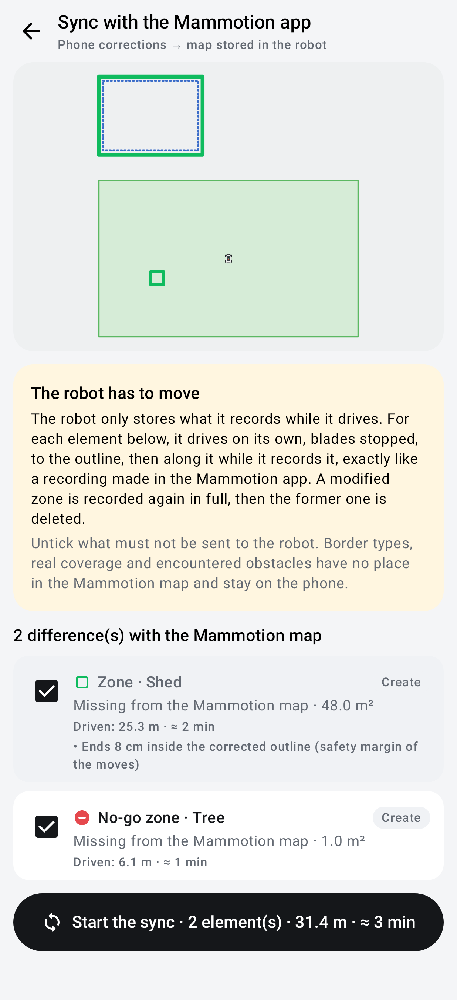

# Sync with the Mammotion app

Writes the local map corrections into the Mammotion map stored in the robot, so that the robot and the official app
know them too: DumbyLuba zones, passages and no-go zones are created there, Mammotion zones and no-go zones corrected
on the phone are replaced by their corrected outline.

| | |
|---|---|
| **Access** | Map → **Map** sheet → *Local corrections* → **Sync with the Mammotion app** (with at least one active correction) |
| **Status** | Implemented and checked end to end on the simulated robot of the test bench (real `RobotBle`, BLE frames, moves, map reading); **not yet tried on the robot** (first real recording to supervise, blades stopped) |
| **Models** | LUBA 2 AWD (`Luba-VS…`, X series `Luba-VP…`) only; every other model is in read-only mode and its writes are refused |
| **Code** | `mapsync/MapSync.kt` (differences, outlines driven, recognition of the recorded element), `mapsync/MapSyncRunner.kt` (sequence, stop on failure), `mapsync/MapSyncPage.kt` (page), `ble/RobotBle.kt` (`MapSyncLink`, outline drive in recording mode), `protocol/Commands.kt` (`startMapRecording`, `endMapRecording`, `cancelMapRecording`, `deleteMapElement`), `simulation/PointPlanner.kt` (`tracePlan`) |
| **Tests** | `MapSyncTest`, `MapSyncRunnerTest`, `MapSyncPageTest`, `ReadOnlyPolicyTest`, end to end `ble/MapSyncBenchTest` (robot `ble/SimRobot`) |

## Why the robot has to move

The robot only stores what it records itself while it is driven: the Mammotion app starts a recording, the user drives
the outline, the app ends the recording and the robot saves the element. There is no command to send a boundary as a
list of points to a LUBA 2 (the shapes typed in by coordinates of the official app, `ManualElementMessage`, are only
offered to other models), and the official **Redraw Section** edit is also done by driving.

The sync therefore does what a user would do in the Mammotion app, but the robot drives on its own: blades stopped, it
goes to the outline, the recording is started, it drives the outline with the usual route tracking, the recording is
ended. Nothing is simulated: the robot records its own RTK positions.

## The page

1. **Map**: the Mammotion map as stored in the robot, the outlines to create (green) and to replace (orange, over the
   former outline dashed). A tap on an element of the list shows the path the robot centre will follow (blue dotted).
2. **The robot has to move**: what is going to happen, shown before anything starts.
3. **Differences**: one line per element, ticked by default. Untick what must not be sent to the robot (a zone you
   want to keep on the phone only, for example). Each line gives the action (**Create**, **Replace**), the area or
   length, the distance driven and the time it takes at the route speed; an element that cannot be driven is greyed
   out with its reason.
4. **Start the sync** (number of elements, metres, minutes), then a confirmation: the robot will move on its own,
   stay next to it with STOP within reach, back up the map in the Mammotion app first.

During the sync, the page shows the phase (move to the outline, start of the recording, outline driven, saving,
checking, deletion of the former element), the share of the outline recorded, the trail recorded live in red on the
map, the robot, the state of each element and a **STOP** button. At the end: elements now in the Mammotion map, those
not done and why, **Back to the differences**.

## What is sent, and how

| Difference on the phone | In the robot |
|---|---|
| DumbyLuba zone | new zone recorded by driving its outline |
| DumbyLuba passage | new passage recorded by driving its axis |
| No-go zone drawn, laid shape or obstacle | new no-go zone recorded by driving around it |
| Mammotion zone or no-go zone corrected (points, edge, shape, offset, driven enlargement) | corrected outline recorded as a new element, **then** the former one deleted |
| Border types, real coverage, encountered obstacles, difficulties, signal surveys, relief | nothing: the Mammotion map has no place for them, they stay on the phone |

Order: zones first (a passage or a no-go zone needs them), then passages, then no-go zones. Disabled corrections, and
corrections that do not apply to the current map, are not sent.

**Outline driven by the robot centre.** A Mammotion boundary describes the outer side of the chassis
([recorded boundaries](map.md)): to record a zone, the robot centre drives half a chassis width inside the wanted outline,
plus 15 cm; to record a no-go zone, it drives around it as far outside. The 15 cm keep the robot centre 10 cm beyond the
safe surface of the moves (half a width + 5 cm), enough for the tracking deviation and the RTK noise: with 8 cm, the
end-to-end bench stopped the drive after a pivot. The recorded zone therefore ends about 15 cm inside the corrected
outline (a no-go zone about 15 cm larger), never the other way round. Corners are rounded to the chassis pivot radius
(43 cm), like the mowing border laps: the robot turns while it drives instead of pivoting in a corner, where its
envelope would leave the safe surface. A passage is driven along its axis. The outline must be drivable with the
checks of a move to a point (safe surface, LUBA 2 footprint, pivots) and keep out of the safety zone of the charging
station (plus 15 cm; 0.7 m when the base axis is unknown); otherwise the element is not offered and its reason is
shown (record it with the Mammotion app). While recording, the forward speed is capped at about 0.19 m/s (180 units):
closer tracking on tight curves, evenly spaced points.

**Sequence for one element.**

1. The robot map is read again (fresh state, the differences are computed on it).
2. Move near the start of the outline, blades stopped, by the usual move to a point: 40 cm (then 25 cm) inside a zone
   or outside a no-go zone, so that the move never ends facing the boundary; the start of a loop is chosen where the
   robot is.
3. Join onto the outline in a straight line, still without recording: among the points of the loop (every 25 cm,
   nearest first), the first whose join and following turn pass the footprint checks. The robot reaches the outline
   at a shallow angle instead of facing the boundary (facing a no-go zone 34 cm away, its nose would enter it).
   The robot first faces the join point in place, then drives the line straight: the tracking otherwise turns while
   moving below 25° of misalignment, and that arc took the chassis towards the element the line ends next to (join
   refused by the envelope check on 8 draws of the noise out of 40 on the simulated robot).
4. Every move waits for the robot to be READY again (state 11, after it leaves the manual mode of the previous one), or
   charging on its base (states 15 and 39: the first move leaves the station in a straight line, as a move to a point).
   Recording started (`todev_get_commondata` action 0, type 0 zone / 1 no-go zone / 2 passage); the robot must enter
   its recording state within 10 s (31, 32 or 34, APK `DeviceWorkState`).
5. The outline is driven exactly from the join point, in recording mode: the manual mode is never sent (it would end the recording), and
   no recovery, bypass or replanning is done (it would draw a detour into the element): a contact, a deviation or a
   robot state that changes stops the drive. The robot first faces the first edge of the outline in place: the join
   leaves it up to 25° off, and the arc that corrected it while driving took the chassis about 15 cm towards the
   element (footprint check, outline abandoned). A pivot on the spot adds no recorded point.
   The heading gap measured by the previous drive (move to the outline, then join) is kept when it was measured over
   at least 40 cm of straight line and the robot has not moved since (published position within 30 cm, published
   heading within 5°, less than a minute): each drive used to confirm its heading again over its first 15 cm of
   straight line, that is over the short link before the outline, where 1 cm of RTK noise can put it 10° off; the
   robot then drove the outline that much askew and drifted towards the element. After that first confirmation the
   gap is also measured again over the whole straight line as long as the robot keeps driving straight (up to 1 m),
   instead of being refined 15 cm at a time (every tracking by the phone or the Redmi gateway; the heading kept from one
drive to the next only for the drives of the sync tracked by the phone).
6. Recording ended (action 1); the robot must leave its recording state within 20 s.
7. The robot map is read again; the new element is recognised by a new identifier of the same type overlapping the
   wanted outline by at least 50 % (passage: axis within 1 m on average). If it is missing, the mapping is saved
   explicitly (APK `saveTask`, `todev_save_task = 1`, Bluetooth only) and the map read once more: the APK has this
   command and it is not known whether the LUBA 2 needs it after a recording.
8. Replacement: the former element is deleted (action 6 with its identifier) and the map read again. If the robot also
   removed other elements with it (a no-go zone attached to the zone), they are recorded again from their former
   outline, at the end of the queue.
9. The corrections the robot now holds are removed from the phone.

**Stop and failures.** STOP, or any failure, stops the robot, abandons a recording in progress (action 7: nothing is
saved) and ends the sync; the elements already done stay in the robot and disappear from the list. The former element
of a replacement is only deleted once the new one is found in the robot map: a failed recording never loses a zone.
If the new element is recorded but the former one cannot be deleted, the page says so (delete it in the Mammotion
app); the corrections are then kept.

**Before starting**, the robot must be a LUBA 2 connected over Bluetooth or through the gateway, its map read, no other
activity running, battery above 40 %. Writing to the map only goes through the robot link, never through the cloud.

## Consequences in the Mammotion app

- A replaced zone gets a **new identifier**: the Mammotion schedules of this zone must be set again. The phone data
  attached to the former identifier (saved start point, validated borders, border types of that zone) no longer apply.
- Nothing written to the robot can be undone from DumbyLuba: back up the map in the Mammotion app first.

## Safety

- Only the LUBA 2 (`Luba-VS…`, X series `Luba-VP…`) can write: the read-only barrier now refuses the map writing commands (recording,
  erasing, deletion: `todev_get_commondata` with `subCmd` 0) to every other model, and the cloud filter refuses them to
  every model.
- Blades are always stopped; the moves keep the checks of a move to a point (fresh position, footprint, battery,
  bumper, robot state), except the manual mode, replaced by the check of the recording state.
- The behaviour of the firmware when it is driven by the app in recording mode is the one of the Mammotion app
  (same motion commands) but has **not been observed yet** on this robot: the first sync must be supervised closely,
  starting with a small no-go zone in the open.

## What is verified, what is not

**Verified against the APK and PyMammotion** (catalogue of the decompiled APK 2.3.8, PyMammotion `navigation.py`): the
recording commands (`startDrawBorder` / `startDrawBarrier` / `startChannelLine` = action 0 type 0/1/2, `endDrawBorder(type)`
= action 1, `cancelCurrentRecord` = action 7, `deleteMapElements(type, hash)` = action 6, `saveTask` = `todev_save_task`),
all Bluetooth only in the APK; the recording states 31/32/34 (`DeviceWorkState`, read in `sys_status`); over Bluetooth the
official joystick sends `DrvMotionCtrl`, the motion command the tracking uses.

**Verified end to end on the test bench** (`MapSyncBenchTest`): the real `RobotBle` drives a simulated LUBA 2 that
serves its map over BLE, records its own positions only in its recording state, leaves it if it receives the manual
mode, saves on the end of the recording (or only after `saveTask`), cancels and deletes. Covered: a no-go zone created
(recorded shape overlapping the wanted one by more than 60 %), a corrected zone recorded again then the former one
deleted, with the no-go zone the robot removed with it recorded again (overlap above 85 %), an explicit save, STOP
while recording (recording cancelled, map and corrections unchanged), a robot pushed off its outline (recording
cancelled, nothing saved), an outline too close to the station refused, a sync started with the robot on its base. The manual mode and the blades are never sent
while the robot records.

**Success rate under the position noise** (`MapSyncSweepTest`, optional: `MAPSYNC_SWEEP=121-420`): the same no-go zone
over many draws of the simulated RTK and heading noise. Measured on 2026-10-25 over 300 draws: 1 outline abandoned
(0.3 %), against 35 (11.7 %) on 2026-10-24 and 53 (17.7 %) before the outline was faced in place; all safe aborts
(recording cancelled, nothing saved, corrections kept on the phone: start the sync again). The 35 were the footprint
and corridor checks of the outline drive: the heading, confirmed again over the 15 cm of the link before the outline,
was up to 10° off, the robot drove the outline askew and its actual chassis, on the simulator, entered the no-go zone
being recorded on 7 draws out of 60 (sometimes without the check stopping it). The heading kept from the previous
drive and measured over the whole straight line fixed it (no contact over 60 draws, `MapSyncBenchTest` checks the
actual chassis). The margins of the outline (15 cm, chords cutting up to 6 cm of it) are kept until the first real
tries say how the LUBA 2 tracks an outline.

**Not verified until a first real try**: that the LUBA 2 firmware accepts the motion commands of the app while it
records (the official app does the same over Bluetooth), the exact moment it saves the element, how it treats a new
zone overlapping the zone it replaces (it may refuse it: the former one is then kept and the page says so), and
whether deleting a zone also deletes its no-go zones (handled either way). Start with a small no-go zone in the open,
STOP within reach; every step and every robot reply is in the log (`map_sync_*`).

## Logs

`map_sync_start`, `map_sync_item`, `map_sync_approach_refused`, `map_sync_join_refused`, `map_sync_record_start`,
`nav_trace_mode`, `map_sync_record_end`, `map_sync_save`, `map_sync_save_sent`,
`map_sync_reply` (robot replies to the map commands), `map_sync_border_state`, `map_sync_recorded`, `map_sync_delete`,
`map_sync_lost`, `map_sync_record_cancel`, `map_sync_end`.
