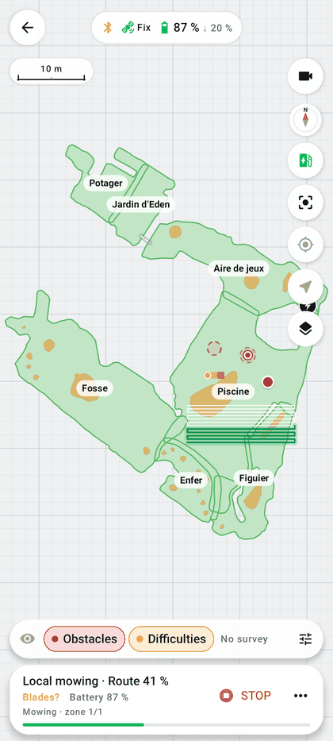

# Map

The map shows the robot's zones, its no-go zones, its passages and its base, the robot's live position, learned
obstacles and signal surveys. Every mowing, every route and every survey starts from here.

| | |
|---|---|
| **Access** | Home → **MY MAP** tile, robot photo or **Start mowing** (**Follow mowing** while a task runs); Me → account map |
| **Status** | Implemented: BLE and cloud reading, local cache, local corrections (0.60.0), DumbyLuba zones and passages recorded by driving (1.4.0) |
| **Code** | `map/MapScreen.kt`, `MapSettingsSheet.kt`, `MapLayerBar.kt`, `MapDisplay.kt`, `MapFx.kt`, `MapFollow.kt`, `MapCompass.kt`, `MapOverlayLayout.kt`, `MapCorrections.kt`, `MapCorrectionEditor.kt`, `MapCorrectionTools.kt`, `MapCorrectionStore.kt`, `DrivenRecording.kt`, `MapTransfer.kt`, `MapCache.kt`, `StationReader.kt`, `LastKnownPosition.kt`, `MapObstacles.kt`, `MapLive.kt`, `MapRobot.kt`, `simulation/BaseStore.kt` |
| **Reference** | [Map reading and test procedure](../MAP_PREVIEW_TEST.md) |

  
  
  
  

## Loading a map

**Map** button in the bottom bar, *Map source* group (the displayed source is marked "Shown"):

| Source | How | Use |
|---|---|---|
| **Read the robot map** | Bluetooth or gateway ("Reading…" while it runs); not possible during a mission, a Mammotion task, a test, a map read or a simulation | all features |
| **Mammotion account map** | cloud, no Bluetooth ([account](mammotion-account.md)); not possible during a simulation | "Viewing and simulation, no mowing" |
| **Try the demo** / **Back to the real map** | built-in fictional map | explore the app without a robot |

The active source is shown at the top of the **Map** sheet and in the status sheet: "Robot Bluetooth map",
"Mammotion account map · read only", "Demo map" or "Local simulation · no real movement". The demo map is also
flagged by a "Demo map" note above the bottom bar.

Complete maps are cached on the phone (one per geometry, atomic write) and reloaded at startup. Reading is bounded
(4096 frames, 100,000 points, 1024 shapes) to reject an abnormal map.

**Automatic reading** (1.1.1): when the connected robot (Bluetooth or gateway) has no known map (new installation,
cleared cache, robot never read), its map is read over BLE by itself as soon as telemetry is received, once per
connection. It is skipped silently while a route, a mission, manual control or a test is running; **Read the robot
map** stays available. The account map is only shown without a robot link, so it cannot fill this gap.

**No map on this phone** (1.1.2): an empty map shows a panel above the action bar with **Read via the gateway**
(pilot connected through the [gateway](gateway.md): the gateway reads the map over Bluetooth and relays it) or
**Read the robot map** (direct Bluetooth), and **Account map**. While reading, the panel shows the progress
("BLE map · n/N items"); the button is disabled when the robot is not linked or busy (route, mission, manual
control, test, simulation). The home screen offers the same reading under the **MY MAP** card.

## Screen

- **Header**: **Back** and a status pill — link (Bluetooth icon, or a router when the robot is connected through the
  [gateway](gateway.md); orange if telemetry is pending, struck through when offline), positioning (Fix, Float,
  Single), battery with the threshold that applies ("↓ 20 %" / "↑ 90 %", see
  [real mowing](real-mowing.md#threshold-shown-next-to-the-battery)) and **weather** (Dry, Monitoring, Rain ≈ N min…).
  Tapping the weather opens **Garden weather** ([rain and weather](rain-and-weather.md)); tapping elsewhere opens the
  **Device status** sheet ([below](#device-status-sheet)).
- **Scale** (top left): a round length (50 cm to 200 m) recomputed on zoom.
- **Camera** button (top right): live view of the robot camera in a movable, resizable window
  ([camera](camera.md#live-view-on-the-map-and-in-manual-control-reconnection)).
- **Map background**: metric grid tied to the map (one line per meter, a stronger one every 5 m; the spacing widens
  when zooming out to keep lines at least 14 dp apart), a fixed dot pattern, or a plain background.
- **Zone names**: a pill readable at any rotation; below the order number when the zone is selected; omitted when
  the zone is too small on screen.
- **Side bar**:
  - compass (follows the map rotation; a tap puts north back at the top);
  - **Charging station** ([station and moves](station-and-moves.md)); enabled once the base is known, or through the
    Mammotion account without Bluetooth;
  - **Recenter the map** (also stops following the robot);
  - **Follow the robot** / **Stop following the robot** ([below](#following-the-robot));
  - **Move to a point** ([station and moves](station-and-moves.md#move-to-a-point)), inside the zones or beyond them;
    enabled with a connected, idle robot and a complete map;
  - **Show the signal layers** / **Hide the layers**: shows or collapses the layer bar and the heatmap (green when a
    heatmap is shown).
  - always visible: the bottom panels (protection alert, layer bar, mowing resume, zone selection, action bar…)
    keep the full width below the bar; a panel that rises up to it is narrowed to its left, never covering its
    buttons or the camera button. With an incident panel (robot stuck, task interrupted), the layer bar and the
    stopped-mowing bar are hidden (0.62.0).
- **Heatmap layers**: a compact bar above the actions, with the eye (show / hide), one button per measured layer
  (**Wi-Fi**, **RTK**, **BLE**, **Mobile**, **Satellites**, **Slope** and **Terrain** if the terrain can be computed)
  and the settings icon (legend, shading, history). Tapping the displayed layer hides it. The choice (layer, heatmap
  hidden, bar collapsed, terrain shading) is kept until the next change, including after leaving the map or
  restarting the app (0.45.2). The survey shown is the continuous map (automatic survey during moves), including on
  the Mammotion account map or a re-read map as long as it is in the same frame; a survey chosen from the history
  (**Show on map**) replaces it, with its date and a cross to return to the continuous map. A simulated survey is
  flagged "Simulated". Without a survey, the bar shows "No survey" and its icon opens the heatmap history
  ([signal surveys](signal-surveys-and-terrain.md)). At the head of the bar, two toggles independent of the signal:
  **Obstacles** (bumper contacts with a photo, presumed obstacles; tapping a contact opens its card, where you pick
  the exclusion size before saving the obstacle; tapping a saved obstacle opens its exclusion size, which can be
  edited, or deletes it) and **Difficulties** (heatmap of blockages, wheel slips, lifts…), kept between launches
  ([encountered obstacles and difficulties](obstacles.md#encountered-obstacles-and-difficulties)).
- **Bottom bar** (compact): **Mow** (or **Follow** during a Mammotion task), **Manual** (Bluetooth only), **History**
  (latest completed tasks; a tap opens the details and the replay of the actual route, see
  [task history](mowing-history.md#replay-of-the-actual-route)), **Map** (**Map** sheet: background, displayed items,
  heatmap, local corrections, source and legend). **Mow** reopens the already computed preview if there is one,
  otherwise the zone selection. The link status is in the top pill; only a Mammotion task in progress or the demo
  are shown above the bar. When idle, the [global STOP bar](interface.md#global-stop-bar) is hidden on the map. The
  bottom bar is replaced by the mowing bar during a route and by the simulation bar during a simulation.
- **Gestures**: zoom, rotate and pan with two fingers (one finger pans); a tap selects a zone during the zone choice,
  otherwise opens an obstacle or contact card.

### Following the robot

**Follow the robot** (side bar, enabled when a robot position is shown, not on the demo) keeps the view centered on
the robot, between the header and the bottom panels, at the zoom and rotation chosen by the user; the robot is glided
between two readings. The button turns green. A second tap, **Recenter the map** or a one-finger drag stops following
(the view stays where it is). The choice survives a screen rotation or a Fold fold/unfold.

### Device status sheet

Opened by tapping the status pill (outside the weather segment). It recalls the context (map source, or "Local mowing
· n/total" during a route) and groups:

| Group | Contents |
|---|---|
| *Connection* | **Bluetooth** state, **Bluetooth signal** (dBm), **Last telemetry** ("never received"), **Manage the connection** (opens the robot connection page) |
| *Positioning and battery* | **Positioning** (Fix in green, otherwise orange), **Last RTK state**, **Battery**, **Displayed position** (source · "recent" or "last known"); note "Accurate RTK position: automatic mowing is possible." or "Only a Fix positioning allows accurate automatic mowing." |
| *Last known position* | **Robot**, **Communication**, **Fix position** ("none saved"); "Local save failed: position kept in memory" on a storage error |
| *Technical details* | **Robot state (code)**, **RTK state / quality**, **Position type**, **Local position** (x / y in meters) |

## Map sheet

The **Map** button in the bottom bar opens a sheet grouping all map-specific settings (0.56.0). It opens at half
height: each setting applies immediately on the map still visible above, and is kept between launches. At the top,
the displayed source and the map contents ("7 zones · 26 no-go zones").

| Group | Contents |
|---|---|
| *Map background* | three illustrated tiles: **Grid** (default, "Metric grid tied to the map: one line per meter, stronger every 5 m"), **Dots** ("Discreet pattern, fixed on screen"), **Plain** ("Neutral background, no grid") |
| *On the map* | switches **Zone names** (on by default), **Scale** (on), **Planned route animation** (comet running along the route in mowing order, on), **Encountered obstacles**, **Difficulties** (same toggles as the layer bar) |
| *Signal heatmap* | **Show the heatmap** (**Show the simulated heatmap** during a simulated survey) and chips for the measured layers (Wi-Fi, RTK, BLE…), or "No signal survey on this map: open the history to show one."; **Layer bar** (shown or collapsed, like the **Layers** button), **Heatmap history**, **Flat-ground reference** (tilt and orientation of the gateway phone, for the terrain) |
| *Local corrections* | **Correct the map**: number of active corrections ("2 active"); opens the editor ([below](#correcting-the-map-local-corrections)). **Record by driving**: opens the dedicated page (map following the robot, camera, joysticks) to record a DumbyLuba zone, passage or no-go zone ([below](#mammotion-zones-and-dumbyluba-zones)) |
| *Map source* | **Read the robot map**, **Mammotion account map**, **Try the demo** ([above](#loading-a-map)) |
| *Legend* | symbols drawn as on the map, by family: *Garden*, *Routes*, *Obstacles*, *Robot* |

### Reading the map

| Item | Rendering |
|---|---|
| Mowing zone | pale green fill with a green outline (inspired by the Mammotion app); slightly stronger when selected, black badge = mowing order |
| DumbyLuba zone | same fill, **dashed** green outline and "· DL" after its name: recorded by driving, exists only on this phone ([below](#mammotion-zones-and-dumbyluba-zones)) |
| Beyond the Mammotion boundaries | **orange hatching** with a thin orange outline: mowing surface added on the phone (DumbyLuba zones, enlargements) |
| No-go zone | ochre fill, thin darker outline |
| Map obstacle | grey, outlined |
| Vision zone (LUBA 2 AWD X) | drawn like a map obstacle: rectangle of type 25/26 recorded by the robot's vision, avoided by moves; mowing computation refused on such a map ([details](supported-models.md#map-of-a-luba-2-awd-x-vision-zones-version-1121)) |
| Passage | grey stripe dotted with white (path never mowed); **green** stripe for a DumbyLuba passage |
| Passes to mow | white lines, translucent white band at the cutting width |
| Borders to mow | white lines on a lighter band at the cutting width: the margin kept along the boundaries and around no-go zones reads as a light edging |
| Charging station | to-scale drawing and docking corridor; round badge with a lightning bolt when the station is smaller than 20 dp on screen |
| Base safety zone | grey disc edged in white: the disc the planner excludes from every route (entry and exit through the front corridor only), shown once the docking axis is known |
| Already mowed | dark green stripes at the cutting width and the robot's green trail |
| Move with blades stopped | blue dots on a light edging: returns, links, manual accesses, move to a point (blue target) |
| Move beyond the mapped zones | orange dots on a white edging over the route: section of a [move to a point](station-and-moves.md#beyond-the-mapped-zones) outside the zones, without border check |
| Start and resume | purple "Start" marker (first cutting point) or "Resume" marker ([resume further on](mowing-resume.md#resume)) |
| Saved obstacle | orange disc circled in white, margin as a fill, turning envelope dotted |
| Presumed obstacle | dotted red circle on a light fill |
| Bumper contact | red badge circled in white, white dot if a photo exists |
| Difficulties | 1 m cells from yellow (rare) to red (frequent) |
| Locally corrected | pencil ✎ after the name of a corrected Mammotion zone; in the editor, original Mammotion outline in grey dots |
| Robot | LUBA silhouette oriented along its heading (kept readable when zoomed out): pulsing green waves for a fresh position ("Live position"), grey ring for the last FIX ("Last known position") |

Lines, dots and badges keep the same thickness on screen at any zoom (before 0.56.0 they grew with it for obstacles
and difficulties).

## Correcting the map (local corrections)

**Map** sheet → **Correct the map** (0.60.0). Fixes defects in the Mammotion map **without modifying it**: the
corrections form a layer saved on the phone, never sent to the robot nor written to the map cache. The map displayed
and used everywhere (preview, planning, simulation, local mowing, moves, no-go checks while driving) is recomputed
as follows: Mammotion map → active corrections, in order → corrected map. Native mowing and the official Mammotion
docking keep the original map.

The entry is available on a complete Mammotion map, outside the demo, with no simulation, local route or Mammotion
task in progress. The editor opens full screen ("Local correction · the Mammotion map is not modified"); with no shape
selected it shows "Tap a zone or a no-go zone to correct" and the buttons **Drawn no-go**, **Shape no-go**,
**Obstacle** and **Corrections (n)**. One finger moves the map, two fingers zoom and rotate.

| Action | Gesture |
|---|---|
| Pick a shape | tap a zone or a no-go (the no-go takes precedence over the zone containing it); tools **Points**, **Edge**, **Shape**, **Offset** |
| **Points** | drag a handle; "+" between two points inserts one (dragging the "+" inserts and moves it); tap a point then **Delete this point** (at least 3 points kept). On a dense Mammotion outline (one point every 50 cm), only spaced-out handles are shown: zoom in to see them all |
| **Edge** | tap the outline at the start of the edge, the points of the new edge, then the outline at the end: the shorter part of the outline between the two is replaced (**Side: short** / **Side: other** switches to the other part; **Previous point** removes the last point). Two points are enough for a straight edge along a fence. **Apply this edge**, then more edges or points, then **Validate** |
| **Shape** | **Add** or **Remove** a **Square**, a **Round** or a **Triangle**: drag the shape to move it, the white square to resize it, the top circle to rotate it; dimensions shown in meters (0.1 to 100 m per side) |
| **Offset** | the whole outline from −1 m to +1 m in 5 cm steps ("outwards" when positive, "inwards" when negative); on a no-go, it is a margin |
| **Drawn no-go** / **Shape no-go** | new no-go zone: points tapped one by one (at least 3, movable, "+" between two), or a simple shape |
| **Obstacle** | a circle placed with a tap, radius 0.1 to 2 m in 5 cm steps, type (**Swing leg**, **Tree**, **Pole**, **Hole**, **Low branch**, **Other**) used as its name; it is a no-go: mowing goes around it with a border pass |
| ↶ / **Discard** / **Validate** | undoes the last gesture / leaves the edit without keeping anything / saves a correction ("Correction saved: …") |
| 👁 (hold) | shows the original Mammotion map, for comparison ("Hold to see the original") |
| ☰ **Corrections** | list, newest first, with date and status: switch (disable without deleting), **Show**, **Edit** (shapes, offsets, added no-gos), **Delete** with **Undo** in the message, **Restore everything** (after confirmation) |

While editing, the area added compared to the Mammotion map is hatched in green, the area removed in red, and the
balance is shown ("Area: 412.0 m² → 418.3 m²"). **Enlarging a zone is allowed**: the part outside the Mammotion
outline is flagged ("Including 4.2 m² outside the Mammotion boundary: mowed under your responsibility") without being
blocked. A Mammotion no-go stays on the map: it can be modified but not deleted (at least 0.05 m²; a zone keeps at
least 0.5 m²). A correction that would split a shape into several pieces, make it disappear, cross its own outline or
cut a hole in a zone ("The correction would make a hole: create a no-go zone instead") is rejected with its reason.
A no-go passing less than 1 m from the station is flagged when saving ("warning: no-go zone less than 1 m from the
station"). Changing tools during an edit is refused ("Validate or discard the current edit before changing tools").

**Independent corrections.** An outline edit (points, edge, shape) is saved as a geometric difference (area added,
area removed), not as point indices: each one can be undone on its own, even an old one, without touching the later
ones, and still applies if the zone is re-saved on the Mammotion side (status "Mammotion boundary changed since: check
it"). A correction whose shape no longer exists on the map stays inactive ("Shape not found on this map"); an invalid
result is ignored ("Invalid result: correction ignored"). Deleting an added no-go also deletes its edits.

**What follows the correction.** Shapes keep their Mammotion identifier (saved starting point, validated borders);
an edited border goes back to "to be revalidated". The base, manual accesses and the heatmap stay attached to the
Mammotion map. A mowing resume saved before a correction is no longer possible (map changed). Corrections also apply
to the Mammotion account map (shapes targeted by their identifier), not to the demo nor to an already prepared
simulation. Saving is refused during a local route ("Corrections: stop the current route first").

File: `map-corrections.json` (app folder, versioned format, atomic write, at most 500 corrections; types `patch`,
`offset`, `nogo`, and since 1.4.0 `zone` and `passage`, which an older version ignores).

## Mammotion zones and DumbyLuba zones

The app works on **a single map**: the Mammotion map read from the robot, completed by the local corrections. Since
1.4.0, these corrections can also add **DumbyLuba zones** and **DumbyLuba passages**, recorded by driving the robot like
in the Mammotion app ([recording by driving](manual-control.md#recording-a-zone-a-passage-or-a-no-go-zone-by-driving)).

| | Mammotion zone or passage | DumbyLuba zone or passage |
|---|---|---|
| Recorded by | the Mammotion app, in the robot | DumbyLuba, on this phone only (`map-corrections.json`) |
| Seen by the robot and the Mammotion app | yes | **no** |
| Zone choice, route preview, simulation, local mowing, resume, borders, start point | yes | **yes, the same way** |
| Moves (return to base, move to a point, links between zones, surveys) | yes, through the zones and passages | **yes, the same way**: a DumbyLuba passage connects zones like a Mammotion one |
| On the map | solid outline, grey passage | **dashed** outline, "· DL" after the name, **green** passage |
| Edited, disabled, deleted | outline corrections only ([above](#correcting-the-map-local-corrections)) | tap it in the editor to edit its outline; disabled or deleted in ☰ **Corrections** like any correction (deleting it also deletes its edits) |

**Surface beyond the Mammotion boundaries.** Everything the corrections add outside the zones recorded by Mammotion
(DumbyLuba zones, enlargements) is **hatched in orange** on every map, and recalled in the result of a recording and in
the task settings ("Includes 34.0 m² beyond the Mammotion boundaries…"). The robot does not know this surface: only
DumbyLuba's checks (safe surface, chassis footprint, no-go zones, tracking) keep the robot inside it, and it is mowed
under your responsibility. A Mammotion task started from the official app ignores it. The docking stays the official
one, from the approach point in front of the base, which remains on the Mammotion map. That the firmware accepts
motion and blades in a zone entirely outside its map still has to be checked on each robot (blades stopped first).

Corrections are not tied to a robot: a DumbyLuba zone applies to any complete map in the same frame. They are reapplied
after a new reading of the Mammotion map; a zone re-recorded on the Mammotion side that now overlaps a DumbyLuba zone
is not cut automatically (disable or edit the DumbyLuba zone).

## Base and manual accesses

- The base position comes from the robot's station message, or from the position and heading observed while
  charging. It is stored per map geometry; no station on the robot is modified. While charging, only a position
  received after charging started counts, and the base is only moved beyond 5 cm or 5°: RTK noise no longer changes
  the map at every report (prepared route or resume rejected, preview recomputed). There is no manual placement or
  rotation of the base (removed); on the demo map, a fictional base is used.
- **Manual access**: a polyline (assumed clear width 0.8 m) that connects a base outside the zones or separate zones
  when the map has no passage. A manual access never removes a no-go zone. *Obsolete:* the button to draw or clear a
  manual access was removed from the map options; accesses drawn with an older version stay saved per map geometry
  and are still used by the planner and drawn on the map. Links otherwise rely on the passages recorded by the robot.
- Passages imported from the robot are drawn as a grey stripe dotted with white; they are never mowed.
- **Base safety zone** (0.64.0): a grey disc around the station, with the radius actually excluded from routes
  (approach distance minus the pivot guard, ≈ 1.05 m for a 1.5 m approach). No route enters it, except the front
  corridor base ↔ approach point. Shown only when the docking axis is known (otherwise the planner does not set it).
- Manual accesses are drawn like moves with blades stopped (blue dots).

## Finding an offline robot

- The map keeps the **last reliable RTK FIX position** (received less than 5 s earlier), its heading, the time of the
  position, the last communication, and the last known battery and state.
- The trail covers the 5 minutes before that point (one point per second) and stays frozen during an outage.
- A degraded or old position never overwrites the last FIX. Without Bluetooth, the account position is shown with a
  note on its accuracy.
- Coordinates are in the robot's local frame, not latitude/longitude; the saved data survives closing the app, not
  clearing its data.

## During a mission

- **Mowing bar** at the bottom of the map: progress, blades, height, battery, duration, recharges, STOP and "⋯"
  details ([real mowing](real-mowing.md#mowing-bar)); the **Travel speed** slider (10 to 100 %) is in the details,
  adjustable live and kept from one route to the next.
- **Mowing interrupted · X %** panel ([resume](mowing-resume.md)) and **Move to a point interrupted** panel
  ([station and moves](station-and-moves.md#move-to-a-point)).
- Robot blocked: a single panel replaces the resume panel, titled **Robot locked after STOP** (button **Unlock**),
  **Robot stuck against an obstacle** (button **Clear**: 30 cm straight back-off, blades stopped, then wait for the
  lock to clear) or **Robot protection active**; it recalls the interrupted task ("… at 42 % · resume possible once
  the robot is cleared"), offers **Discard** and **Details** ([safety](safety.md#robot-locked-after-stop)). Outside the
  working hours set in the Mammotion app (self-check 23), a dismissible note replaces it: nothing to unlock
  ([safety](safety.md#mammotion-app-working-hours-self-check-23)).
- Robot silhouette centered on its **center of rotation**: the LUBA 2 publishes a point 8 cm behind that center.
  Drawn on that point (before 0.48.1), it turned during a pivot around a point in front of it, with the rear
  appearing to skid. A pivot on the spot is now motionless, on the full-screen map as on the reduced maps; the trail
  followed live by the gateway uses the same center.
- During a [simulation](simulation.md), the real robot stays visible next to the simulated silhouette, and the
  bottom bar shows the simulation progress.
