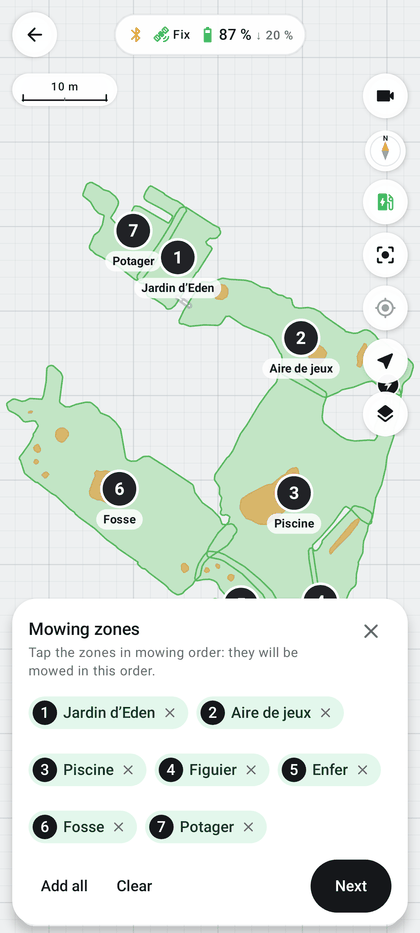
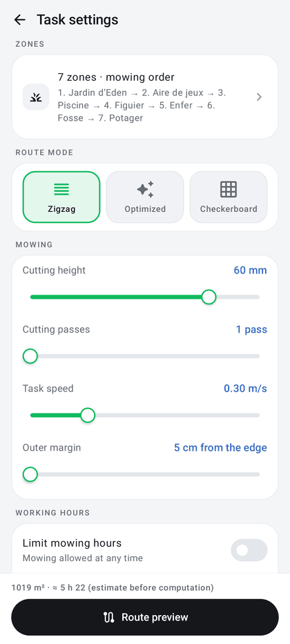
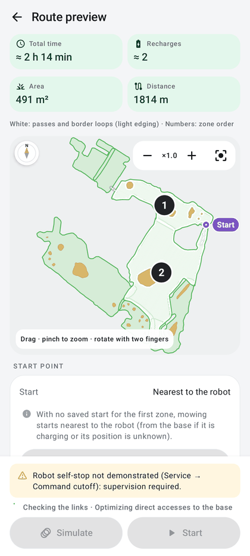
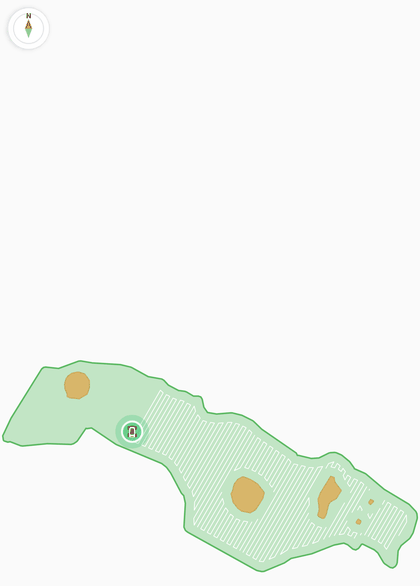

# Preparing a mowing run: local planning

The route is computed **on the phone**, not by the robot. A single coverage engine produces passes (zigzag,
checkerboard…), border laps and links, all checked against the LUBA 2 AWD footprint. The same route is used for
simulation, real mowing and signal surveys.

| | |
|---|---|
| **Access** | Map → **Mow** (reopens the already computed preview if there is one); Home → **Start mowing** |
| **Status** | Implemented; validated in JVM tests on a real reference map (7 zones) and on the test phone |
| **Code** | `planning/` (`RoutePlanning.kt`, `AutomaticPlanner.kt`, `CoverageEngine.kt`), `map/CoveragePlanner.kt`, `MixedSweep.kt`, `MultiZonePlanner.kt`, `TrajectoryEnvelope.kt`, `MowingPreview.kt`, `StartPointGroup.kt`, `MowingTaskSettings.kt`, `OuterOffsetSetting.kt`, `CutPasses.kt`, `planning/ZoneStart.kt`, `map/MapScreen.kt` (task pages) |
| **References** | [Architecture](../path-planning/ARCHITECTURE.md) · [Algorithms](../path-planning/ALGORITHMS.md) · [Parameters](../path-planning/PARAMETERS.md) · [Single engine](../path-planning/ENGINE.md#one-engine-one-prepared-route) · [Continuous mowing](../path-planning/ENGINE.md#continuous-mowing) · [Nearest start](../path-planning/ENGINE.md#nearest-start) |

  
  
  
  

## Three-step flow

### 1. Mowing zones

The **Mowing zones** panel opens over the map (the map stays visible): "Tap the zones in mowing order: they will be
mowed in this order."

- Tap the zones **in mowing order**: they will be mowed in that order, each zone finished before the next.
  Numbered badges show the order on the map and in chips under the title; tapping a zone again, or a chip, removes
  it.
- **Add all**, **Clear**, then **Next**. A complete map is required ("Load a complete map first (Map button).").
- The cross closes the zone choice. **Mow** reopens the route preview already computed, if any, instead of the zone
  choice.
- [DumbyLuba zones](map.md#mammotion-zones-and-dumbyluba-zones) (recorded by driving, kept on the phone) are chosen and
  mowed like the Mammotion zones; their chip and their name carry the **DL** mark ("3. Verger · DL").

### 2. Task settings

The **Task settings** page starts with the **Zones** group ("3 zones · mowing order", with the order "1. Aire de
jeux → 2. Piscine…"; a tap goes back to the zone choice on the map). When the chosen zones go beyond the Mammotion
boundaries (DumbyLuba zones, enlargements), an orange note gives the area concerned: "Includes 34.0 m² beyond the
Mammotion boundaries (DumbyLuba zones, enlargements; hatched on the map): this surface only exists on this phone and is
mowed under your responsibility."

**Route mode**

| Mode | Principle |
|---|---|
| **Zigzag** (default) | parallel passes; the orientation is chosen automatically for the zone |
| **Optimized** | each part of a zone takes the direction that needs the fewest U-turns; the simple variant is kept if it is better |
| **Checkerboard** | two families of passes crossed at 90°: all the passes in one direction, then all those in the other |
| **Zamboni** (experimental) | the zigzag passes, driven a few rows apart with rolling U-turns while the mowed part advances as one block ([Zamboni](#zamboni-experimental)) |
| **Spiral** (experimental) | passes parallel to the boundary, joined into spirals without U-turns, from the edge inwards or from the centre outwards; centre and tight parts finished in zigzag ([Spiral](#spiral-experimental)) |

The five tiles sit on two rows of three equal tiles (Zigzag, Optimized, Checkerboard; Zamboni, Spiral), so that their
labels stay whole on a folded Fold.

With **Optimized**, a note recalls: "Zigzag fitted to the shape: each part takes the direction needing the fewest
U-turns." ([details](../ROUTE_OPTIMIZATIONS.md#optimized-mode-orientation-chosen-per-part-of-a-zone)). With
**Zamboni**: "Experimental. Passes taken a few rows apart with rolling U-turns, while the mowed part advances as one
block: a stop leaves no isolated stripe. Relies on 0.35 m turns not yet validated on the robot." With **Spiral**:
"Experimental. Passes parallel to the boundary, joined into an inward spiral without U-turns; the centre and the tight
corners are finished in zigzag. A zone where the spiral would mow less is mowed in zigzag (shown in the preview). Relies
on 0.35 m turns not yet validated on the robot."

**Spiral direction** (Spiral only, between the tiles and the Spiral note): **From the edge** (default, the behaviour
before the setting) or **From the centre**. From the centre, the note reads "Experimental. Passes parallel to the
boundary, joined into a spiral driven from the centre out to the boundary without U-turns; the centre is mowed in zigzag
first, the tight corners in zigzag too. …". The choice is kept with the other settings (`spiral_direction`; an unknown
value reads back as From the edge) and while another mode is chosen. See [spiral direction](#spiral-direction).

**Direction of the passes** (group under *Route mode*): **Automatic** (default, "Each zone takes its quickest
direction."), **Each session** (change every session: "At least 45° away from the last mowing of each zone when it costs
at most 5 % more; otherwise the same direction with the rows shifted by a few centimetres.") or **Manual**, with an
**Angle of the passes** slider from 0 to 175° in 5° steps ("35°"). In Manual (Zigzag, Checkerboard, Zamboni), a
map of the chosen zones under the slider shows light guide lines at this angle (both families in Checkerboard) and the
angle in its corner; drawing a finger across the map along the wanted direction sets the angle (5° steps), two fingers
move, zoom and turn the view. See [direction of the passes](#direction-of-the-passes). With **Optimized** and **Spiral** the group stays visible but disabled, with
the note "Not used by Optimized and Spiral: the direction follows the shape."; the saved choice is kept for the next
Zigzag, Checkerboard or Zamboni.

Signal surveying is no longer a mowing mode: it runs automatically during moves, and the dedicated survey route
(*Full loop* or *Grid*, blades stopped) is prepared from Service → **Signal surveys**
([signal surveys](signal-surveys-and-terrain.md)). It then opens the same flow with a **Survey zones** panel and a
**Survey route** page (group *Signal survey route*): **Full loop** ("Adjacent zones merged: only the shared outer
boundary is driven") or **Grid** (merged boundary and crossed grid), **Grid spacing** 1 to 10 m (default 3 m),
**Edge margin** (5 to 100 cm, default 10 cm, kept) and **Survey speed** 0.2 to 0.6 m/s; the preview button reads
**Start the survey**.

**Settings**

| Setting | Range | Default |
|---|---|---|
| *Direction of the passes* · Direction | Automatic / Each session / Manual; disabled for Optimized | Automatic |
| *Direction of the passes* · Angle of the passes (Manual) | 0 to 175°, 5° steps, counter-clockwise from the map's x axis | 0° |
| *Mowing* · Cutting height | range of the connected model, 1 mm steps: 25 to 70 mm (LUBA 2), 55 to 100 mm on an H version ([heights by model](supported-models.md#cutting-heights-by-model-version-1130)) | 60 mm |
| *Mowing* · Cutting passes | 1 to 3 passes, at least 5 mm apart | 1 pass |
| *Mowing* · First pass height (2 passes or more) | from cutting height + 5 mm per pass up to the model's maximum (70 mm, 100 mm on an H version) | 70 mm |
| *Mowing* · Task speed | 0.2 to 0.6 m/s | 0.3 m/s |
| *Mowing* · Outer margin | 5 to 100 cm between the robot's side and the boundary, in 5 cm steps ("5 cm from the edge"); disabled with 0 perimeter loops | 5 cm |
| *Working hours* · Limit mowing hours | off / on, window in 15 min steps ([working hours](real-mowing.md#working-hours)) | off |
| *Advanced settings* · Pass spacing | 5 to 35 cm, 1 cm steps | 25 cm |
| *Advanced settings* · Perimeter loops | 0 to 4 | 1 |
| *Advanced settings* · Loops around no-go zones | 0 to 4 | 1 |
| *Advanced settings* · Perimeter first | on / off ("Mow the borders before the inside of the zones.") | on |
| *Advanced settings* · Lawn friendly | on: "Rolling U-turns where they fit, one pass in two (longer)"; off: "Pivots in place at the pass ends"; Zamboni: on and disabled, "Always on in Zamboni: the order weighs duration and lawn wear."; Spiral: off and disabled, "Not used by Spiral: no U-turns between its rings." (the saved choice is kept for the other modes) | off |
| *Advanced settings* · No-go zones on the way | on: "Their loop is done when the route passes nearby, then mowing resumes."; off: "All the no-go zone loops are grouped before the perimeter." | on |
| *Advanced settings* · Battery: return / resume | 10 to 100 %, return ≤ 80 %, gap ≥ 5 points | 20 % / 90 % |
| *Advanced settings* · Return reserve | 5 to 30 %, never above the return threshold (brought back under it when the threshold is lowered) | 10 % |

The *Advanced settings* group is collapsed; its header summarizes spacing and loops ("25 cm · 1 + 1 loops"). The
battery range recalls "Mowing stops at 20 % to recharge, then resumes at the interrupted point at 90 %." The return
reserve recalls "Far from the base, the robot returns as soon as its battery nears the cost of the return plus 10 %,
even above 20 %. Between 5 and 20 % (never above the low threshold)." (see
[return reserve](real-mowing.md#return-reserve-never-die-outside)). With 2 or 3
cutting passes, a note gives the heights ("Tall grass: 70 → 55 → 40 mm. Every other pass is driven in reverse;
duration multiplied by 3."); a cutting height too high for several passes shows "Cutting height too high for several
passes (at least 5 mm apart, 70 mm at most)." (100 mm on an H version)

The footer gives the area and a first duration estimate ("412 m² · ≈ 1 h 05 (estimate before computation)"), then
the **Route preview** button.

**Height passes for tall grass** (since 0.45.0): with 2 or 3 passes, the task is mowed several times, lower and
lower, down to the cutting height. Heights are spread evenly between the first pass and the cutting height: for
example 3 passes from 70 to 40 mm give **70 → 55 → 40 mm**. The computed route contains every pass; every other pass
is driven **in reverse**, so that it starts where the previous one ended (no link route between two passes) and the
grass is cut in the other direction. Between two passes, the robot stops, sets the new height and waits until it
reports it before resuming cutting. Duration and distance are multiplied by the number of passes (estimate,
recharges and progress included). The preview shows "3 passes 70 → 55 → 40 mm" in its settings. A cutting height
that is too high limits the number of passes (at least 5 mm apart, 70 mm at most: 66 mm and above only allows one
pass; on an H version up to 100 mm, so 96 mm and above).

**Last settings reused** (since 0.39.1): all these settings (height passes included since 0.45.0, the direction
of the passes and the spiral direction), and the route mode (Zigzag, Optimized, Checkerboard, Zamboni, Spiral), are kept from one task to the next and after an app restart; the default value is only used the
first time (stored in the `mowing_task` preferences; the outer margin and the survey edge margin in `planner`). The
**travel speed** set during mowing is kept in the same way. The **Outer margin** (between the robot's side and the
boundary), adjustable up to 1 m, is shown with the height and speed (it used to sit in the advanced settings). The
working hours are a setting shared by all tasks.

**Margin applied everywhere** (since 0.40.1): the lap around no-go zones follows the **outer lap margin** (it stayed
5 cm from the no-go zone whatever the setting). Passes stay behind the laps; without a lap, they stop at the lap
distance + 20 cm (the margin was ignored). They therefore never get closer to a boundary than the lap, and the
bumper stays at least the set margin away from a no-go zone at the end of a pass.

**Margin also kept during pivots near no-go zones** (since 0.45.1): when pivoting, the robot's corners sweep 43 cm
around its center, more than the bumper (34.5 cm). On Oct 15, with a 25 cm margin, the Fosse saw four bumper
contacts around a no-go zone, all during a pivot: the corners passed 17.6 cm from the outline at the end of a pass
and 7.6 cm at the entry of the no-go lap (pivot placed on the lap). Now:

- passes that end facing a no-go zone stop at 43 cm + the margin from its outline (9 cm earlier), the no-go lap
  mowing the strip;
- the lap of a no-go zone is joined and left **at an angle**: the robot pivots further out, where the whole pivot
  keeps the margin, then joins the lap along a tangent curve over 1.2 m (symmetrical exit), with no pivot on the lap;
Outside this guarantee remain the sharp corners inside a lap: hollows of a no-go zone (30 to 40° pivot), points of
the outer lap where it goes around a no-go zone close to the boundary, and a blades-stopped link that pivots in a
passage narrower than the full pivot with the margin (between a no-go zone and the boundary). Rounding them lost
coverage in several zones; no contact has been recorded there. Test: `NoGoPivotMarginTest`.

**Pass ends in the middle of the lap's stripe** (since 0.41.0): with an outer lap, each pass stops half a cut
(20 cm) inside the lap's track, that is in the middle of the stripe the lap has mowed, including in the corners and
narrow lobes that the lap rounds off. Up to 0.40.2, the pockets recovered behind no-go zones followed the outline
without this rounding: in these corners, passes came within 1–13 cm of the lap, or even beyond it (reference map,
Jardin d'Eden, Aire de jeux and Piscine; test `ZigzagBehindLoopTest`).

### 3. Route preview

- Indicators: **Total time**, **Recharges**, **Area**, **Distance**. Time and recharges start from the actual
  battery of the connected robot and are adjusted on previous real mowing runs (duration factor, battery life,
  recharge duration); the note under **Route** gives the source
  ([adjusted estimates](mowing-history.md#adjusted-estimates)).
  Before the full estimate is ready, a simplified "≈" value from the distance is shown.
- Preview map (drag, pinch to zoom, rotate with two fingers; **Zoom out** / **Zoom in** with the zoom factor and
  **Recenter the map** at the top right): white = mowing route and border loops (the latter on a lighter edging that
  shows the margin along boundaries and around no-go zones), numbers = zone order, purple **Start** marker = first
  cutting point, with an arrow giving the direction the robot sets off in along its first pass, blue dot = requested start point (chosen or saved). The route is traced progressively in mowing
  order once computed (instant when Android animations are off). "N border fragment(s) too narrow to maneuver: not
  driven." flags skipped border loops.
- **Start point** group: *Start* shows "Nearest to the robot", "Saved for <zone>" or "Chosen on the map · <zone>".
  **Change** (then **Cancel**), then tap the preview map inside a chosen zone (outside no-go zones): the route is
  recomputed from that point. **Nearest** returns to the default start for this preview. **Save for <zone>** stores
  the point as the default start of the zone containing it; **Forget the saved start of <zone>** clears it. See
  [chosen or saved start](#start-chosen-or-saved-per-zone).
- **Route** group: zones in order and settings ("Zigzag · 60 mm · 25 cm · 0.30 m/s", "Zamboni (experimental) · …",
  "Spiral from the edge (experimental) · …", "Spiral from the centre (experimental) · …", or
  "3 passes 70 → 55 → 40 mm"), **Direction** of the passes of each zone for Zigzag, Checkerboard and Zamboni ("Piscine 59° · Figuier 99°", both families in
  Checkerboard: "Piscine 37°/127°", "Enfer 120° (shifted by 8 cm)" when the rows are shifted), an orange warning per zone
  where the pattern could not be applied ("Spiral not possible on Figuier: zigzag used"; "Zamboni on <zone>: no regular
  cell, zigzag order" when no cell of a Zamboni zone could be reordered; "Zamboni on <zone>: no safe link in the
  Zamboni order, zigzag order" when the zone was ordered as in Zigzag; "Spiral from the centre not possible on <zone>:
  spiral from the edge used"), then the estimate note.
- **Check**: **Coverage**, **Unmowed area**, **Total distance** ("1,234 m including 210 m without cutting"), and the
  note "Route checked: same route for the simulation and real mowing." or "Route not validated: …" with the reasons.
- Warnings: rain forecast ([weather](rain-and-weather.md)), "Robot self-stop not demonstrated (Service → Command
  cutoff): supervision required." ([command cutoff](safety.md#command-cutoff-motor-watchdog)), "Starting replaces the
  saved "Mowing interrupted" (42 % mowed)." when an interrupted task exists.
- Status line above the buttons: "Computing the route · …", "Checking the links · n/total" (then recharges and
  returns optimization), "Start possible as soon as the robot is connected (gateway or direct Bluetooth)." or, on the
  account or demo map, "To mow, read the robot's Bluetooth map."
- **Simulate** ([simulation](simulation.md)), enabled once the links are checked and the base and its docking axis
  are known; **Start** ([real mowing](real-mowing.md)), enabled with a connected robot, the robot's own map, a valid
  plan and no other activity.

## How the route is computed

1. **Ground**: chosen zones minus no-go zones and [learned obstacles](obstacles.md), shrunk by the safety margin. An
   obstacle counts for its radius, its margin and the robot's turning envelope.
2. **Orientations**: for each zone, the directions of the six longest edges and a grid every 15° are evaluated in
   parallel, with a cost that accounts for turns and stops. With a **Manual** direction, the chosen angle is the only
   candidate of every zone; with **Each session**, the directions 45° and 135° away from the last mowing are added and
   the cheapest one far enough from it is kept ([direction of the passes](#direction-of-the-passes)).
3. **Passes and borders**: full passes, concentric border laps offset by the spacing. In **Spiral**, rings parallel to
   the boundary joined into spirals, zigzag in the pockets, compared with the zigzag of the zone
   ([Spiral](#spiral-experimental)).
   **U-turns** ([Turn Optimizer](#u-turns-turn-optimizer)): between two passes of a cell, the manoeuvre that fits and
   costs least for the chosen style is kept.
4. **Continuous order**: the cell started is finished before the next; a neighboring block is then reached through
   a safe link ([continuous mowing](../path-planning/ENGINE.md#continuous-mowing)). A **virtual bar** advances across
   the zone: the robot mows everything left on one side before moving on, instead of leaving a stripe in the middle
   and coming back to it across the zone. The bar is tried across and along the passes, in both directions; the
   tidiest order is kept if it costs no more than 2 % of route length, otherwise the nearest link is kept. In
   **Checkerboard**, all the passes in one direction are mowed before those in the other
   ([sweep bar](../path-planning/ENGINE.md#sweep-bar-and-checkerboard-by-direction--0460)).
5. **Nearest start**: the route starts with the shortest reachable link from the robot's position; from the base
   if it is charging, if its position is unknown or if it is inside the base safety zone. Closed loops change origin rather than
   keep an arbitrary anchor. The mission ends at the base.
   A start point chosen in the preview or saved for the first zone replaces the robot's position in this
   computation (below).
6. **Links**: A* search in the free area (zones, robot passages, manual access), with at least 50 cm from the
   borders during moves with blades stopped, except in a narrow passage. Areas flagged as difficult (Difficulties
   heatmap) are avoided by these blades-stopped moves, and a learned obstacle near the docking corridor gets a
   reduced margin ([obstacles near the base](obstacles.md#obstacles-near-the-base)).
7. **Validation**: whole mission evaluated (coverage on a 2 cm grid), chassis checked on every translation and every
   pivot. A plan can only be run if it is valid and has no geometric violation.

## Direction of the passes

The passes of Zigzag, Checkerboard and Zamboni follow one direction per zone (two crossed at 90° in Checkerboard). The angle is
the one of the planner: the direction of the passes, counter-clockwise from the map's x axis, 0 to 179° (0° = along
the x axis of the map, 90° = along its y axis); it is shown as is in the settings and in the preview.

- **Automatic** (default): each zone takes the direction that costs least (lengths, links, U-turns), as before. The plan
  is byte for byte the one of the previous version (same `planHash` on the seven zones of the reference map).
- **Manual**: one angle for the whole task, the same in every zone, usually to draw the stripes parallel to the house.
  The angle is chosen with the slider or on the map under it: the chosen zones and their no-go zones, crossed by guide
  lines at the angle (`OrientationGuide`: straight lines clipped to the zones minus the no-go zones, about 18 across the
  largest extent, not the real spacing). They are redrawn at once on every 5° step and no coverage is computed while
  the angle is chosen; a finger drawn across the map ("One finger: direction · two fingers: move") gives the
  direction of the line, either way along it. The guide lines are drawn in the same map frame as the route preview,
  so they have the direction of the computed passes (`OrientationGuideTest` compares them with a real preview at 35°
  and 145°). *Route preview* then computes the route at this angle.
  In Checkerboard the families are the angle and the angle + 90° (143° gives 53° and 143°). The angle is **never
  replaced**: if a zone cannot be mowed at this angle (unsafe pass, coverage under the 95 % threshold), the route is not
  validated, *Start* stays disabled and the check reads "Manual angle 37°: route not validated at this angle. Use
  Automatic." (a sweep refused on a zone: "Manual angle 37° cannot be mowed on Figuier: … Use Automatic."). The preview
  gives the angle used on each zone. A per-zone angle is not offered yet.
- **Change every session**: the app remembers, per zone, the direction and the row position of the last real mowing
  that covered at least half of the zone's cutting metres (an interrupted mowing counts for the zones it mowed at 50 %
  or more; resumes included). The next computation keeps the cheapest direction at least 45° away from it (both
  families count in Checkerboard), provided it costs at most 5 % more than the automatic one in the ranking of the
  directions; otherwise it keeps the automatic direction and shifts the rows by 0.3 spacing (7.5 cm at 25 cm: rows
  centred, then shifted to one side, then to the other), so that the wheels do not run in the same tracks twice in a
  row. The first mowing of a zone, a zone retraced or enlarged since (its outline no longer matches), Optimized
  and the surveys are computed as Automatic. The memory is kept on the phone (`zone-orientations.json`); simulations
  do not update it.

Manual, measured on the reference map (recorded boundaries, 25 cm, `OrientationReferenceTest`), mission duration
against Automatic:

| Zone | Automatic | Manual 0° | 37° | 90° | 143° |
|---|---|---|---|---|---|
| Jardin d'Eden | 60°, 1157 s | 1264 s | 1221 s | 1206 s | 1265 s |
| Aire de jeux | 150°, 2731 s | 2839 s | 2880 s | 2950 s | 2829 s |
| Piscine | 59°, 5234 s | 5358 s | 5121 s | 5148 s | 5206 s |
| Figuier | 99°, 2122 s | 2187 s | 2017 s | 1977 s | 2130 s |
| Enfer | 120°, 1695 s | 1782 s | 1805 s | 1785 s | 1712 s |
| Fosse | 135°, 4729 s | 4872 s | 4827 s | 4815 s | 4616 s |
| Potager | 135°, 1401 s | 1515 s | 1516 s | 1495 s | 1450 s |

Zigzag: −6.8 to +9.3 % (a manual angle can beat Automatic, which ranks the directions with an estimated cost before
the whole mission is evaluated); Checkerboard: −1.2 to +5.5 %. Every plan valid, coverage within 0.17 point of
Automatic, no geometric violation. A manual plan takes about half the time of Automatic (×0.46 to ×0.53 over three
runs; 0.31 s against 0.67 s per zone on an idle machine): only the search over the directions shrinks, the order and
the evaluation of the whole mission are the same.

A thin strip does not make a manual angle fail by itself: a 1.6 m wide strip mowed across (90°) stays valid with the
same coverage, but takes 709 s instead of 413 s along it (75 U-turns instead of 2).

Change every session, measured on the same map with the automatic plan as the first mowing, then four sessions in a
row (each one remembered as mowed, `OrientationReferenceTest`): 40 of the 56 sessions change direction by 45 to 78°,
16 keep the automatic direction with shifted rows (Enfer in Zigzag; Jardin d'Eden, Aire de jeux and Potager in
Checkerboard, whose other directions cost more than 5 %). With only the last mowing remembered, the zone alternates
between two directions (Piscine 59° → 120° → 59° → 120°) or cycles the three row positions; the same direction and
row position never come twice in a row. Mission duration against Automatic: −7.0 to +6.2 % (the 5 % cap applies to
the ranking cost: four sessions exceed 5 % on the evaluated mission, Jardin d'Eden zigzag +6.2 %, Piscine checkerboard
+6.1 %, Potager zigzag +5.3 %, Aire de jeux zigzag +5.2 %); coverage within 0.17 point; every plan valid, no geometric
violation; computation ×0.96 to ×1.10 of Automatic over three runs (0.87 s against 0.86 s per zone on an idle machine).

## U-turns (Turn Optimizer)

For each U-turn between two passes of a cell, `map/TurnOptimizer.kt` compares four manoeuvres and keeps the possible
one with the best score for the chosen style:

| Manoeuvre | Geometry | Possible when |
|---|---|---|
| Pivots in place | stop, pivot, straight link, pivot (two 90° pivots between neighbouring passes) | always, if the chassis pivots at the pass ends (the pass ends are placed for it) |
| Rolling U-turn | arc of 0.35 m, tangent straight line, arc (Dubins), every vertex turning 4° so that the tracking drives it without stopping | the passes are at least 0.7 m apart; the passes may be shortened by up to 0.6 m to make room, only if the U itself sweeps the shortened parts (within half a cut) |
| Rounded loop (Ω) | away from the next pass, around, into it, on arcs of 0.35 m | passes closer than 0.7 m and room beyond their ends (rarely: about 0.9 m beyond the end) |
| Multi-point turn | forward and reverse moves | never: the tracking does not drive in reverse |

Each candidate is checked like the passes (safe surface, chassis envelope on every translation and pivot), on the
U-turn and 0.7 m of each pass around it. Its duration follows the tracking rules (pivots at 27 °/s with a 1.5 s stop,
speed limited by the curvature on the arcs), its **wear** is an index of the lawn torn by the turns: the degrees pivoted
in place, plus those of a rolling turn of radius R weighted by h / (h + R) (h half the chassis width: 0.42 for 0.35 m).
A manoeuvre whose chassis comes within 5 cm of the boundary is penalized.

- **Fast** (default): duration first; between neighbouring passes (25 cm) only the pivots fit, the route is the one
  computed before.
- **Lawn friendly**: wear first. In each cell the passes are taken one in three at 25 cm (one in two from 35 cm), so
  that two passes driven one after the other are at least 0.7 m apart, and the zigzag order is kept wherever it costs
  fewer runs and U-turns (long links refused along curved borders). The wear also weighs on the choice of orientation.
- **Zamboni** mode: always the Lawn friendly objective, with a front-advancing order instead of one pass in three
  (below).

Measured on the seven zones of the reference map (25 cm, recorded boundaries, `TurnStyleReferenceTest`): degrees
pivoted in place on the passes 70,059° → 33,107°, wear 70,124 → 36,913, 54 rolling U-turns, same surface mowed within
0.1 %. Driven by the tracking bench (`RollingTurnExecutionTest`, nominal robot, whole mission with its links):
Potager 351 → 224 s pivoting in place at 30 % (302 → 203 s at 50 %), 2,757 → 2,815 s in all; Aire de jeux 782 → 721 s
(681 → 644 s), 5,859 → 5,829 s; largest deviation 21 cm, no pivot in the middle of a pass. The tracking still pivots a
little on some rolling U-turns (its reference heading, 25 cm ahead, turns about 20° on a 0.35 m arc). Not tried on
the robot: the radius of 0.35 m is close to the ≈ 0.3 m it could not follow on the bench of 2026-10-10.

## Zamboni (experimental)

**Zamboni** keeps the passes of Zigzag (same direction, same rows, same surface) and changes their order inside each
regular cell (straight passes one spacing apart, at least 8 of them at 25 cm): two passes driven one after the other
are at least three rows apart (0.75 m at 25 cm, room for a rolling U-turn of 0.35 m), and a pass is only taken once
every pass more than 8 rows behind it is mowed. The mowed part therefore advances as one block with a ragged edge at
most 8 rows wide: a stop leaves no isolated stripe in the cell, unlike *Lawn friendly*, which leaves the cell striped
until its last sweep. The order is the cheapest one for duration plus lawn wear (*Lawn friendly* is on and disabled),
found exactly cell by cell; a U-turn that does not fit is replaced by a link, as in Zigzag. Smaller cells, spacings
under 7 cm and cells where the order would cost more than the zigzag keep the zigzag. The direction of the passes
applies (Automatic, Each session, Manual). The runs of a cell are mowed in their order, from one end or the other;
when that order leaves no safe link to the rest of the zone (Aire de jeux at a manual 0°, 115° or 155°), the zone is
ordered as in Zigzag instead of refusing the route, and the preview says so.

Measured on the reference map (25 cm, recorded boundaries, `ZamboniReferenceTest`): degrees pivoted in place on the
passes ×0.81 of Zigzag, wear ×0.94, pass duration ×1.037 (×1.035 of Lawn friendly), mission −10.4 to +2.9 %, same
coverage within 0.11 point, computation ×1.24; 38 % of the U-turns of the regular cells roll. Most pass ends of this
map lie along slanted borders, where a rolling U-turn between passes three rows apart would leave unmowed ends; square
to the border every U-turn rolls (a 16 × 11 m rectangle: pivots 7020° → 0°, wear ×0.41, passes +2.6 %). Tracking
bench (Potager, Jardin d'Eden): largest deviation 0.20 m, no pivot in the middle of a pass. Details:
[Zamboni order](../path-planning/ENGINE.md#zamboni-order). Experimental until the 0.35 m radius is validated on the
robot: if the robot pivots on each arc, the gain disappears.

## Spiral (experimental)

**Spiral** mows each zone with passes parallel to its boundary, joined into inward spirals. It works on the same area as
the zigzag passes (border loops, margins, no-go zones and obstacles unchanged): the outer ring follows the line where
the zigzag passes stop, each next ring one spacing further in. Convex corners are rounded to 0.35 m so the robot turns
them without stopping; one ring leads to the next by a gentle slant (25 cm across over 1 m at 25 cm spacing), placed in
the middle of a long straight stretch, so the chain has no U-turn. A no-go zone or an obstacle inside the zone is
reached by a narrow slit from the boundary, and the rings run round it. Where the rings split (two lobes joined by a
neck), each part gets its own spiral; what the rings cannot sweep (the centre, parts narrower than 0.7 m, sharp
corners, the gaps between two parts) is merged into a few pockets mowed in zigzag. The spirals can be entered at either
end, the started spiral is finished before the next one, and the robot ends at the base as in every mode.

The spiral is computed together with the zigzag of the zone (the same as in Zigzag mode). It is kept unless it mows
more than 0.2 point less than that zigzag; otherwise the zone is mowed in zigzag and the preview says so ("Spiral not
possible on Figuier: zigzag used"). The direction of the passes and *Lawn friendly* do not apply (both disabled); "Change
every session" remembers nothing for a spiral zone.

Measured on the reference map (25 cm, recorded boundaries, `SpiralReferenceTest`, against Zigzag): spiral kept on 6 of
the 7 zones (Figuier in zigzag: 0.21 m² less mowed than allowed 0.14 m²); coverage within 0.10 point (99.87 to 99.98 %);
cutting length ×1.006 to ×1.142; fewer U-turns except on Aire de jeux (pockets); mission duration of the planner +5.5
to +21.6 % and pass duration ×1.26 to ×2.5 (each ring turns 360° plus the bends of the recorded boundary, and the
pockets are short zigzags with pivot U-turns); computation ×1.09 to ×1.50, ×1.24 on the map. On a 16 × 11 m rectangle:
same surface, cutting ×1.003, 2 U-turns instead of 39 (the zigzag core), pivots 7020° → 360°; on an L, cutting ×0.995,
6 U-turns instead of 50. Tracking bench (Potager, Jardin d'Eden at 30 and 50 %): largest deviation 0.20 m, no pivot in a
stripe, missions 3 to 15 % longer than Zigzag. Details: [Spiral](../path-planning/ENGINE.md#spiral). Experimental until
the 0.35 m radius is validated on the robot; best on compact, regular zones.

### Spiral direction

- **From the edge** (default): the spirals as described above, built from the outer ring inwards. Unchanged by the
  setting (same routes as before it); as before, the order of the blocks may still enter a spiral at its inner end when
  that is the shorter way in.
- **From the centre**: the same rings and pockets, every spiral driven backwards, from its innermost ring out to the
  boundary. The zigzag of the centre a spiral starts from is mowed first, then the spiral is entered at its centre end
  only; where the rings split, the spirals of the inner parts are driven before the one around them, so each part is
  mowed from its centre out. The spiral built nearest to the base is driven last and ends at the boundary near it.
  Sharp corners and thin lobes keep their own zigzag, ordered as from the edge. Same coverage as from the edge; more
  transit to reach the centres.
- Every spiral driven backwards is checked again (safe surface, chassis envelope with the pivots at its vertices) before
  use; one refused backwards keeps its inward direction. When the order from the centre finds no safe link to the
  remaining blocks on a zone, that zone is planned from the edge and the preview says so ("Spiral from the centre not
  possible on <zone>: spiral from the edge used").
- A resumed mowing drives the saved route (checkpoint), so it keeps the direction it started with. The smart resume
  after a recharge never starts with a block that would drive a chain before a part of its centre or of the chains
  inside it still to mow (the order is saved with the route).
- Measured on the reference map (25 cm, recorded boundaries, `SpiralDirectionTest`, from the edge / from the centre):
  from the centre on 5 of the 6 spiral zones (Aire de jeux: from the edge, no safe order from the centre), coverage
  unchanged (within 0.01 point), mission −0.0 to +4.8 %, transit 84 → 93 m (Jardin d'Eden) to 104 → 156 m (Piscine).

## Start chosen or saved per zone

Priority order for a preview's start point:

1. **Point chosen in the preview** (**Change** button, then tap the map); it must lie in a chosen zone, outside
   no-go zones. **Nearest** forces the default start for this preview, even if a point is saved.
2. **Saved start of the first zone** in the mowing order (only the first zone counts: it is the one mowed first). A
   saved point that is no longer inside its zone (map reread or redrawn) is ignored.
3. Otherwise, **nearest to the robot**: from the base if it is charging, if its position is unknown or if it is in
   the base safety zone.

- The requested point is moved to the nearest free point (2 m at most) where the robot can stand and pivot;
  otherwise the computation is refused: "Start point unreachable: choose a point further inside the zone".
- The start point sets the route's **entry** (shortest link from that point, origin of the loops); at the real
  launch, the robot first reaches this entry from its exact position through a safe link, as for any start. The
  mission always ends at the base.
- Saved starts are kept on the phone (`zone-starts` preferences), per zone identifier of the robot's map. The choice
  made in the preview is forgotten when the zone selection or the map changes.
- Code: `planning/ZoneStart.kt` (`ZoneStart`, `ZoneStartStore`), `RoutePlanning.nearestUsable`,
  `map/StartPointGroup.kt`; tests `ZoneStartTest`.

## Robot footprint

- LUBA 2 AWD: **690 × 513 × 273 mm**, position reference at the center (345 mm to the front and to the rear).
- **Recorded outlines (zones, no-go zones) are the robot's outer side**, not its center. All center routes (outer
  lap, no-go laps, passes, links) therefore stay **at least half a width (25.7 cm)** from the outline: outer lap at
  25.7 cm + the set margin, no-go laps at 25.7 cm + the same margin (5 cm by default, see below). As the blades (40 cm) are narrower than the robot, a 5.6 cm
  strip along the outlines is never cut; it is not counted in the coverage. During a pivot or a tracking deviation,
  the chassis can overhang the outline by 15 cm at most. Up to 0.39, the outline was taken as the center's track: the
  no-go laps passed 8 cm from the outline, with the robot entering it by 18 cm.
- The robot stops and pivots at vertices: the corners sweep a radius of about **430 mm**, reserved around the edges
  during turns.
- Translations use an exact envelope; turns are split into steps of 5° at most, with an allowance that covers the
  space between poses. Any contact with a boundary is rejected.
- Modeled cutting width: 40 cm disc.

## Safeguards

- Minimum coverage: **95 %** on a real map (65 % on the demo map, which cannot start a robot). It is measured inside
  the outer lap: the strip left on purpose along the outline (robot half-width, **outer lap margin**, rounded
  corners included) and around no-go zones is not counted as missed. Before 0.39.2, a set-back of 50 cm or more was
  refused ("Residual area …; threshold or reference not reached").
- Explicit rejection messages: "No route possible with this margin", "Unsafe border: increase the margin", "No
  coverage space left after the border loops", "Map changed: recomputation required", "Map or obstacles changed
  during the computation: recomputation required", "Start point unreachable: choose a point further inside the
  zone", passages reduced to a point or unconnected zones.
- **Start** requires a connected and ready robot, the robot's real map (neither the demo nor the account map), a
  known base with its docking axis and no other activity; the full list of start conditions is in
  [real mowing](real-mowing.md#start-conditions).

## Limitations

- Free areas come from the map: the width of a passage defined by a simple axis is an assumption, not a field
  measurement. Obstacle height is not checked.
- The nearest start minimizes the link among a finite set of candidates; it does not guarantee the shortest total
  duration.
- Task settings are stored on the phone (Fold), not on the robot or in the account: another phone keeps its own.
- Several zones chosen: only the saved start of the first zone is used.
