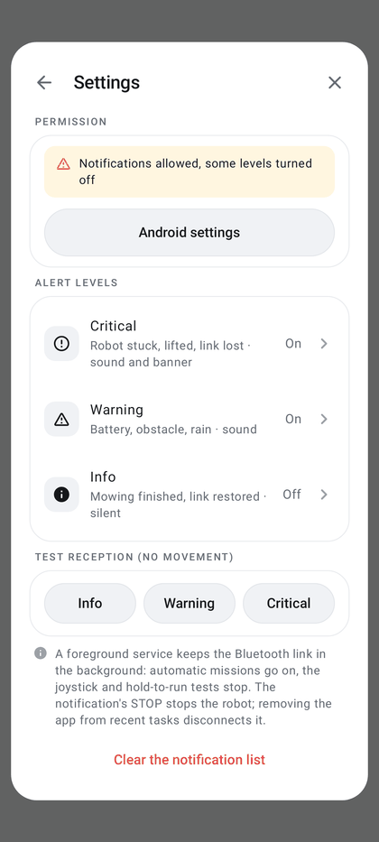

# Local alerts (notifications)

The phone generates its own alerts from the robot's telemetry and the navigation checks, without going through the
Mammotion cloud.

| | |
|---|---|
| **Access** | Home → **Notifications** bell; Me → **Notifications**; tap on an Android notification |
| **Status** | Implemented and covered by JVM tests (`RobotAlertsTest`, `LocalNotificationsTest`, `AlertJournalTest`, `RtkAlertPolicyTest`, `GatewayAlertPolicyTest`, `NotificationDaysTest`); physical reception still to be validated on site |
| **Code** | `alerts/` (`RobotAlerts.kt`, `LocalNotifications.kt`, `AlertJournal.kt`, `RouteAlertPolicy.kt`, `RtkAlertPolicy.kt`, `GatewayAlertPolicy.kt`), panel `ui/NotificationsPanel.kt`, triggers in `ble/RobotBle.kt` |
| **Reference** | [Local notifications: triggers and delivery](../../LOCAL_NOTIFICATIONS.md) |

  
  

## Triggers

| Alert (title shown) | Trigger | Level |
|---|---|---|
| **Robot stuck** | progress check stop: insufficient translation for 3 s, or no progress towards a point for 15 s | critical |
| **Robot lifted** | lift guard ([safety](safety.md#lift)) | critical |
| **Repeated bumper** | 3 distinct contacts within 30 s, then 5 (or a latched bumper fault) | warning then critical |
| **Obstacle encountered** | bumper contact followed by a back-off (route, move to point), once the obstacle photo is taken or missed; the photo is attached ([obstacles](obstacles.md#encountered-obstacles-and-difficulties)) | warning |
| **Critical battery** | fresh robot reading ≤ 10 %, then ≤ 5 % (hysteresis up to 13 % / 8 %) | warning then critical |
| **Return to base failed** | interruption during return, alignment or docking, BLE loss included; also an automatic out-of-hours return that fails ([working hours](real-mowing.md#working-hours), warning) | critical (warning out of hours) |
| **Prolonged BLE loss** | 5 s without valid telemetry, once the telemetry stream is established (two reports received) | critical |
| **Prolonged RTK loss** | 10 s without a fresh FIX (`rtk.status` = 4, report less than 5 s old) during a movement: route, mowing, manual control or test; never while the robot is stationary at the base | critical |
| **Robot offline** | 30 s without valid telemetry after an unexpected loss | critical |
| **Unexpected stop** | interruption of a route, a test or manual control (link lost, robot error, control failure) | critical |
| **Automatic resume failed** | interruption during recharging or resume (critical); resume impossible after a gateway update or a gateway loss during recharging (warning) | critical or warning |
| **Error reported by the robot** | code classified as warning or stop ([error codes](safety.md#robot-error-codes)); critical when a stop code interrupts a moving activity without another alert | warning or critical |
| **Low gateway battery** | control through the gateway, health report less than 60 s old, gateway phone not plugged in: ≤ 24 %, then ≤ 14 % (hysteresis up to 27 % / 17 %); cleared once plugged in | warning then critical |
| **Gateway fell off the robot** | autonomous tracking by the gateway: its Bluetooth signal to the robot drops 15 dB below its usual level while the robot drives away from where it was last normal ([gateway](gateway.md#autonomous-tracking-android-and-esp32-gateways)); the robot is stopped, the alert gives the phone's position and a marker shows it on the map | critical |
| **Gateway disconnected** | Wi-Fi tunnel to the gateway silent for 2 s or cut; one alert until telemetry comes back | critical if the robot was moving, otherwise warning |
| **Move beyond the mapped zones** | start of a [move to a point](station-and-moves.md#beyond-the-mapped-zones) whose path leaves the mapped zones: length of the dotted section, driven without border check | warning |
| **Rain during mowing** | during a mowing or route, with weather monitoring on and a garden location set: rain observed, imminent or recent, or forecast within 30 min ([weather](rain-and-weather.md)); no command is sent to the robot | warning |
| **Blades to replace** | robot blade counter (Bluetooth) beyond the interval chosen after the last change noted in [Maintenance](maintenance.md), or beyond the Mammotion threshold if no change was noted; once per connection while due | warning |
| **Link restored** | telemetry received again after a loss | info |
| **Mowing finished** | end of a real mowing run (blades), report available ([history](mowing-history.md)) | info |
| **Notification test** | **Test reception** buttons in the settings; no robot command | chosen level |

Each alert shows the robot, the time, the state and phase, the known battery level, the last FIX point with its
time, the reason and a recommended action. Unknown data is shown as unknown.

## Delivery

- Three Android channels: **Robot · INFO**, **Robot · WARNING**, **Robot · CRITICAL** (low, normal, high
  importance).
- One notification per robot and per type, with a repeat counter, grouped per robot under a summary
  ("Robot alerts — open to view the log"). A repeat only sounds again after 15 minutes, unless the severity
  increases (the notification then moves to the higher channel).
- An obstacle photo is attached: thumbnail in the collapsed notification, large image once expanded (if the file still
  exists).
- Tapping a notification opens the app directly on the **Notifications** panel.
- Local history of the last 50 notifications (type, level, time, robot, reason, state, battery, position); an alert
  blocked by a permission or a disabled channel is kept and published as soon as it is allowed again, with the time
  of the incident.
- Publishing runs on a dedicated thread: it never delays a STOP.
- Titles, reasons and actions are in the interface language ([language](interface.md#language)); channel names stay the
  same.

## Notifications panel

Reached from the **Notifications** bell on Home (top left), from Me → **Notifications** (subtitle: the latest
notification, "Local alerts enabled" when there is none, or "Notifications blocked · allow"), or by tapping an
Android notification.

- **Latest notifications** in chronological order, most recent at the top, grouped by day ("Today", "Yesterday",
  then the date, with the year outside the current year). Each row shows a level badge (red critical, orange warning,
  blue info; green check for **Mowing finished**), the type, the time, the robot, the reason and the number of
  repeats (×3).
- Tapping a notification expands it: level, state, battery, last known position and recommended action.
- A red dot marks notifications received since the panel was last opened; the badge on the bell (Home) only lights
  up for these new ones or if notifications are blocked. Opening the panel marks them as seen.
- Notifications blocked: "Notifications blocked: alerts stay visible here" and an **Allow notifications** button at
  the top of the list; with the permission granted but a level turned off: "Some alert levels are turned off in
  Android".
- Empty list: "No notifications".
- Footer: "The last 50 notifications are kept on this phone. Tap a notification for its details."

### Settings (⚙ button)

The ⚙ button opens **Settings** (back arrow to the list):

- **Permission**: status ("Local alerts enabled", "Notifications allowed, some levels turned off" or "Notifications
  blocked"), **Allow notifications** button (Android 13+ permission request) or **Android settings** once allowed.
- **Alert levels**: Critical, Warning and Info, each marked On or Off, with a hint (Critical: "Robot stuck, lifted,
  link lost · sound and banner"; Warning: "Battery, obstacle, rain · sound"; Info: "Mowing finished, link restored ·
  silent"); a row opens the matching Android channel directly (sound, banner, lock screen). The status is read again
  when returning from the settings.
- **Test reception (no movement)**: Info, Warning, Critical; each sends a **Notification test** at that level
  without any robot command.
- A note on the background: a foreground service keeps the Bluetooth link in the background, automatic missions go
  on, the joystick and hold-to-run tests stop; the STOP of its notification stops the robot
  ([Bluetooth connection](bluetooth-connection.md#link-loss)).
- **Clear the notification list**: empties the panel without touching the anti-repeat logic or the alerts waiting
  for permission.

A history saved by a version earlier than 0.55.0 (free text) is converted on first launch; an unreadable line is
ignored.

## Limitations

- Monitoring lives with the app: there is no 24-hour watch after it is closed.
- A manual STOP, a requested disconnection or going to the background disarm the loss alerts, except when the
  foreground link service keeps the link for an automatic mission (mowing, route): monitoring then continues in the
  background. A hold-to-run activity stopped by going to the background disarms them.
- Android stays in control of sound, Do Not Disturb mode and the lock screen.
