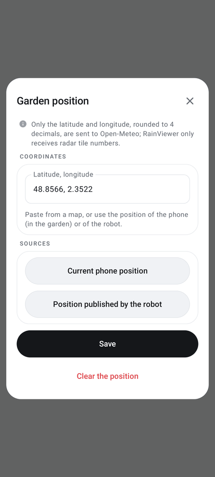

# Rain and weather

Monitors rain around the garden using radar and forecasts. It warns before and during mowing, without ever stopping
the robot on its own (observation mode).

| | |
|---|---|
| **Access** | Service → Garden and history → **Rain and weather**; Map → weather in the status pill at the top → **Garden weather** |
| **Status** | Implemented in observation mode (warnings only); robot rain sensor not read yet; thresholds not calibrated on real showers |
| **Code** | `weather/` (`WeatherService.kt`, `RainAnalysis.kt`, `RainDecision.kt`, `RadarMath.kt`, `GrassWetness.kt`, `WeatherUi.kt`) |
| **Tests** | `RainWeatherTest`, `GrassWetnessTest`, `WeatherPillLabelTest`, `WeatherServiceTest` (no Internet access) |
| **Reference** | [Sensor and radar fusion: design](../RAIN_WEATHER_FUSION.md) |

  
  

## Setting the garden location

Service → Rain and weather → **Settings** → **Garden position**, or tap the weather in the map's status pill →
**Garden position**. The **Garden position** dialog offers:

- the **Latitude, longitude** field: paste coordinates from a map (`48.8566, 2.3522`; a decimal comma
  `48,8566 2,3522` or a semicolon separator are also accepted). Latitude must be within ±85°, longitude within
  ±180°, otherwise "Expected format: 48.8566, 2.3522" is shown;
- **Current phone position**: approximate location (the coarse location permission is only requested at that
  moment), to be done from the garden. The dialog shows "Phone position (± N m): check then save", or "Phone position
  unavailable (location turned off?)" / "Location permission denied";
- **Position published by the robot**, shown only when the robot has published a latitude and longitude (with the
  source in brackets when it is not the robot itself, for example "RTK station");
- **Save** (enabled once the field is valid) and **Clear the position** (when a position is saved).

Changing the location starts from scratch: the radar images and the "end of rain" state of the old garden are never
used for the new one, even if the change happens during a refresh.

The **Monitor rain** switch (Service → Rain and weather → Settings, on by default, saved) cuts off every weather
network call. With no location or with monitoring off, the weather is absent from the map's status pill and no rain
warning is given before or during mowing. **Refresh now** forces an immediate read (disabled without a position or
with monitoring off).

## What is displayed

- **Decision**: *Weather unavailable*, *Dry*, *Monitoring*, *Rain imminent*, *Rain* or *End of rain*, with its
  reason (for example "No rain on the garden (nearest 25 km away)").
- **Rain on the garden** (radar estimate in mm/h, or "none (radar)"), **Nearest rain** (km), **Forecast within the
  hour**, **Forecast over 3 h**, **First rain forecast** ("in ≈ 45 min", or "none until HH:MM"), **Grass** (see
  below) and **Updated** (minutes since the last radar read). A read error is shown under these rows.
- Service page only: **Radar (RainViewer, 10 min)**, the last 7 frames analyzed, each with the echo on the garden
  (dBZ, or "garden dry"), the distance of the nearest rain and the share of rainy area within 10 km. A frame with a
  missing tile is marked "(incomplete)" and retried on the next refresh. **Estimated movement**: speed of the
  nearest rain "towards the garden" or "moving away" ("not enough frames" with fewer than 3).
- **Robot sensor**: "Rain sensor: not read yet"; the decision relies on the radar and the forecast only.
- The Service hub row shows the current decision, or "to set up" without a garden position.

In the map's status pill, the weather segment shows the decision, "Weather —" when unavailable and "Rain ≈ N min"
when rain is imminent with an estimated arrival. During a mowing, it turns orange with "Rain forecast" when rain is
expected within 30 minutes. Tapping it opens **Garden weather** (the rows above, **Garden position** and
**Refresh**).

## Rain decision

Computed at each refresh (`RainMonitor`, provisional thresholds in `RainThresholds`):

| State | Condition |
|---|---|
| Rain | echo ≥ 30 dBZ (≈ 2.7 mm/h) within 1.5 km of the garden, or ≥ 23 dBZ (≈ 1 mm/h) when the previous frame already had ≥ 20 dBZ there |
| Rain imminent | rain approaching with an estimated arrival ≤ 20 min, or ≥ 0.5 mm forecast within 30 min with rain within 15 km |
| End of rain | less than 30 min since the last rain ("resume advised after 30 min") |
| Monitoring | weaker echo on the garden (≥ 15 dBZ, "to be confirmed"), rain within 15 km, ≥ 0.2 mm forecast within the hour, or radar unavailable with a dry forecast |
| Dry | none of the above, radar and forecast available |
| Weather unavailable | radar older than 30 min (or missing) and forecast older than 90 min (or missing) |

The approach is a linear fit of the nearest-rain distance (searched up to 60 km) over the frames of the last
40 minutes (at least 3). Speeds above 120 km/h (a new cell appearing) and arrivals beyond 120 minutes are ignored.
It is an estimate, not a forecast.

## Wet grass and slips when pivoting (0.44.1)

The garden's hourly weather (Open-Meteo: temperature, dew point, humidity, rain, vapor pressure deficit over the
last 3 days), refreshed every hour, gives a **wet grass index** from 0 to 1 (`weather/GrassWetness.kt`), the larger
of two parts:

- **recent rain**: total over the last 72 hours, weighted by age (divided by e every 12 hours), full at 2 mm;
- **dew**: last hour of saturated air within the last 18 hours (humidity ≥ 96 % or dew point within 0.6 °C), then
  drying according to the vapor pressure deficit accumulated since (index divided by e every 0.3 kPa·h).

On Oct 15, the index was 1 at 9:00 (dew), 0.69 at 10:37 and 0.23 at 12:30. The **Grass** row of the **Garden
weather** sheet and of the Service page shows the state of the grass ("dry grass", "recent rain (… mm weighted)",
"saturated air: dew", "dew drying") and the expected slip factor, for example "dew drying · slides ×1.7".

The [slip map](real-mowing.md#slip-map-0440) stores slips normalized to dry grass. A slip is measured
then divided by 1 + index, and the map is rescaled to the current grass conditions for tracking. The coefficient (1)
is provisional. The index is logged at the start and end of each mowing (`mowing_history_start`, `mowing_report`)
and with each measured slip: enough to recalibrate it on real mowings. Without a garden location or without recent
weather (less than 3 h old), no correction is applied.

## Effects on mowing

- **Route preview** (launch screen, not for signal survey routes): over the **estimated mowing duration** (the coming
  hour if unknown), a warning box if it is raining, rain is imminent, rain ended less than 30 minutes ago ("Recent
  rain: the grass is probably wet"), at least 0.2 mm is forecast in total or one 15-minute step reaches 0.1 mm.
  Otherwise an information note "No rain forecast during the mowing (≈ duration)". A forecast that does not cover the
  whole duration is flagged ("forecast available until HH:MM"); a forecast older than 90 minutes gives "Weather
  forecast unavailable: rain not checked".
- **During mowing** (app mowing or app route): **Rain during mowing** alert (warning) when the same check over the
  next 30 minutes warns ([notifications](notifications.md)); the weather segment of the status pill turns orange.
- No automatic action: cutting the blades or going home remains the user's decision.

## Data and network

| Service | Sent | Frequency |
|---|---|---|
| `api.rainviewer.com` (RainViewer credit displayed) | numbers of the radar tiles around the garden (zoom 7) | every 5 min |
| `api.open-meteo.com` (CC BY 4.0), 15-minute forecast over 8 h | coordinates rounded to 4 decimal places (about ten meters) | every 15 min |
| `api.open-meteo.com`, hourly weather of the last 3 days (wet grass) | same coordinates | every hour |

Requests identify themselves as "DumbyLuba" with the app version. Radar frames already analyzed are kept in memory;
no radar image is displayed or stored. The location and the **Monitor rain** switch are stored in the app's private
preferences.
