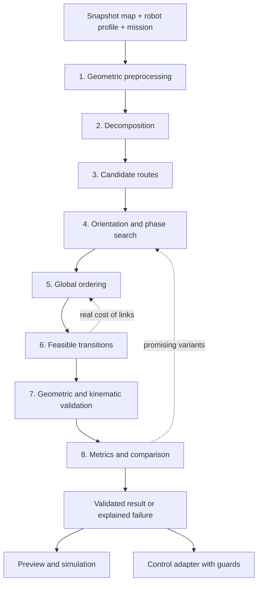

# Target architecture of the CPP engine

Proposal of 2026-10-09, implemented step by step: the production engine is described in [ENGINE.md](ENGINE.md). A module described here as a target does not necessarily exist in the engine.

## Main contract

The engine receives an immutable snapshot of the terrain, the robot, the mission and the controller's capabilities. It returns a typed route with metrics and a validation report, or an explained failure. A partial preview is never an executable route.

The core must be Kotlin/JVM without Compose, Android, BLE, wall clock or network access. JTS stays encapsulated in a geometry adapter; its mutable objects do not cross public interfaces. Rendering and execution consume the same result, identified by its fingerprint.

These steps define responsibilities, not a single irreversible pass. Transitions are queried during ordering, then fully materialized and validated before the final score. The shared cache avoids recomputing them at each level.

## Input model

| Proposed object | Mandatory data and invariants |
|---|---|
| `PlanningSnapshot` | Robot identifier, raw map hash, patch version, metric local frame, date/provenance and hash of the effective geometries |
| `BoundaryEvidence` | `PHYSICAL_EDGE`, `RECORDED_REFERENCE_TRACE` or `UNKNOWN`, provenance, uncertainty, portion concerned; no deduction from the mere absence of demo mode |
| `TerrainModel` | Selected mowing zones, allowed transit domains, exclusions, physical obstacles, axes and **measured widths** of corridors, base and access |
| `RobotProfile` | Chassis footprint relative to the reference point, tool position, nominal/useful width, allowed pivot/arc/reverse modes, kinematic limits and uncertainties |
| `ControllerCapabilities` | Supported and calibrated primitives, measured rate and latencies, guards, braking profile, firmware/protocol version; unknown capability ≠ allowed |
| `MissionSpec` | Imposed or free order, precedences, simple/checkerboard/survey, spacing/overlap, borders, start/end poses, battery/recharge policy, prior coverage |
| `PlannerConfig` | Strategy versions, numerical precision, candidate/iteration budgets, seed, tie-breaking rules and score profile |

Build a single `EffectiveMap` from raw map + patch + obstacles. Share it with coverage, transit, validation and rendering. Distinguish the identity of the raw map from that of the effective map: the current raw equality `engine.map == robotMap` will not be enough to allow local corrections without knowing their provenance. Any modification invalidates dependent results; no silent substitution of one geometry for another.

Cutting and transit areas are different. An unselected zone may allow transit with blades OFF. A corridor of which only the center line is known may serve an explicitly hypothetical simulation; it does not produce a certificate of physical feasibility. A taught boundary must only be widened if the semantics of the trace and its footprint are established.

## Eight interchangeable responsibilities

| Step | Proposed interface | Initial implementations / alternatives | Verifiable output |
|---|---|---|---|
| 1. Preprocessing | `GeometryPreprocessor` | Adapter of the existing geometry; controlled JTS normalization | Canonical domains, exclusions, components, report of errors and transformations |
| 2. Decomposition | `TerrainDecomposer` | Adapter of discrete cells; event-based BCD; trapezoids as reference | Cell polygons, adjacencies, critical events and residuals |
| 3. Candidates | `CoverageGenerator` | Parallel stripes, borders, residual pockets; optional spirals | Tasks and variants with active tool, entry/exit poses, swept footprints |
| 4. Orientation | `OrientationSearch` | Historical grid; edge directions + refinement + phases; choice per cell | Finite set, stable order, rejected candidates and reasons |
| 5. Global order | `TaskSequencer` | Historical order; DP of variants; 2-opt/relocation; optional LNS | List of variants covering all mandatory tasks, precedences respected |
| 6. Transitions | `TransitionPlanner` | Visibility and pivots; passage network; SE(2) primitives, conditional Hybrid A*, Dubins/Reeds–Shepp | Sequence of motions, poses, blade modes, duration and local certificate |
| 7. Validation | `TrajectoryValidator` | `TrajectoryEnvelope` adapter; independent oracle in the bench | Continuous global report, constraints and blocking reasons |
| 8. Scoring | `MissionEvaluator` | Geometry + time metrics; common energy scenario | Raw metrics, uncertainty intervals, rank/Pareto and assumptions |

Historical adapters must keep their behavior for the baseline. A safety fix is not slipped into this adapter: it gets a distinct strategy version and both results are kept to explain the difference.

### 1. Geometry and configuration space

Validate finiteness, closure, area, intersections, holes and components. Canonicalize rings without moving physical edges; only remove duplicates and degenerate segments according to a versioned policy. A topological repair must detail the modified area and boundaries. Refuse a repair that would allow unknown terrain. Shrinking a zone and inflating an obstacle go in opposite directions, which must be respected.

For a rectangle R oriented at θ, the free space of the reference point is `Fθ = Fphysical ⊖ Rθ`. A circumscribed-disc approximation is conservative for pivoting, but can close passages that are passable in a straight line. Keep both uses: the disc as a quick filter, the oriented footprint for the final decision. Do not inflate an obstacle by the robot radius and then recheck that same inflation as a physical obstacle.

Uncertainty is a separate model: map, position, heading, footprint and tracking errors. For example, under established bounds, a heading error δ adds at most `2 r sin(|δ|/2)` to the displacement of a corner at radius r. Reserve the stopping tube according to measured latency and braking; `v τ + v²/(2 a)` is only usable with a validated deceleration model. Do not present these formulas as calibrations already obtained.

### 2–4. Cells, cutting and orientations

The decomposition certifies the union of cells, the absence of unintended interior overlap and equality with the decomposed domain within a fixed tolerance. Holes do not disappear. An event on an edge or several vertices with the same projection follows a stable rule.

The cutting tool is independent of the chassis. Start with a parameterized conservative useful stripe; measure the two discs and their offset later. Useful width, uncertainty and desired overlap determine the spacing. `spacing <= useful width` is necessary for parallel stripes, not sufficient to cover ends and corners.

Each variant contains the internal cost, the end poses and a local coverage report. A `coverageFamily` field distinguishes the two orientations of a checkerboard. Keep uncovered pockets as tasks or as residuals explicitly refused/unreachable; never remove them from the denominator to improve the displayed rate.

### 5–6. Order and motions

`TransitionKey` includes both poses, the motion mode, the map/profile hashes, the validator version and the constraints. A key made of points only is not enough. Cached failures distinguish proven impossibility, exhausted search and budget reached. A cost not yet computed is "unknown", not zero.

The user order remains the default. With that order fixed, DP selects the variants; in free mode, oriented 2-opt and relocation respect precedences and mandatory tasks. Evaluated transitions may be asymmetric. An optimization move that changes headings invalidates the local certificates concerned.

Represent `Straight`, `Pivot`, `Arc`, `Reverse`, `BladeChange`, `Wait`, `Dock`, `Charge` explicitly with SI units, initial/final pose, active tool, task origin and parameters. Do not flatten an arc into a polyline then followed through stops/pivots: that would change how it is executed and its cost. A control adapter may refuse a primitive that is nonetheless geometrically valid.

### 7. Blocking validator

Check pose continuity, absence of jumps, chassis swept volume, physical exclusions, allowed cutting space, margins/uncertainties, radius/curvature, allowed reversing, headings at passages and at the station, precedences and energy feasibility according to the requested certificate level.

The final check covers the assembled mission, including start, transitions, fallbacks, returns and resume. Local certificates alone do not prove the validity of the joints. No safety failure is converted into a score penalty. A map that changes invalidates the certificate before execution.

### 8. Score and comparison

Decision order: blocking constraints → coverage goal → estimated time → secondary metrics. Do not trade a lost pocket for a shorter route. On a tie within numerical tolerances and with equivalent coverage, apply a stable tie-break on total distance, transit, maneuvers, excess overlap, then canonical identifier.

Time includes travel, slowdowns/accelerations if calibrated, pivots, blade commands, pauses/docking, returns and recharges. Publish active time and total time separately. Since the battery depends on history, the final evaluation goes through a common mission model; additive costs guide the search, they do not certify its energy optimum.

## Determinism and performance

- Canonical hash of inputs, strategies and JTS/JVM versions; zone order preserved if it is part of the mission.
- Stable sort of shapes and cells by identifiers then canonical geometry; fixed order of candidates/neighbors. Ties broken by identifier, without a non-transitive epsilon comparator.
- Geometric precision and tolerances recorded. Do not confuse numerical tolerance with physical margin; test a precision reduction to check that it does not enlarge the allowed space.
- Versioned seed and pseudo-random generator for LNS; no UUID or timestamp in the decision. Display identifiers separate from the result hash.
- Deterministic budget in numbers of orientations, variants, expansions and moves. Wall-clock time serves as an operational circuit breaker; a stop on timeout is flagged and is not a guarantee of identical replay.
- If parallelized later, independent tasks and collection in canonical order; no "first thread wins". Measure memory and caches, not only time.
- Caches bounded per snapshot; validated paths reusable; explicit cancellation between phases. A partial result remains non-executable.

Bit-for-bit determinism targets a frozen environment. Across different JVMs/architectures, check geometric equivalence within tolerance and identify any divergence of choice; do not promise universal binary identity.

## Result, failures and control

`PlanningResult` contains status, route if any, coverage/residuals, metrics, version manifest, assumptions and validation report. Statuses: `VALIDATED_IN_MODEL`, `PARTIAL_COVERAGE`, `INVALID_INPUT`, `DISCONNECTED`, `INFEASIBLE_PROVEN`, `NO_SOLUTION_FOUND`, `BUDGET_EXHAUSTED`, `UNVERIFIED_CAPABILITY`, `CANCELLED`. A heuristic failure is not a proof of impossibility.

A profile using a hypothetical passage width can produce a `VALIDATED_IN_MODEL` preview with assumptions, but not an authorization for real movement. Only a control adapter that has calibrated capabilities and fresh guards can accept the plan. No polyline upload to Mammotion is assumed.

Local replanning first stops the robot according to the existing guards, freezes observations, adds exclusions and recomputes the suffix. It keeps the area actually cut already and the remaining tasks; a skipped segment still has to be done. Validation covers the link and the new suffix. If there is no solution, the robot stays stopped.

## Non-breaking migration

First create non-production adapters around `Preview`, `TrajectoryPlanner` and `MowingSimulation`. Keep the historical results and the current BLE control. Then introduce the candidate strategies in the bench; enabling them for preview does not mean enabling them for control. Replacing `Preview` with the typed route and connecting it to the executor are the last increments, after geometric, kinematic and field validation.
