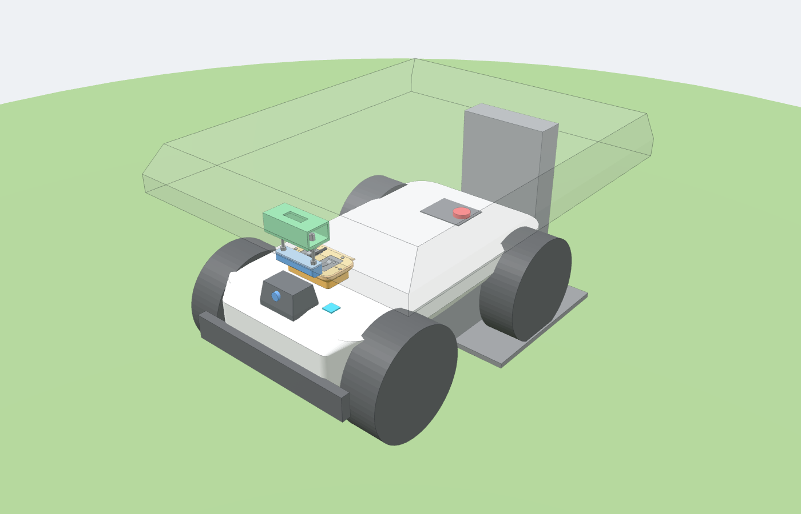
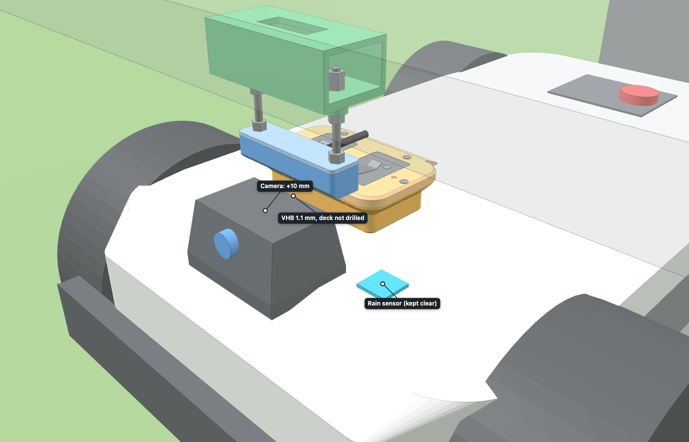
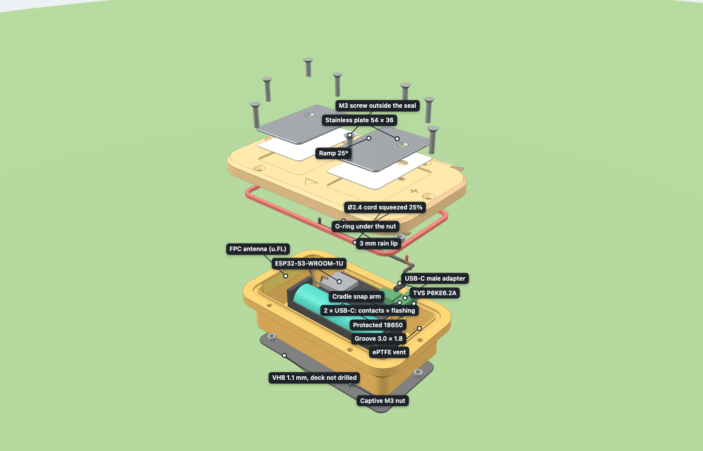
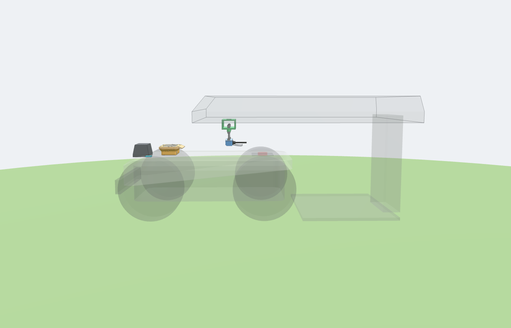
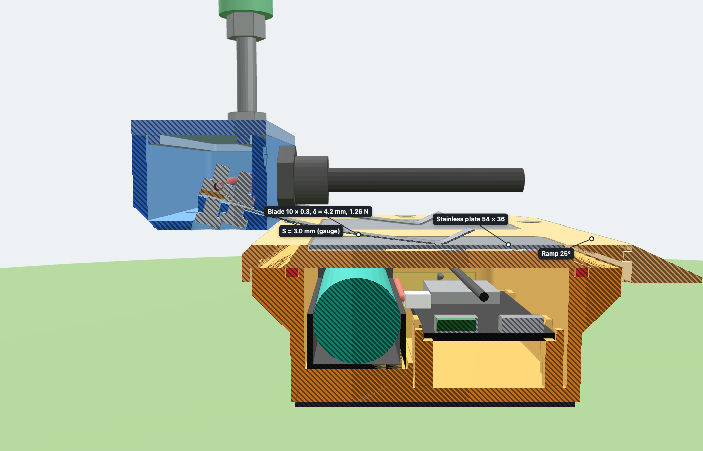
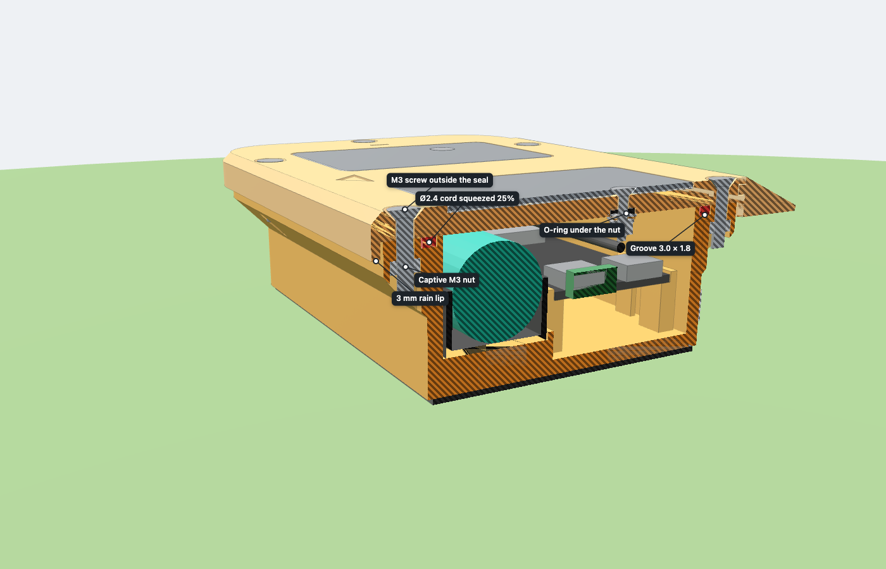

# ESP32 on board the LUBA 2 AWD, charged by contacts at the base

A sealed enclosure is **bonded** to the deck of the LUBA 2, just behind the camera. It
holds an ESP32 and an 18650 battery. Two **stainless plates** sit flush in its lid. Two
**stainless spring blades** hang from a **fixed holder** under the garage roof: when the
robot backs into the station, an entry ramp on the lid lifts the blades, which slide onto
the plates and press them with a slight flexion. The 5 V of a USB charger then reaches the
board through a USB-C plug. Nothing moves except the blades bending, and nothing is
soldered: everything plugs in, clips in, screws on, is crimped or is bonded.

Design record (figures, formulas, alternatives, decision of 2026-10-27):
[docs/CONTACT_CHARGING_DESIGN.md](../../docs/CONTACT_CHARGING_DESIGN.md). **Nothing has
been built or measured yet.**



| Docked | Exploded view |
|---|---|
|  |  |

| Approach: the lid passes under the holder | Docked: section through a blade and its plate |
|---|---|
|  |  |

| Section through the closure: seal, lip, screws, captive nuts and the plate screw O-ring |
|---|
|  |

The images are screenshots of the viewer, retaken with `cad/render_images.py` (see
[Regenerating after measuring](#regenerating-after-measuring)). The blades are drawn in
their docked pose; the animation of their flexion while docking is not done yet.

## Interactive 3D model (suited to the Galaxy Z Fold 8)

Open [`viewer/luba-esp32-dock.html`](viewer/luba-esp32-dock.html) in Chrome or Samsung
Internet: the model is embedded in the file, so just copy it to the phone (three.js is
loaded from the CDN, so a connection is required when opening it).

- **Cover screen, or inner screen held in portrait**: the model fills the top and the
  controls sit in a panel at the bottom. Tapping the grip collapses or expands the panel;
  dragging it sets its height.
- **Inner screen in landscape**: panel on the right.
- **Flex mode** (phone half folded, horizontal fold): the model shows above the fold and
  the controls below it.
- Gestures: one finger to rotate, two fingers to zoom and pan. Tapping a part opens its
  card (role, dimensions, STL file), with "Center" and "Isolate". 46 px touch buttons, a
  full-screen button.
- **Three modes**: *On the robot*, *Enclosure* alone, *+ Blade mount*.
- Progressive **exploded view** (0–100% slider). **Section** across or lengthwise, at an
  adjustable position, with hatched cut faces.
- Commented and annotated **details**, browsed with ‹ ›: sealing, contact charging,
  electronics, closing and bonding, blade holder, placement on the LUBA 2.
- *Docking* tab (the robot backing in under the holder; the blades stay in their docked
  pose) and *Dimensions* tab (generator report: forces, stress, height window, tolerances).

URL parameters open a specific view, for example
`luba-esp32-dock.html#detail=1` (section through a blade and its plate) or
`#mode=boitier&explode=1&notes=1` (annotated exploded view).

## Chosen design and why

1. **Simple and fixed.** The enclosure is VHB-bonded to the deck; the blade holder does not
   move. It hangs from two M6 rods clamped between two nuts on a bridge bonded under the
   roof: **one turn of a nut moves the holder by 1 mm** (M6 pitch is 1 mm), so it can be
   set to the millimeter and then locked. The bridge and the rods are those of the former
   fixed charging mount (`05_roof_bridge.stl` is unchanged).
2. **Plates on the robot, springs under the roof.** The plates are flat, flush and
   passive: nothing sticks out of the robot. Each plate is **54 × 36 mm** of 1 mm A4
   stainless (316L), long in the direction of travel to absorb the stop error, centered at
   y = ±28 mm with a **20 mm gap**: a 10 mm blade can never touch both plates. Each blade
   is a **10 × 0.30 mm** strip of 1.4310 (301) spring stainless, 36 mm free, laid on a seat
   inclined at 16.5° in the holder. Same stainless family on both sides: no galvanic couple,
   no verdigris.
3. **Contact force and height window.** With the holder **3.0 mm** above the lid, each
   blade bends by **4.2 mm** and presses its plate with **1.26 N**. The robot can stop
   up to **2.5 mm higher** (2.00 N; 0.5 mm of clearance left under the holder, whose
   lowest point is the hard stop) or **2.5 mm lower** (0.50 N; contact is lost at 4.2 mm
   lower). This **5.0 mm window** is a little narrower than with the former fixed
   transmitter (5.6 mm), but the failure is gradual (the force fades) and the tolerances in
   position are about twice as large: **±24 mm along** and **±13 mm across** with the blade
   fully on its plate (±21 mm with 2 mm of overlap). A blade only reaches the wrong plate
   33 mm off to the side. The generator recomputes all of this and refuses a design that
   leaves the 0.4–2.5 N range, exceeds 0.7 of the yield of the strip (495 MPa = 0.65 at the
   hard stop) or narrows the window below 2 mm on a side, all with ±20 % on the stiffness.
4. **The blade trails and the lid has a ramp.** The blade root is on the +x side and its
   tip points towards the station: when the robot backs in, the lid moves from the root
   towards the tip and friction keeps the blade straight. The contact is the convex
   **knee** (radius 4 mm) of the bent tip, followed by a 6 mm nose turned up at 25°, so it
   slides both ways without turning over. A blade hangs lower than the lid by the flexion
   it will have once docked: a **25° printed ramp** bonded to the −x end of the lid lifts
   it (foot 7 mm under the plates). The generator rolls the knee over the lid, the plates
   (taken 0.15 mm proud), the countersunk screw heads and the ramp, along every lane of the
   lateral tolerance: no step above 0.3 mm and no slope above 25.5° outside the ramp.
5. **The LUBA 2 docks in reverse** (manual, § 3.4.4). The camera is at the front: it stays
   in front of the holder and never passes under it. Only the enclosure passes under the
   holder, whose lower +x edge has a 45° lead-in. The rods are on the sides
   (y = ±42 mm), out of the way.
6. **The enclosure stays below the top of the camera** (lid at about 263 mm, camera at
   273 mm). The overall height of the robot does not change and the front view is not
   blocked. The enclosure sits about 41 mm behind the camera (the holder takes the space in
   between) and is offset sideways to keep the **rain sensor** clear (light blue in the
   mock-up).
7. **Watertight passages.** The 5 mm lid has no window any more. Each plate is bonded on a
   0.3 mm film of neutral-cure silicone with a bead on its edge, and held by one
   **countersunk M3 × 10** A4 screw, flush. Under the lid, a **3 × 1.5 mm O-ring** in a
   Ø6.4 × 1.1 mm recess is squeezed 27 % by a flat washer: water running down the screw stops
   there. The seal, the lip, the six flange screws (now M3 × 14) and the vent are unchanged.
8. **Electrical path and protections.** 5 V USB charger → **PTC** 0.75 A hold (garage end,
   IP65 box) → 3 m of 2 × 0.75 mm² cable → **PG7** gland → ring terminals on the blades →
   plates → ring terminals under the lid → two wires → **USB-C male adapter** in the board's
   native USB socket, with a **TVS P6KE6.2A** across VBUS and GND in its terminals. The
   board's own 1N5819 blocks a reversed supply (the TVS then conducts and the PTC trips:
   no damage, no charge). The board is never fed through EXT1 pin 21 (unprotected), and
   the Mammotion station is never tapped. **+ is on the +y plate and blade** (left when
   facing forward), with a red wire.
9. **No soldering.** The board is an **Olimex ESP32-S3-DevKit-Lipo-EA** (ESP32-S3-WROOM-1U
   module with a u.FL socket for an external antenna, two USB-C, Li-ion charger). It has no
   mounting holes: it clips into a cradle printed with the base (ledges under the four
   corners, end stops on the module side, one snap arm per long side), headers not
   soldered. It now sits 8 mm lower than before (PCB top 15 mm above the bottom) so that the
   plate screws, their ring terminals and the wires have 5 mm under the lid; the snap arms
   are 12 mm long (0.74 % hook strain, below the 2 % of ASA). The 18650 sits in a separate
   off-the-shelf holder with leads and a JST plug that goes into the board's 2-pin 2.0 mm
   battery socket. **Check the polarity with a multimeter before plugging it in**: JST
   leads are not standardized and a reversed plug destroys the charger.
10. **Protected cell only.** The board charges the cell but has no battery protection
    (over-discharge, short circuit): the 18650 must be a **protected** cell, about 69–70 mm
    long instead of 65 mm, which the holder and the generator allow for.
11. **External antenna, away from the plates.** A flexible (FPC) 2.4 GHz antenna is bonded
    inside the end wall opposite the USB-C sockets, about **19 mm** from the nearest plate
    (generator minimum 15 mm) and 33 mm from the cell, below the seal line. Its u.FL cable
    stays inside: nothing goes through the wall. A thin stainless plate disturbs the antenna
    less than a ferrite sheet would, but compare the Wi-Fi RSSI before and after.
12. **Maintenance.** The enclosure stays bonded. To flash over USB, open the lid (6 screws):
    the plates stay on the lid, linked by 150 mm of wire (unscrew the adapter terminals to
    free it). The USB-UART socket (CH340X) is left free, with 22 mm in front of it for a
    straight plug. Routine updates go over Wi-Fi (`pio run -e ota-s3lipo -t upload`, see
    [firmware/esp32-gateway](../../firmware/esp32-gateway/README.md#update-over-wi-fi)).

## Shopping list

Prices are rough figures. Check them at the time of purchase.

| Qty | Item | Note | ≈ Price |
|---:|---|---|---:|
| 1 | **Olimex ESP32-S3-DevKit-Lipo-EA** (SKU 106011: ESP32-S3-WROOM-1U N8R8, 8 MB flash, 8 MB PSRAM, u.FL, two USB-C, Li-ion charger) | [Olimex](https://www.olimex.com/Products/IoT/ESP32-S3/ESP32-S3-DevKit-Lipo/), €7.95 in October 2026, shipping extra. Take the **-EA** version (external antenna) | €8 |
| 1 | **1 × 18650 holder with leads and a JST plug** (2-pin, 2.0 mm pitch), taking a ~70 mm protected cell | About 78 × 21 × 20 mm; measure it and adjust `HOLDER_*` if it differs. Check the polarity with a multimeter before plugging it in | €2–4 |
| 1 | **Protected 18650 Li-ion cell 3,400–3,500 mAh** (button or flat top, about 69–70 mm long) | **Mandatory**: the board has no battery protection | €6–10 |
| 1 | **Flexible (FPC) 2.4 GHz antenna with a u.FL cable**, about 40–50 × 8–10 mm, cable 10–15 cm | Self-adhesive, bonded inside the end wall. Check that the plug is u.FL (IPEX MHF1), the socket of the WROOM-1U | €3–6 |
| 2 | **Stainless A4 (316L) sheet 1.0 mm**, cut to 54 × 36 mm, corners R3 | A 100 × 200 mm sheet and tin snips, or laser-cut. File the top edges 0.4 mm at 45° | €8–15 |
| 1 m | **Stainless spring strip 1.4310 (301), 10 × 0.30 mm**, ¾ to full hard | Two 60 mm blades and spares. Ask the supplier for the yield (assumed ≥ 760 MPa) | €8–15 |
| 2 + 4 | **A4 M3 × 10 countersunk** screws (plates) + **A4 M3 × 12 pan head** screws (blade clamps), with nuts, flat washers (OD 7) and toothed washers | | €3 |
| 2 | **O-ring 3 × 1.5 mm**, EPDM or NBR | Under each plate screw | €1 |
| 4 | **Ring terminals M3** for 0.5–1 mm² wire | Plates and blades | €1 |
| 1 | **USB-C male to screw-terminal board**, or a **USB-C male pigtail** (VBUS + GND) with a lever connector | The terminal board must fit about 24 × 15 × 9 mm (tongue included), otherwise take the pigtail | €2–5 |
| 2 | **TVS P6KE6.2A** (axial, one spare) | Across VBUS / GND, band on VBUS. P6KE6.8A if the charger gives more than 5.25 V | €1 |
| 2 | **PTC fuse, radial, 0.75 A hold / 1.5 A trip**, ≥ 16 V (one spare) + 2 lever connectors | On the + wire next to the charger | €3–5 |
| 1 | **USB-A female screw-terminal breakout** + **IP65 junction box** | Garage end: charger plug, PTC, cable | €5–8 |
| 3 m | **Outdoor flexible cable 2 × 0.75 mm²** (H05RN-F or silicone) | Charger to the blade holder | €5–8 |
| 1 | **PG7** nylon cable gland, IP68 (cable 3–6.5 mm) | Ø12.5 hole on the −x face of the holder | €1 |
| 1 | **Neutral-cure silicone** (tube) | Plate film and bead, blade slots | €5 |
| 1 | 5 V USB charger (2 A or more) | Protected outdoor socket. Do not tap into the power supply of the Mammotion station | reused, or €8 |
| 1 m | **Stainless A2 M6 threaded rod** | 2 pieces of **82 mm** (computed length, cut with a hacksaw) | €4 |
| 10 + 6 | **Stainless M6 nuts** + **stainless M6 washers** | Per rod: 1 captive nut in the holder, 1 nut + washer on the holder cap, 1 nut + washer under the bridge, 2 nuts + washer on top | €3 |
| 6 | **Stainless M3 × 14 countersunk screws** (ISO 10642 / DIN 7991) + **6 stainless M3 nuts** | Close the lid; the nuts sit in the pockets under the flange | €2 |
| 1 m | **Solid silicone cord Ø2.4 mm** (hardness 40–60 Shore A) | Lid seal, laid in the 3.0 × 1.8 mm groove (≈ 0.38 m used) | €3 |
| 1 | **3M VHB tape**, outdoor conformable (e.g. 5952 or 4991), 25 mm wide | Enclosure on the deck, bridge plate under the roof | €8–12 |
| 1 | MS polymer or two-part epoxy | Ramp on the lid end | €5 |
| 1 | Double-sided foam tape | Holds the battery holder on its plinth | — |
| 1 | Ø10–12 mm adhesive ePTFE vent, IP67 (optional, recommended) | Stuck over the Ø4 hole at the bottom of the rear wall: limits condensation | €2 |
| 1 | 1 g silica gel sachet | Inside the enclosure | — |
| ~300 g | **ASA filament** (UV resistant; PETG otherwise) | All parts | €8 |

Total: about **€95–125**. The prices of the holder, the protected cell, the antenna, the
stainless sheet and the spring strip are orders of magnitude, not checked at a shop.

## Parts to print (`stl/`, already oriented for printing)

| File | Dimensions | Printing notes |
|---|---|---|
| `01_enclosure_base.stl` | 78 × 132 × 29 mm | Flat bottom on the bed (this is the bonded face). **4 perimeters, 100% wall infill** for sealing. Board cradle, snap arms and holder plinth are printed with it, without supports |
| `02_enclosure_lid.stl` | 82.2 × 136.2 × 8 mm | Visible face on the bed, drip lip pointing up (no supports). 5 mm flat lid with the two plate pockets (1.3 mm deep), countersunk Ø3.4 holes, O-ring recesses, + / − marks and the forward arrow; groove for the ramp tongue in the −x end |
| `03_blade_holder.stl` | 28 × 104 × 20 mm | Floor on the bed. Blade seats inclined 16.5°, slots 10.4 × 0.8 mm through the −x wall, clamp screw counterbores in the underside (short bridges), PG7 hole, captive M6 nut pockets |
| `04_holder_cap.stl` | 28 × 104 × 5 mm | **Holder cap**, clamped by the rod nuts. Flipped, centering tongue pointing up |
| `05_roof_bridge.stl` | 56 × 120 × 50 mm | Bonding plate on the bed, 48 mm bridged crossbar (unchanged) |
| `06_deck_shim.stl` | depends on the crown | **Only if the deck is crowned** (`DECK_R` > 0, see [Installation](#installation)): flat face on the bed |
| `07_entry_ramp.stl` | 16.8 × 98 × 8.2 mm | Flat bottom on the bed, slope up, no supports (the 1.8 mm tongue is a short overhang) |

0.2 mm layers, ASA at about 250 °C in a closed enclosure (or PETG at about 235 °C). No
heat-set inserts: all nuts are captive in hexagonal pockets or clamped.

## Parts to cut (no drawing file yet: dimensions below)

- **Plates** (2): 1.0 mm A4 stainless, 54 × 36 mm, corners R3. One Ø3.4 hole at 10 mm from
  the center along the length and 8 mm off the long axis towards the outer long edge (the
  screw sits at x = −10, y = ±36 in the enclosure frame, plate centers at y = ±28),
  countersunk at 90° for a flush M3 head (Ø6.4 at the top). File the top edges 0.4 mm at 45°.
- **Blades** (2): 10 × 0.30 mm spring strip, cut **60 mm** (56 mm used: 14 mm clamped,
  36 mm free, 6 mm nose). Two Ø3.2 holes in the clamped part, 6.5 and 11.5 mm from the end
  of the free part (centered across). Bend the nose up by 25° around a Ø8 pin (a drill bit
  shank), 6 mm from the tip. Deburr the edges.

## Assembly (no soldering)

**Enclosure**
1. Slide the 6 M3 nuts into the hexagonal pockets from under the flange. Hold them with a
   dab of glue or by pulling them in with a screw.
2. Lay the silicone cord in the groove, butting the two ends together, without stretching
   it. The groove (3.0 × 1.8 mm) is wider than the cord: it sits loose, then the lid
   squeezes it by 25% while filling 84% of the groove. A smear of silicone grease helps
   fitting and sealing.
3. **Plates.** Degrease the pockets and the plates. Push each countersunk M3 × 10 screw
   through its plate, lay a 0.3 mm film of neutral-cure silicone in the pocket, set the plate
   (+ plate on the +y side, marked +), check it is flush with a ruler, then under the lid:
   O-ring in its recess, flat washer, ring terminal of the red (+) or black (−) wire,
   toothed washer, nut. Tighten until the washer lies flat. Run a bead of silicone along the
   plate edges and wipe it level. Let it cure (24 h).
4. **Ramp.** Bond the ramp to the −x end of the lid (tongue in the groove) with MS polymer
   or epoxy, its top level with the lid top. Hand test after curing: 20 N without moving.
5. Peel the FPC antenna and bond it inside the **−y end wall** (the one away from the USB-C
   end), centered, its lower edge about 3 mm above the floor, after degreasing the wall
   with alcohol. It stays below the seal line, away from the screws.
6. Clip the board into the cradle, components up, module towards the antenna wall: slide
   one long edge under a snap arm, then press the other edge down until it clicks. Snap the
   antenna u.FL plug onto the module, straight down, and coil the spare cable loosely on
   the floor between the board and the antenna (bend radius 5 mm or more).
7. Tape the 18650 holder onto its plinth, along the +x wall. Before inserting the protected
   cell, **check with a multimeter that the JST plug polarity matches the board's battery
   socket** (marked on the board). Run the leads above the cradle pillars to the socket and
   plug them in. The first flash is done at this point through the USB-UART socket
   (CH340X), with the gateway firmware's `s3lipo` environment (`pio run -e s3lipo -t upload`,
   see [firmware/esp32-gateway](../../firmware/esp32-gateway/README.md#boards)); later
   updates go over Wi-Fi (`pio run -e ota-s3lipo -t upload`).
8. **Adapter.** Clamp the red wire and the TVS band (cathode) lead in the VBUS terminal, the
   black wire and the other TVS lead in the GND terminal (with a pigtail: one lever
   connector per pole). Plug the adapter into the **native USB** socket, on the holder side in
   the model (the USB-UART socket stays free for the console and flashing; check which is
   which on the board received). Hold the wires with a cable tie; leave enough slack (about
   150 mm per wire) to lay the lid beside the enclosure.
9. Add the silica sachet and close with the 6 countersunk M3 × 14 screws, tightened
   crosswise without crushing the seal. Do a **shower test** with a dry paper towel inside,
   plates mounted, before putting the electronics in.

**Blade holder**
1. Slide an M6 nut into each of the 2 pockets of the holder, then screw the 82 mm rods in
   down to the bottom of the blind hole (they do not stick out underneath).
2. Crimp a ring terminal on each conductor of the cable, pass the cable through the PG7
   gland on the −x face.
3. Slide each blade through its slot from the inside, nose outwards and turned **up**, onto
   its inclined seat. From below, push the two M3 × 12 pan head screws through the
   counterbores, the holder and the blade; on top: washer, nut on the outer screw; washer,
   **ring terminal**, nut on the inner screw (+ on the blade marked +, the +y one). Tighten.
4. Seal the slots and the screw heads with a dab of silicone. Leave the Ø3 weep hole open.
5. Slide the cap onto the rods and clamp it with a washer and a nut per rod. This clamping
   is what closes the cap.

**Garage end**: in the IP65 box, the charger's USB-A plug in the screw-terminal breakout,
the PTC in series on the + (its leads in lever connectors), then the 3 m cable.

## Bench tests (before bonding anything)

1. **Blade force.** Hold the holder level above a kitchen scale and lower it until each
   knee is pushed up by **4.2 mm** (the docked flexion): **128 ± 26 g** expected (1.26 N ± 20 %). Outside this range the strip is not the one
   assumed: adjust `BLADE_T` or `BLADE_E` and regenerate.
2. **Plate flushness.** A steel ruler across each plate must not rock: within ±0.15 mm.
3. **Continuity and polarity.** With the multimeter: + blade to VBUS of the cable end, +
   plate to VBUS at the adapter, no continuity between the two plates, nor between the two
   blades.
4. **Leak test.** Paper towel inside, closed lid, shower for 5 minutes: it must stay dry.

## Installation

1. **First measure how repeatable docking is**, in height and position. Stick a piece of
   masking tape on the deck behind the camera and a fixed mark under the roof. Dock 5 times
   and note the deviations. You need to stay within **±2 mm in height** (the window is
   +2.5 / −2.5 mm), **±24 mm along** and **±13 mm across**. The height is the weak point.
2. **Deck crown.** Lay a ruler across the deck where the enclosure goes and measure the gap
   h at the middle of a chord c (for example c = 130 mm). If h exceeds about 0.5 mm, set
   `DECK_R = c² / (8 h) + h / 2` (and `DECK_CROWN_Y`, the y of the top) in
   `cad/generate.py`, then regenerate: the script produces `06_deck_shim.stl`, a shim that
   follows the deck, to be VHB-bonded between the deck and the enclosure.
3. **Enclosure.** Degrease the deck and the enclosure bottom with isopropyl alcohol. Bond
   the enclosure with VHB, lid arrow pointing forward, about 41 mm behind the camera
   (TO MEASURE: the free deck length behind the camera) and on the side opposite the rain
   sensor (keep **≥ 30 mm** around that sensor). Press for 30 s, then let it rest 24 h
   before driving. If the deck is crowned, use thick conformable VHB.
4. **Bridge and holder: the position sets itself.** Fit the bridge onto the rods: a nut and
   a washer under each boss, then a washer and two nuts above the crossbar, left loose.
   Dock the robot and set the holder on a **3.0 mm gauge** (drill bit or hex key) laid on the
   lid, the blades on the plates, knee at the middle of each plate. Put the VHB on the bridge
   plate, push the bridge up against the underside of the roof and press. The bridge is thus
   bonded exactly above the enclosure.
5. **Height setting.** With the robot docked and the gauge in place, tighten the nut under
   each boss against the bridge, then lock the two top nuts against each other. Remove the
   gauge. To correct later: **one turn of a nut = 1 mm** (+22 / −16 mm travel). Secure the
   cable under the roof with adhesive cable-tie mounts.

## Check with the multimeter

1. **Polarity first**, robot docked, adapter **unplugged**: VBUS terminal positive with
   respect to GND, about 5 V. Only then plug the adapter in.
2. **Voltage at the USB-C plug**, robot docked, board running: **≥ 4.8 V** under load.
3. **Contact drop**: V(blade) − V(plate) **≤ 0.1 V** at about 0.3 A (Wi-Fi transmitting),
   on each pole.
4. **Rail**: the board's +5V rail **≥ 4.3 V** with Wi-Fi transmitting (the BL4054B charger
   needs about 4.25 V).
5. **Presence**: `power.vin_present` at `true` in the gateway's `/status` at each of **5
   dockings** (charge LED of the board too). While the 5 V is present, `power.battery_mv`
   reads the charger output and the level is −1, so they do not show the charge. Then, in
   DumbyLuba, compare the **RTK FIX** layer of a signal survey before and after
   installation, and the Wi-Fi RSSI, to make sure the enclosure does not disturb the
   antennas.

## Power budget (estimate, to be confirmed by measurement)

- ESP32-S3 with Wi-Fi without power saving and BLE connected, on a 3,400–3,500 mAh
  protected 18650: about **22–29 h of runtime** (estimate, not measured), more than one
  mowing cycle of the LUBA 2.
- Charging: the board charges the cell at about **100 mA**, so an empty 3,400 mAh cell
  needs about **34 h** (estimate), plus the slower end of charge. A robot recharge of
  about 1 h 30 min puts back only a small part of a day's use: the battery is topped up
  mainly while the robot stays docked (nights, rainy days). Check on site that the level
  does not drift down from one day to the next.
- Voltage on the +5V rail (estimate, charger 5.1 V): cable 0.14 Ω, PTC about 0.2 Ω, two
  contacts about 0.1 Ω each, internal wiring 0.05 Ω, then the board's 1N5819 (0.33–0.4 V):
  about **4.40 V at a 0.5 A Wi-Fi peak and 4.65 V on average**, against 4.25 V needed. If it
  is short: charger at 5.25 V, 1 mm² cable, PTC 1.1 A hold, clean contacts.
- Heat: the box only holds the linear charger now (about 0.1 W).

## Points to watch

- **Height at docking.** This is the weak point of a fixed holder: flattened or tall grass
  under the front wheels, worn tires or a moved station change the robot's height. If the
  lid rubs the holder, raise it by one turn; if charging no longer starts (`vin_present`
  false), lower it by one turn. Redo the check after each time the station is moved.
- **Corrosion.** 5 V stays on the bare blades and plates. A water film across the 20 mm gap
  passes well under 1 mA (tap water, estimate), which removes a negligible amount of metal
  from passive stainless. Chlorides (coast, de-icing salt, some sprinkler water) are the
  real risk: **inspect after 4 weeks** (black or green deposits, pitting), measure the
  contact drop again and count the charging interruptions. Kept in reserve if needed: a
  charger on a timer, nickel + gold flash plates, or phosphor bronze blades.
- **Cleaning.** The blades wipe the plates at every docking; once a month, clean the plates
  with alcohol and a soft cloth.
- **Blade replacement.** A blade that no longer gives 128 ± 26 g on the scale at 4.2 mm, or
  that took a permanent set, is replaced (cut 60 mm from the spare strip). The geometric
  stop limits the stress to 0.65 of the yield, so this should not happen in normal use.
- **Short circuits.** A conductive object across the plates or the blades is limited by the
  PTC at the charger (5 V SELV: no shock, no arcing). A reversed supply is blocked by the
  board and short-circuited by the TVS, so the PTC trips.
- **Temperature.** A Li-ion battery must only be charged between 0 and 45 °C; do not count
  on the board's charger to watch the cell temperature. The ESP32-S3-WROOM-1U N8R8 module
  is rated for at most **65 °C ambient**. An ASA enclosure left in the sun on the deck can
  get much warmer than the air (not measured here). Print in **light-colored** rather than
  black ASA, and in summer monitor the ESP32-S3 internal temperature and turn Wi-Fi off
  above a threshold.
- **Sealing.** Cord seal in a sized groove (25% squeeze, 84% fill), 6 screws all outside
  the seal, a 3 mm lid lip that drops in front of the closing line, an ePTFE vent at the
  bottom of the rear wall, under the flange; the two plate screws sealed by the silicone
  film and an O-ring. A well-tuned printed part thus withstands rain and sprinklers (close
  to IP65). It is **not** a certified IP67: do the paper towel test before the first use.
  Do not aim a high-pressure jet at the enclosure.
- **Robot.** Drill nothing: this preserves the warranty and the sealing of the LUBA. The
  enclosure weighs about 200 g in total (estimate: the two plates alone are about 30 g). The manual says not to put anything *on* the
  garage: the bridge is bonded *underneath*.
- **Approximate dimensions.** The robot, station and garage are mock-ups. Measure on site
  the top of the deck (`DECK_Z`), the rear and the top of the camera (`CAM_X0`, `CAM_TOP`),
  the underside of the roof (`ROOF_Z`) and the rain sensor, then regenerate. The generator
  refuses to produce a result if clearances become insufficient. The model needs **at least
  98 mm** between the lid and the roof; below that, shorten `BR_GAP`.
- **TO CHECK** (open points of the design record): docking scatter in height, along and
  across; supplier, temper and yield of the spring strip and the real blade force; contact
  resistance and rail voltage with Wi-Fi transmitting; datasheet values of the BL4054B, the
  PTC and the P6KE6.2A, and the real output of the charger; size of the USB-C adapter
  bought; plate-to-antenna distance and RSSI; free deck length behind the camera; silicone
  film thickness and plate flushness; strength of the ramp bond; the blades crossing the
  flush flange screw heads at x = −35 mm (if they catch, move the four side screws to
  y = ±52 mm); corrosion after 4 weeks.
- **Board details to check on the board received.** The Olimex documentation does not give
  the component heights (the model assumes up to 4 mm above and 2 mm below the PCB, and a
  1.5 mm strip free of components along the long edges, where the snap arms hook), the
  corner of the module where the u.FL socket sits (the whole module top is kept free), the
  exact place of the two USB-C sockets (the model leaves the one away from the holder free
  for the USB-UART port) and of the battery socket (assumed on the long edge on the holder
  side). Measure them, adjust `COMP_*`, `UFL_X`, `USB_DX` and `BAT_JST_Y` in
  `cad/generate.py` and regenerate before printing.
- **Validation.** Nothing has been tried on the robot yet: contact force and resistance,
  docking repeatability, temperatures and Wi-Fi range with the antenna inside the
  enclosure are still to be measured.

## Regenerating after measuring

```sh
python3 -m venv "$TMPDIR/cadvenv"
"$TMPDIR/cadvenv/bin/pip" install -r hardware/luba-esp32-dock/cad/requirements.txt
"$TMPDIR/cadvenv/bin/python" -I hardware/luba-esp32-dock/cad/generate.py
```

The parameters are at the top of `cad/generate.py`. The script rewrites `stl/` and
`viewer/luba-esp32-dock.html`, prints the dimension report (forces, stress, height window,
tolerances, rod length, clearances) and returns an error code if a check fails:

- blades: force outside 0.4–2.5 N over the window (±20 % stiffness), stress above 0.7 of
  the yield at the hard stop, window under 2 mm on a side, buckling (axial load above a
  quarter of the Euler load), ramp shallower than the flexion at the upper limit + 0.3 mm;
- plates: each blade at least 2 mm on its own plate and never within 1 mm of the other over
  the whole stop tolerance, gap at least the blade width + 6 mm, wrong-plate distance at
  least twice the lateral tolerance, plates inside the flat lid top, 4 mm from the flange
  screw heads, 3 mm from the seal and the vent, 2 mm of lid left under them, O-ring squeeze
  20–30 %;
- passage: knee rolled over the whole approach (no step above 0.3 mm, no slope above 25.5°
  outside the ramp), ramp bond face, robot raised to the top of the window passing under
  the rigid holder (gap at least the 0.5 mm hard-stop margin);
- holder: wall around the PG7 hole, blade slot clearance, seats, cavity and rod nuts,
  clamp screws recessed with 1.5 mm under the blade, no rigid part under its underside,
  5 mm from the camera, rod travel, roof clearance, lid top 3 mm under the camera top;
- enclosure: seal (18–32% squeeze, 70–90% fill, distance to the screws), vent opening
  (outside and inside), flange screw thread past the nut, each electronic part, cable,
  wire, adapter and envelope (board components, u.FL plug, flashing plug, plate screw
  stacks) against the base with its cradle, the lid and each other, snap arm strain, antenna
  distance to the plates (15 mm) and the cell (20 mm), to the seal and the screws, antenna
  length on the flat of the wall, u.FL route length, battery holder height.

To retake the six images (Google Chrome installed, connection needed for three.js):

```sh
"$TMPDIR/cadvenv/bin/python" -I hardware/luba-esp32-dock/cad/render_images.py
```

## Sources

- [LUBA 2 AWD manual (product view, reverse docking, garage)](https://robotlawnmowers.com.au/wp-content/uploads/2024/02/Luba_2_AWD_Series_User_Manual_V1.0_EN.pdf)
- [LUBA 2 AWD dimensions 690 × 513 × 273 mm](https://support.mammotion.com/portal/en/kb/articles/luba-2-awd-series-specifications)
- [Olimex ESP32-S3-DevKit-Lipo (product page)](https://www.olimex.com/Products/IoT/ESP32-S3/ESP32-S3-DevKit-Lipo/), [hardware repository (Rev B gerbers)](https://github.com/OLIMEX/ESP32-S3-DevKit-LiPo)
- [Mammotion garage (outer dimensions)](https://www.amazon.com/Mammotion-Garage-LUBA-Robotic-Mowers/dp/B0C99CFPHM)
- Design record with the formulas (beam stiffness and stress, Euler load, contact
  resistance, water bridge, voltage budget): [docs/CONTACT_CHARGING_DESIGN.md](../../docs/CONTACT_CHARGING_DESIGN.md)
