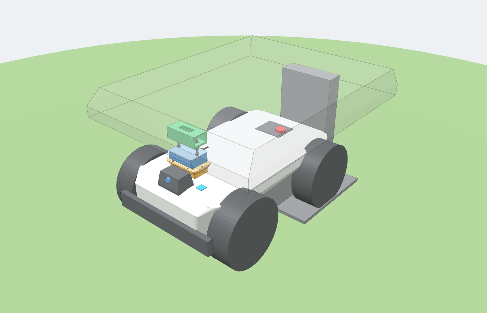
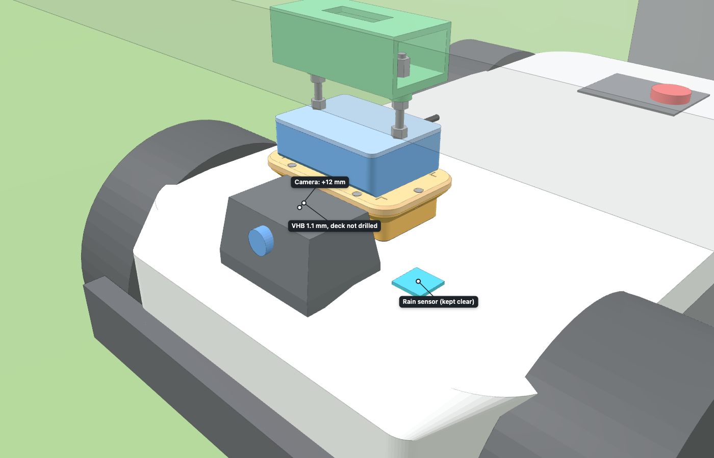
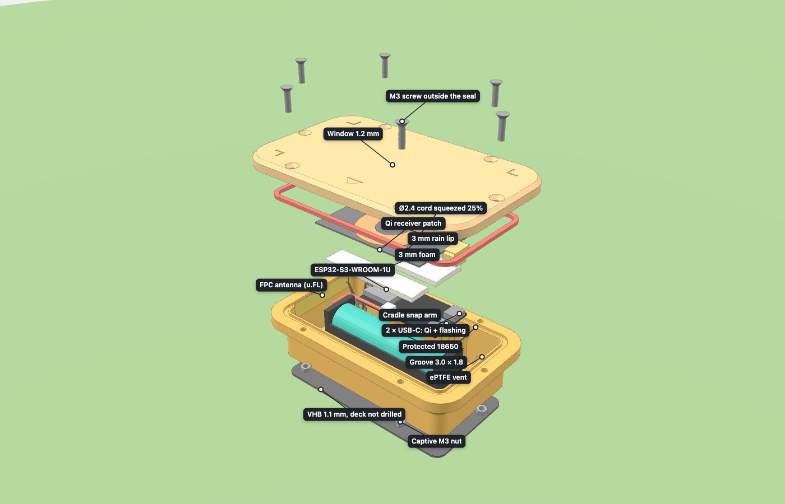
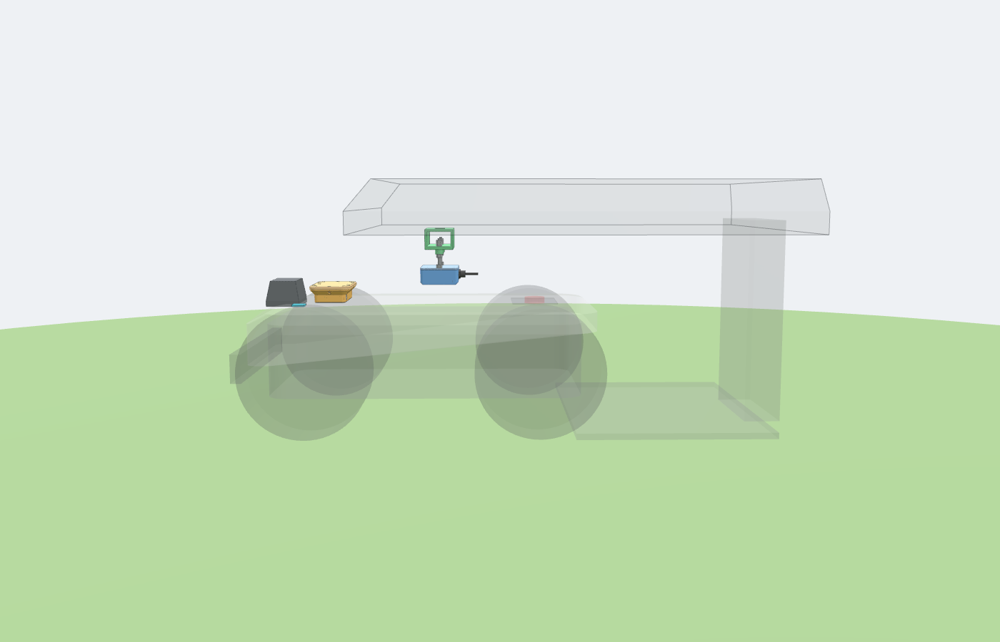
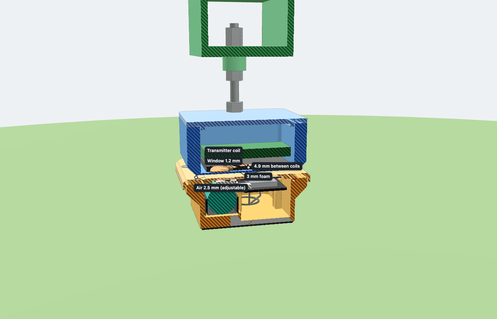
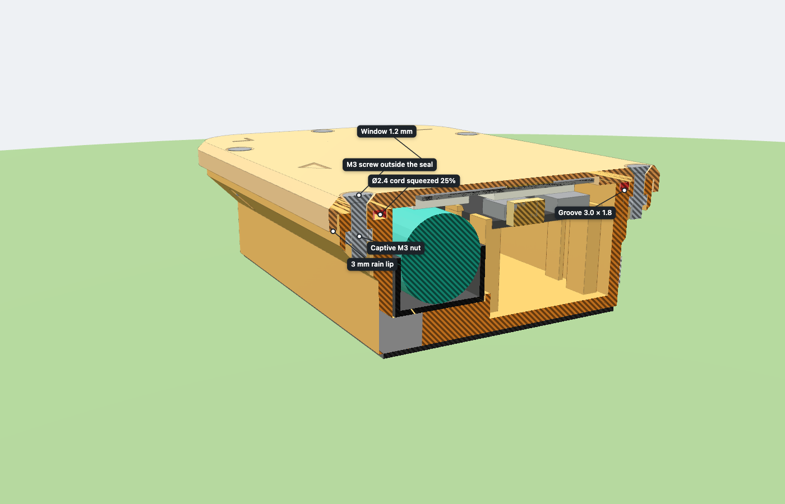

# ESP32 on board the LUBA 2 AWD, charged wirelessly at the base

A sealed enclosure is **bonded** to the deck of the LUBA 2, just behind the camera. It
holds an ESP32 and an 18650 battery, charged by induction (Qi). The transmitter sits in a
**fixed mount** hung under the garage roof, adjusted to the millimeter so that it stops just
above the lid when the robot is docked. No moving parts, no soldering: everything plugs in,
clips in, screws on or is bonded.



| Docked | Exploded view |
|---|---|
|  |  |

| Approach: the lid passes under the mount | Docked: section through the coils, 2.5 mm of air |
|---|---|
|  |  |

| Section through the closure: seal, lip, screws and captive nuts |
|---|
|  |

## Interactive 3D model (suited to the Galaxy Z Fold 8)

Open [`viewer/luba-esp32-qi.html`](viewer/luba-esp32-qi.html) in Chrome or Samsung
Internet: the model is embedded in the file, so just copy it to the phone (three.js is
loaded from the CDN, so a connection is required when opening it).

- **Cover screen, or inner screen held in portrait**: the model fills the top and the
  controls sit in a panel at the bottom. Tapping the grip collapses or expands the panel;
  dragging it sets its height.
- **Inner screen in landscape**: panel on the right.
- **Flex mode** (phone half folded, horizontal fold): the model shows above the fold and
  the controls below it.
- Gestures: one finger to rotate, two fingers to zoom and pan. Tapping a part opens its
  card (role, dimensions, STL file), with "Center" and "Isolate". 46 px touch buttons, a
  full-screen button.
- **Three modes**: *On the robot*, *Enclosure* alone, *+ Qi mount*.
- Progressive **exploded view** (0–100% slider). **Section** across or lengthwise, at an
  adjustable position, with hatched cut faces.
- Commented and annotated **details**, browsed with ‹ ›: sealing, Qi charging,
  electronics, closing and bonding, adjustable mount, placement on the LUBA 2.
- *Docking* tab (animation of the robot backing in under the mount) and *Dimensions* tab
  (generator report).

URL parameters open a specific view, for example
`luba-esp32-qi.html#detail=0` (sealing section) or
`#mode=boitier&explode=1&notes=1` (annotated exploded view).

## Chosen design and why

1. **Simple and fixed.** The enclosure is VHB-bonded to the deck; the transmitter does not
   move. The mount hangs from two M6 rods clamped between two nuts on a bridge bonded under
   the roof: **one turn of a nut moves the mount by 1 mm** (M6 pitch is 1 mm), so it can be
   adjusted to the millimeter and then locked.
2. **Qi charging only works between 2 and 8 mm.** Between the coils there are 1.2 mm of
   lid, 2.5 mm of air and 1.2 mm of mount floor, i.e. **4.9 mm**. The robot can therefore
   stop up to **2.5 mm higher** (beyond that, the lid rubs under the mount) or
   **3.1 mm lower** (beyond that, it is out of range) than during the adjustment. This
   window of about 5.5 mm is the limit of the fixed design: measure it before bonding
   (see [Installation](#installation)).
3. **The LUBA 2 docks in reverse** (manual, § 3.4.4). The camera is at the front: it stays
   in front of the mount and never passes under it. Only the enclosure passes under the
   mount. The lower front and rear edges of the mount are chamfered at 45°: on contact,
   the lid slides underneath instead of hitting it. The rods are on the sides
   (y = ±42 mm), out of the way.
4. **The enclosure stays below the top of the camera** (lid at about 261 mm, camera at
   273 mm). The overall height of the robot does not change and the front view is not
   blocked. The enclosure is offset sideways to keep the **rain sensor** clear (light blue
   in the mock-up).
5. **No soldering.** The board is an **Olimex ESP32-S3-DevKit-Lipo-EA** (ESP32-S3-WROOM-1U
   module with a u.FL socket for an external antenna, two USB-C, Li-ion charger). It has no
   mounting holes: it clips into a cradle printed with the base (ledges under the four
   corners, end stops on the module side, one snap arm per long side), headers not
   soldered. The 18650 sits in a separate off-the-shelf holder with leads and a JST plug
   that goes into the board's 2-pin 2.0 mm battery socket. **Check the polarity with a
   multimeter before plugging it in**: JST leads are not standardized and a reversed plug
   destroys the charger. The Qi receiver plugs into the native USB socket; the USB-UART
   socket (CH340X), which carries the console and the flashing, stays free. The Adafruit
   transmitter comes with its coil already wired and is powered over micro-USB.
6. **Protected cell only.** The board charges the cell but has no battery protection
   (over-discharge, short circuit): the 18650 must be a **protected** cell, about 69–70 mm
   long instead of 65 mm, which the holder and the generator allow for.
7. **External antenna, away from the Qi coil.** A flexible (FPC) 2.4 GHz antenna is bonded
   inside the end wall opposite the USB-C sockets, about 24 mm from the receiver patch and
   its ferrite and 33 mm from the cell, below the seal line. Its u.FL cable stays inside:
   nothing goes through the wall, the sealing is unchanged.
8. **Size.** The board and the holder sit side by side, so the inside is 6 mm wider than
   for the LILYGO T-Energy S3 the enclosure was first drawn for (56 instead of 50 mm). The
   length is kept to leave room for the flashing plug and to keep the antenna wall away
   from the Qi patch. Height, window, seal, screws, lip, vent and the whole transmitter
   mount are unchanged: the mount STL files are identical and the lid still passes under it.
9. **Maintenance.** The enclosure stays bonded. To flash over USB, open the lid
   (6 screws): the USB-UART socket (CH340X) is left free, with 22 mm in front of it for a
   straight plug (lift the Qi patch aside). Routine updates go over Wi-Fi
   (`pio run -e ota-s3lipo -t upload`, see [firmware/esp32-gateway](../../firmware/esp32-gateway/README.md#update-over-wi-fi)).

## Shopping list

Prices are rough figures seen during research. Check them at the time of purchase.

| Qty | Item | Note | ≈ Price |
|---:|---|---|---:|
| 1 | **Olimex ESP32-S3-DevKit-Lipo-EA** (SKU 106011: ESP32-S3-WROOM-1U N8R8, 8 MB flash, 8 MB PSRAM, u.FL, two USB-C, Li-ion charger) | [Olimex](https://www.olimex.com/Products/IoT/ESP32-S3/ESP32-S3-DevKit-Lipo/), €7.95 in October 2026, shipping extra. Take the **-EA** version (external antenna) | €8 |
| 1 | **1 × 18650 holder with leads and a JST plug** (2-pin, 2.0 mm pitch), taking a ~70 mm protected cell | About 78 × 21 × 20 mm; measure it and adjust `HOLDER_*` if it differs. Check the polarity with a multimeter before plugging it in | €2–4 |
| 1 | **Protected 18650 Li-ion cell 3,400–3,500 mAh** (button or flat top, about 69–70 mm long) | **Mandatory**: the board has no battery protection | €6–10 |
| 1 | **Flexible (FPC) 2.4 GHz antenna with a u.FL cable**, about 40–50 × 8–10 mm, cable 10–15 cm | Self-adhesive, bonded inside the end wall. Check that the plug is u.FL (IPEX MHF1), the socket of the WROOM-1U | €3–6 |
| 1 | **Qi "patch" receiver with USB-C plug**, 5 V / 1 A, about 102 × 43 × 1 mm | Sold for phones without wireless charging. Pick the plug orientation that allows folding upwards (often offered as A/B variants) | €6–10 |
| 1 | **Adafruit 2162 "Universal Qi Wireless Charging Transmitter"** (coil 53 × 53 × 4 mm, board 55 × 37 × 6 mm, micro-USB 5 V 2 A, 2–8 mm range) | [The Pi Hut](https://thepihut.com/collections/adafruit-power/products/universal-qi-wireless-charging-transmitter), [Opencircuit](https://opencircuit.shop/product/universal-qi-wireless-charging-transmitter) | €30–38 |
| 1 | **Right-angle** micro-USB cable, 3 m + 5 V 2 A USB charger | Protected outdoor socket or IP44 box. Do not tap into the power supply of the Mammotion station | €10–15 |
| 1 | **PG9** nylon cable gland, IP68 | Ø15.5 hole provided on the rear side of the mount | €1 |
| 1 m | **Stainless A2 M6 threaded rod** | 2 pieces of **75 mm** (computed length, cut with a hacksaw) | €4 |
| 10 + 6 | **Stainless M6 nuts** + **stainless M6 washers** | Per rod: 1 captive nut in the mount, 1 nut + washer on the mount cap, 1 nut + washer under the bridge, 2 nuts + washer on top | €3 |
| 6 | **Stainless M3 × 12 countersunk screws** (ISO 10642 / DIN 7991) + **6 stainless M3 nuts** | Close the lid; the nuts sit in the pockets under the flange | €2 |
| 1 m | **Solid silicone cord Ø2.4 mm** (hardness 40–60 Shore A) | Lid seal, laid in the 3.0 × 1.8 mm groove (≈ 0.38 m used) | €3 |
| 1 | **3M VHB tape**, outdoor conformable (e.g. 5952 or 4991), 25 mm wide | Enclosure on the deck, bridge plate under the roof | €8–12 |
| 1 | 3 mm adhesive EVA/neoprene foam | Presses the Qi patch against the lid window | €3 |
| 1 | Double-sided foam tape | Holds the battery holder on its plinth | — |
| 1 | Ø10–12 mm adhesive ePTFE vent, IP67 (optional, recommended) | Stuck over the Ø4 hole at the bottom of the rear wall: limits condensation | €2 |
| 1 | 1 g silica gel sachet | Inside the enclosure | — |
| ~300 g | **ASA filament** (UV resistant; PETG otherwise) | All parts | €8 |

Total: about **€105–135**, a third of it for the Adafruit transmitter. The prices of the
holder, the protected cell and the antenna are orders of magnitude, not checked at a shop. A generic
"USB-C 15 W" Qi transmitter module is cheaper. Its dimensions vary, so you will then have to
adjust `TX_COIL`/`TX_PCB` and the mount cavity.

## Parts to print (`stl/`, already oriented for printing)

| File | Dimensions | Printing notes |
|---|---|---|
| `01_enclosure_base.stl` | 78 × 132 × 29 mm | Flat bottom on the bed (this is the bonded face). **4 perimeters, 100% wall infill** for sealing. Board cradle, snap arms and holder plinth are printed with it, without supports |
| `02_enclosure_lid.stl` | 82.2 × 136.2 × 6.2 mm | Visible face on the bed, drip lip pointing up (no supports). Window thinned to **1.2 mm** under the coil (6 layers of 0.2 mm) |
| `03_transmitter_mount.stl` | 76 × 104 × 30 mm | **1.2 mm** floor on the bed, 45° chamfers without supports |
| `04_mount_cap.stl` | 76 × 104 × 5 mm | **Mount cap** (named so in the viewer), clamped by the rod nuts. Flipped, centering tongue pointing up |
| `05_roof_bridge.stl` | 56 × 120 × 50 mm | Bonding plate on the bed, 48 mm bridged crossbar |
| `06_deck_shim.stl` | depends on the crown | **Only if the deck is crowned** (`DECK_R` > 0, see [Installation](#installation)): flat face on the bed |

0.2 mm layers, ASA at about 250 °C in a closed enclosure (or PETG at about 235 °C). No
carbon- or metal-filled filament: it would absorb the Qi field. No heat-set inserts: all
nuts are captive in hexagonal pockets.

## Assembly (no soldering)

**Enclosure**
1. Slide the 6 M3 nuts into the hexagonal pockets from under the flange. Hold them with a
   dab of glue or by pulling them in with a screw.
2. Lay the silicone cord in the groove, butting the two ends together, without stretching
   it. The groove (3.0 × 1.8 mm) is wider than the cord: it sits loose, then the lid
   squeezes it by 25% while filling 84% of the groove. A smear of silicone grease helps
   fitting and sealing.
3. Peel the FPC antenna and bond it inside the **−y end wall** (the one away from the USB-C
   end), centered, its lower edge about 3 mm above the floor, after degreasing the wall
   with alcohol. It stays below the seal line, away from the screws.
4. Clip the board into the cradle, components up, module towards the antenna wall: slide
   one long edge under a snap arm, then press the other edge down until it clicks. Snap the
   antenna u.FL plug onto the module, straight down, and coil the spare cable loosely on
   the floor between the board and the antenna (bend radius 5 mm or more).
5. Tape the 18650 holder onto its plinth, along the +x wall. Before inserting the protected
   cell, **check with a multimeter that the JST plug polarity matches the board's battery
   socket** (marked on the board). Run the leads above the cradle pillars to the socket and
   plug them in. The first flash is done at this point through the USB-UART socket
   (CH340X), with the gateway firmware's `s3lipo` environment (`pio run -e s3lipo -t upload`,
   see [firmware/esp32-gateway](../../firmware/esp32-gateway/README.md#boards)); later
   updates go over Wi-Fi (`pio run -e ota-s3lipo -t upload`).
6. Plug the receiver's USB-C plug into the native USB socket, on the holder side in the
   model (the USB-UART socket stays free for the console and flashing; check which is
   which on the board received), fold the flex cable upwards and stick the patch onto the
   3 mm foam (on the holder and on the board, not on the module, so that the u.FL plug is
   not pressed), **centered under the window** (corner marks engraved on the lid), **coil side
   towards the lid and ferrite towards the board**.
7. Add the silica sachet and close with the 6 countersunk screws, tightened crosswise
   without crushing the seal. Do a **shower test** with a dry paper towel inside before
   putting the electronics in.

**Transmitter mount**
1. Slide an M6 nut into each of the 2 pockets of the body, then screw the 75 mm rods in
   down to the bottom of the blind hole (they do not stick out underneath).
2. Lay the Adafruit coil flat at the bottom of the cavity, **winding side down, against the
   floor, ferrite plate on top**. Laid upside down, the ferrite would block the field. Add
   2 to 3 mm of foam, then the transmitter board. Plug in the right-angle micro-USB cable
   and run it out through the PG9 cable gland on the rear side.
3. Slide the cap onto the rods and clamp it with a washer and a nut per rod. This clamping
   is what closes the cap.

**Bench test (before bonding anything)**: place the mount on the closed enclosure lid with
2.5 mm spacers, power the transmitter and check that the board charges. Repeat with the
mount shifted 5, 10 and 15 mm sideways, and with 1 to 4 mm spacers, to find the actual
tolerance.

## Installation

1. **First measure how repeatable docking is**, in height and position. Stick a piece of
   masking tape on the deck behind the camera and a fixed mark under the roof. Dock 5 times
   and note the deviations. You need to stay within **±10 mm** horizontally (single-winding
   Adafruit coil) and within a window of about **5 mm** in height (2.5 mm up, 3 mm down).
   Beyond that, the fixed design is not suitable.
2. **Deck crown.** Lay a ruler across the deck where the enclosure goes and measure the gap
   h at the middle of a chord c (for example c = 130 mm). If h exceeds about 0.5 mm, set
   `DECK_R = c² / (8 h) + h / 2` (and `DECK_CROWN_Y`, the y of the top) in
   `cad/generate.py`, then regenerate: the script produces `06_deck_shim.stl`, a shim that
   follows the deck, to be VHB-bonded between the deck and the enclosure.
3. **Enclosure.** Degrease the deck and the enclosure bottom with isopropyl alcohol. Bond
   the enclosure with VHB, lid arrow pointing forward, about 20 mm behind the camera and on
   the side opposite the rain sensor (keep **≥ 30 mm** around that sensor). Press for 30 s,
   then let it rest 24 h before driving. If the deck is crowned, use thick conformable VHB.
4. **Bridge and mount: the position sets itself.** Fit the bridge onto the rods: a nut and
   a washer under each boss, then a washer and two nuts above the crossbar, left loose.
   Dock the robot and place the mount on the lid with two **2.5 mm** spacers, centered on
   the marks. Put the VHB on the bridge plate, push the bridge up against the underside of
   the roof and press. The bridge is thus bonded exactly above the enclosure.
5. **Height adjustment.** With the robot docked and the spacers in place, tighten the nut
   under each boss against the bridge, then lock the two top nuts against each other.
   Remove the spacers. To correct later: **one turn of a nut = 1 mm** (±15 mm travel).
   Secure the cable under the roof with adhesive cable-tie mounts.
6. **Check.** Dock and leave 3 times each: the lid must not rub (a strip of masking tape on
   the lid shows the slightest mark) and charging must start every time (charge LED of the
   board, or `power.vin_present` at `true` in the gateway's `/status`; while the 5 V is
   present, `power.battery_mv` reads the charger output and the level is −1, so they do
   not show the charge). Then, in DumbyLuba, compare the **RTK FIX** layer of a signal
   survey before and after installation, to make sure the enclosure does not disturb the
   antenna.

## Power budget (estimate, to be confirmed by measurement)

- ESP32-S3 with Wi-Fi without power saving and BLE connected, on a 3,400–3,500 mAh
  protected 18650: about **22–29 h of runtime** (estimate, not measured), more than one
  mowing cycle of the LUBA 2.
- Charging: the board charges the cell at about **100 mA**, so an empty 3,400 mAh cell
  needs about **34 h** (estimate), plus the slower end of charge. A robot recharge of
  about 1 h 30 min puts back only a small part of a day's use: the battery is topped up
  mainly while the robot stays docked (nights, rainy days).
  Check on site that the level does not drift down from one day to the next; otherwise
  the firmware has to save power while the robot is docked.

## Points to watch

- **Height at docking.** This is the weak point of a fixed transmitter: flattened or tall
  grass under the front wheels, worn tires or a moved station change the robot's height.
  If the lid rubs, raise the mount by one turn; if charging no longer starts, lower it by
  one turn. Redo the check after each time the station is moved.
- **Temperature.** A Li-ion battery must only be charged between 0 and 45 °C; do not count
  on the board's charger to watch the cell temperature. The ESP32-S3-WROOM-1U N8R8 module
  is rated for at most **65 °C ambient**. Wireless charging dissipates 1 to 2 W as heat
  inside the closed enclosure, and an ASA enclosure left in the sun on the deck can get
  much warmer than the air (not measured here). The garage roof shades the enclosure
  while charging, which is the favorable case. Print in **light-colored** rather than
  black ASA, and in summer monitor the ESP32-S3 internal temperature and turn Wi-Fi off
  above a threshold.
- **Sealing.** Cord seal in a sized groove (25% squeeze, 84% fill), 6 screws all outside
  the seal, a 3 mm lid lip that drops in front of the closing line, an ePTFE vent at the
  bottom of the rear wall, under the flange. A well-tuned printed part thus withstands rain
  and sprinklers (close to IP65). It is **not** a certified IP67: do the paper towel test
  before the first use. Do not aim a high-pressure jet at the enclosure.
- **Robot.** Drill nothing: this preserves the warranty and the sealing of the LUBA. The
  enclosure weighs about 150 g in total. The manual says not to put anything *on* the
  garage: the bridge is bonded *underneath* and the whole assembly weighs about 250 g.
- **Approximate dimensions.** The robot, station and garage are mock-ups. Measure on site
  the top of the deck (`DECK_Z`), the rear of the camera (`CAM_X0`), the underside of the
  roof (`ROOF_Z`) and the rain sensor, then regenerate. The generator refuses to produce a
  result if clearances become insufficient. The model needs **at least 107 mm** between the
  lid and the roof; below that, shorten `BR_GAP`.
- **Board details to check on the board received.** The Olimex documentation does not give
  the component heights (the model assumes up to 4 mm above and 2 mm below the PCB, and a
  1.5 mm strip free of components along the long edges, where the snap arms hook), the
  corner of the module where the u.FL socket sits (the whole module top is kept free), the
  exact place of the two USB-C sockets (the model leaves the one away from the holder free
  for the USB-UART port) and of the battery socket (assumed on the long edge on the holder
  side). Measure them, adjust `COMP_*`, `UFL_X`, `USB_DX` and `BAT_JST_Y` in
  `cad/generate.py` and regenerate before printing.
- **Validation.** The setup has not been tried on the robot yet: Qi efficiency at 4.9 mm,
  temperatures, Wi-Fi range with the antenna inside the enclosure and docking
  repeatability are still to be measured.

## Regenerating after measuring

```sh
python3 -m venv /tmp/cadvenv
/tmp/cadvenv/bin/pip install -r hardware/luba-esp32-qi/cad/requirements.txt
/tmp/cadvenv/bin/python -I hardware/luba-esp32-qi/cad/generate.py
```

The parameters are at the top of `cad/generate.py`. The script rewrites `stl/` and
`viewer/luba-esp32-qi.html`, prints the dimension report (rod length, clearances) and
returns an error code if a check fails: seal (18–32% squeeze, 70–90% fill, distance to the
screws), vent opening (outside and inside), each electronic part, cable and envelope (board
components, u.FL plug, flashing plug) against the base with its cradle, the lid and each
other, antenna distance to the Qi patch and the cell (20 mm minimum), to the seal and the
screws, antenna length on the flat of the wall, u.FL route length, holder height,
transmitter/mount, mount and enclosure/camera, robot passing under the mount while
backing in, rod adjustment travel, or coil distance outside the Qi range.

## Sources

- [LUBA 2 AWD manual (product view, reverse docking, garage)](https://robotlawnmowers.com.au/wp-content/uploads/2024/02/Luba_2_AWD_Series_User_Manual_V1.0_EN.pdf)
- [LUBA 2 AWD dimensions 690 × 513 × 273 mm](https://support.mammotion.com/portal/en/kb/articles/luba-2-awd-series-specifications)
- [Olimex ESP32-S3-DevKit-Lipo (product page)](https://www.olimex.com/Products/IoT/ESP32-S3/ESP32-S3-DevKit-Lipo/), [hardware repository (Rev B gerbers)](https://github.com/OLIMEX/ESP32-S3-DevKit-LiPo)
- [Adafruit 2162 transmitter (The Pi Hut)](https://thepihut.com/collections/adafruit-power/products/universal-qi-wireless-charging-transmitter)
- [Mammotion garage (outer dimensions)](https://www.amazon.com/Mammotion-Garage-LUBA-Robotic-Mowers/dp/B0C99CFPHM)
